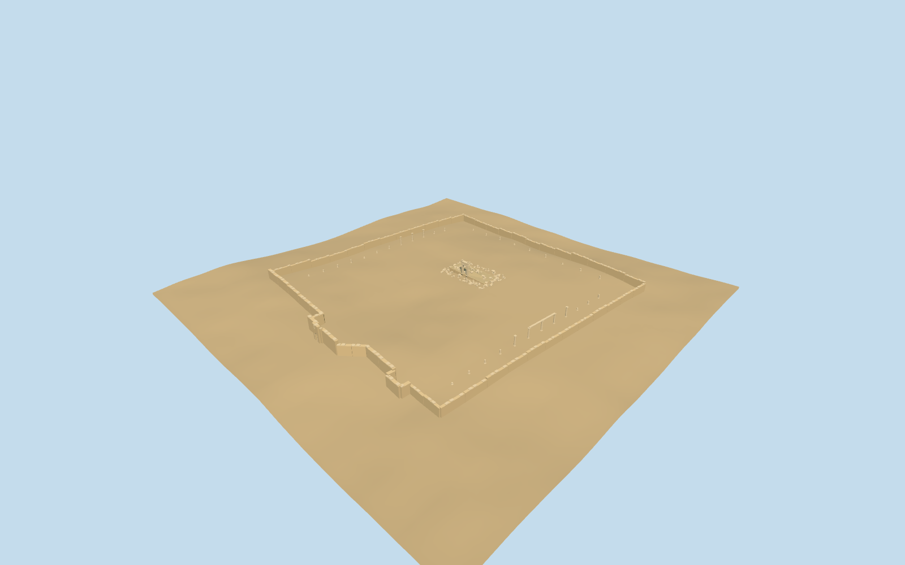
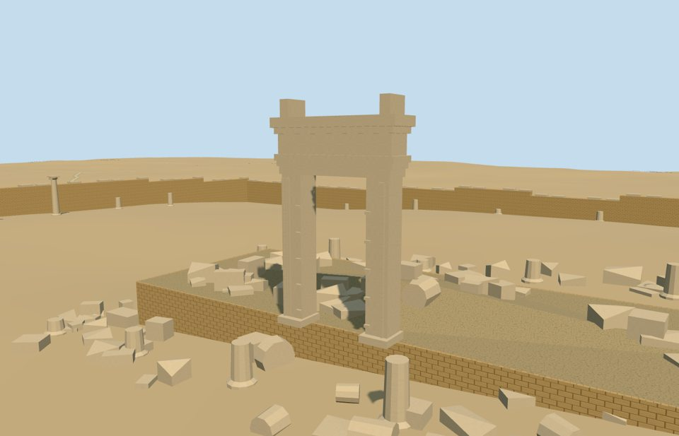

# N0505 — Temple of Bel

Reviewed2026-10-19. Accepted for the specific medium-fi surviving ruin and approximate PMTiles/DEM fit. The central cella was destroyed in2015; the model intentionally retains the surviving doorway and rubble.

## Exterior and shared materials

Inspected all 12 portable views. The specific surviving Temple of Bel precinct includes the mapped enclosing wall and fortified west gate, selected perimeter column remains, central podium, free-standing rectangular cella doorway and fallen-block/drum field. The doorway has battered jambs, layered architrave/frieze/cornice and raised corner blocks. The west gate has a real arched passage, projecting jamb trim and upper niche frame. No cella roof, intact cella walls or complete temple colonnade is restored. Current renders prompted seating the surviving beam on level column tops and breaking up the rubble silhouette. Perimeter column allocation and individual stones remain schematic.

Inspected all 12 shared-material views. Three common 256-square graphs provide coursed sandstone walls, continuous raw sandstone for modeled stones and gravel for the exposed podium/rubble core. Metric UVs, linear tints, three near draws and one skyline draw; no embedded images or unique atlas. Each graph loads once and eviction releases model geometry. Flat-stage captures are material/framing evidence: they bury some terrain-following perimeter bases. Actual contact was inspected separately on the unchanged standard DEM.

## Browser levels

| Level | Triangles | Bytes | Draws |
| --- | ---: | ---: | ---: |
| skyline | 586 | 62156 | 1 |
| district | 3738 | 363984 | 3 |
| street | 9414 | 888444 | 3 |
| closeup | 10734 | 1018336 | 3 |

Inspected all 28 medium-fi views: street/block/skyline in Economy/High at noon and late afternoon, an untextured silhouette, seven architectural/site views, all four complete-ruin levels and transitions. Levels 586/3738/9414/10734 triangles preserve the enclosure, west gate opening, central podium and standing doorway. Skyline merges wall segments and keeps standing perimeter columns; district adds profiles, stumps and selected rubble; street adds broken coping and a denser angular stone/drum field; closeup keeps all185 schematic fallen blocks/drums. Initial skyline plus district geometry totals426140 bytes, plus three reused common graphs. Separate vertex streams avoid duplicate GPU uploads. Some broad-stage High close views show coarse shadow striping on the doorway cornice; the portable and actual-site captures show its geometry separately. Physical-device and dense-city measurements remain pending.

## Geographic fit

Reviewed approximate full-site fit on the unchanged161-square/6m standard DEM. The mapped temenos boundary retains16 original vertices; the central cella/podium retains four original building vertices. Geometry uses raw east/south coordinates at heading0, with a4.589-degree internal compound rotation. The western boundary fixes the fortified gate; the cella doorway faces west on the long mapped side. Post-destruction2016/2018 pictures govern the isolated doorway and rubble; the enclosing gate form also uses an ordinary pre-destruction picture. Exact current damage, surviving column sections and heights remain uncertain. The small occupied podium clears all40 rendered terrain vertices in its bounds by at least0.2000005m. Outer walls and scattered fragments seat on local coarse grade; the open court keeps the original terrain. No ground/water cutout. Full loading replaces one obsolete generic cella building record, preserves17 independent tile buildings exactly, and leaves43 independent buildings in the retained extract outside the replacement envelope. One native water record retains51.800969034666196 square metres. Failed loads preserve all18 tile buildings; eviction frees all model geometry. Synthetic10m residency through the cella doorway keeps original terrain while clipping the rear podium/rubble and excluding the enclosing walls/gate; full architectural completeness requires surrounding tiles. Column count/positions, rubble layout, gate profiles and podium height remain medium-fi estimates; this is not a measured post-destruction survey.

## Scope and limitations

Accepted for the specific medium-fi surviving Temple of Bel ruin and approximate standard-map/DEM fit. The complete temenos retains16 original boundary vertices and the central cella/podium retains four original mapped building corners. The obsolete generic central building record is replaced with the post-destruction ruin. Two2016/2018 pictures show the isolated doorway, rubble, stumps and selected perimeter remains; an ordinary pre-destruction gate picture guides the surviving fortified entrance form. Geometry uses raw east/south coordinates at heading0; the compound rotates4.589 degrees and both principal doorways face west. The lost cella walls/roof and complete ancient colonnade remain absent. Exact present-day damage, surviving column count/positions, rubble arrangement, wall heights, 11.15m doorway cornice and 12.1m corner blocks above the conservative podium datum are medium-fi estimates. The gate form and stone colors are approximate; no measured recent survey or navigable interior is claimed. The central opaque podium clears all40 relevant original rendered DEM vertices by at least0.2000005m. Walls/fragments seat on local coarse grade, and the open court keeps its terrain. No ground/water opening. Synthetic10m residency through the doorway clips the rear ruin and excludes the outer enclosure; full completeness requires surrounding tiles. Only ordinary pictures and the standard map/DEM were used.

## Source and checks

Two registered recipes and retained source inputs rebuild the master and four browser levels. Master:10,734 triangles /1,290,540 bytes. Six Khronos validations have zero errors or warnings. All90 geometry probes,20 map-coordinate checks,360 occupied-floor samples and40 relevant terrain vertices pass. Inspected52 official and25 site/failure/partial views. Bulk captures stay local.

The960m integration tile contains18 map buildings. One obsolete generic cella record is replaced and17 independent records remain byte-identical. All43 independent buildings in the full retained44-record extract remain outside the replacement envelope. One native water record retains51.800969034666196 square metres. The original161-square/6m DEM and map properties remain unchanged. Failed loads preserve all18 buildings; eviction releases geometry. Synthetic10m partial loading preserves ground while clipping the ruin/enclosure.

Selected source/import/LOD/placement checks, strict medium-fi audit, asset hash verification, scene validation and sim30 pass. The next full source rebuild and asset-lock refresh belong to a meaningful batch milestone. No dependency audit, Git mutation or upload was performed.

Rebuild: node packages/worldgen/scripts/generate-additional-landmarks.mjs --ids=N0505; node packages/worldgen/scripts/import-next-1000-models.mjs --ids=N0505; node packages/tooling/scripts/generate-landmark-lods.mjs --ids=N0505.

Source: sha256:8eed10c5b52758af9d52869040ea7b5c853f9cd2f886b29e43014d640f7c04ba

Runtime: sha256:fb457c9a742bba0927a0a43efc64b09b2677e8fe4e13389e6090c969285bd438

Input: sha256:a2a23c0bfa4ed33a6c4d9fa622d522cc4584524b86063ec5e2bd057dc0469aac

## Ordinary pictures

https://commons.wikimedia.org/wiki/File:Palmyra_after_freedom_(4).jpg — Tasnim News Agency; CC BY4.0; viewed only. 2016-03-28 No pixels shipped.

https://commons.wikimedia.org/wiki/File:Palmyra_13970826_12.jpg — Hamed Jafarne­jad / Tasnim News Agency; CC BY4.0; viewed only. 2018-11-17 No pixels shipped.

https://commons.wikimedia.org/wiki/File:Gate_of_the_fortified_Temple_of_Bel_Palmyra_Syria.jpg — Author information retained at the Commons file page; not copied.; CC BY-SA2.5; viewed only. Uploaded2005-10-17; pre-destruction reference. No pixels shipped.
