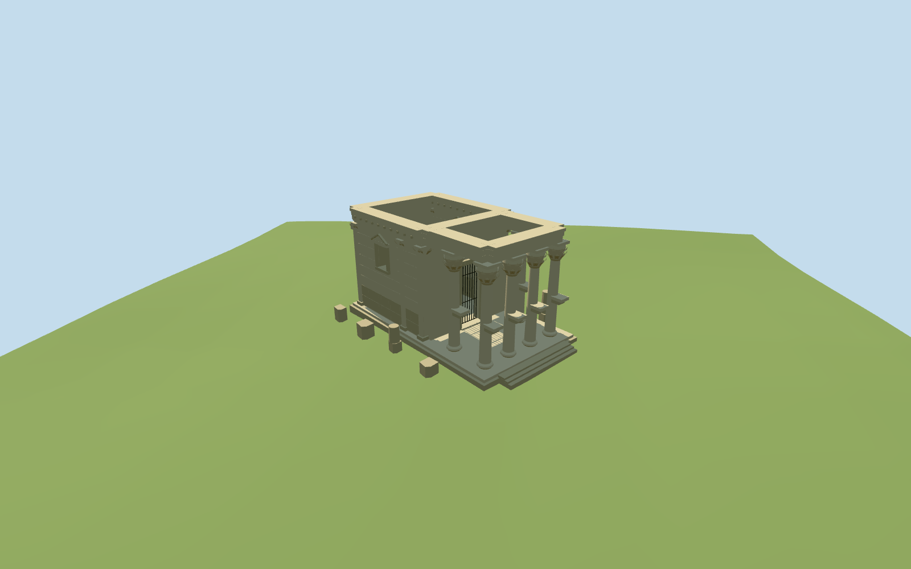

# temple_of_baalshamin — Temple of Baalshamin

Reviewed 2026-10-19. Completed in one continuous authoring/inspection round for the dated2010 historical exterior and approximate map fit; explicit viewingDate opt-in required.

## Visible architecture

Inspected current source, shared-material, medium-fi and actual retained-terrain renders in the same authoring round. Dated 2010 roofless cella with six free-standing Corinthian porch columns, projecting shaft brackets, open pedimented side windows, attached pilasters, gated doorway, surviving horizontal cornice, closed stepped podium and a small selected fallen block/drum group. Corrected a coarse brick-pattern material mismatch on smooth shafts by reusing raw sandstone instead; retained larger masonry joints in geometry. No complete ancient roof or pediment is invented.

## Shared materials

Two reused 256² graphs: raw sandstone and standing-seam metal. Metric UVs, neutral linear sandstone tints, no embedded images or model-specific atlas. Sandstone supports separate tint roles while sharing its baked texture; at most three draws and one read per material graph. Separate GPU streams; eviction releases geometry. Flat/shared context exposes buried bases and is not proof of native-grade contact.

## Browser levels

| Level | Triangles | Bytes | Draws |
| --- | ---: | ---: | ---: |
| skyline | 976 | 104344 | 1 |
| district | 2988 | 303620 | 3 |
| street | 7812 | 795460 | 3 |
| closeup | 8676 | 888556 | 3 |

Inspected 24 current medium-fi views: noon/late, Economy/High, street/block/skyline, silhouette, three details, four explicit levels and transitions. Triangle levels: 976 / 2988 / 7812 / 8676. Initial skyline-plus-district geometry 407,964 bytes. The roofless block and six-shaft porch persist at distance; window reveals, pilasters, brackets and simplified capitals resolve nearer. Physical laptop/phone and dense-city timing remain pending.

## Map and terrain

Q20871005 and way389978856 identify the broad archaeological precinct, not a 140m solid building. Use the Wikidata reference anchor for the small temple; the precinct axis guides rotation, with the porch toward its northeast end from the ordinary north-side photograph. The approximately16m by9m podium, cella subdivisions, exact origin and signed facing are picture-led estimates; no surviving mapped temple footprint resolves them. Preserve all independent current map buildings and the host precinct terrain. Reuse pinned standard temple_of_bel Palmyra PMTiles/Mapzen data. The small podium floor is above the maximum nearby native grade, with a buried base and shallow front treads. Preserve native terrain/water without cutouts. Current DEM/map context is explicitly an approximate setting for a dated historical exterior, not a reconstructed 2010 streetscape or surveyed archaeological pavement. Historical-only interval 2010-04-21 inclusive through2015-08-23 exclusive. Verified default/no-date, before-interval, destruction-date/current and distant-Chicago queries exclude the model; the represented date selects it. All 60 independent in-tile buildings, native ground and original water geometry remain unchanged. No current building footprint is replaced. Failed model loading retains all 60 native records; eviction releases all model geometry.

## Limits

Dated 2010 surviving Temple of Baalshamin: roofless rectangular ashlar cella, six free-standing Corinthian porch shafts with projecting brackets, open side windows with pedimented surrounds and attached pilasters, tall gated doorway, continuous surviving upper stone beams/cornice, low stepped podium and a small selection of fallen stone/drum fragments. This is the photographed pre-destruction ruin, not a reconstruction of its complete ancient roof or today’s damaged remains. Q20871005 and way389978856 identify the broad archaeological precinct, not a 140m solid building. Use the Wikidata reference anchor for the small temple; the precinct axis guides rotation, with the porch toward its northeast end from the ordinary north-side photograph. The approximately16m by9m podium, cella subdivisions, exact origin and signed facing are picture-led estimates; no surviving mapped temple footprint resolves them. Preserve all independent current map buildings and the host precinct terrain. Human-scaled ordinary 2010 pictures guide a roughly7.8m surviving wall/capital elevation and8.5m cornice above the stepped podium. Shaft proportions, brackets, window pediments, ashlar courses, broken edges and scattered fragment inventory are medium-fi estimates. No original roof/pediment, full courtyard colonnade, fine inscriptions, sculpture or navigable interior is reconstructed. Reuse pinned standard temple_of_bel Palmyra PMTiles/Mapzen data. The small podium floor is above the maximum nearby native grade, with a buried base and shallow front treads. Preserve native terrain/water without cutouts. Current DEM/map context is explicitly an approximate setting for a dated historical exterior, not a reconstructed 2010 streetscape or surveyed archaeological pavement. Two ordinary 2010 photographs guide this medium-fi exterior. Signed facing, temple dimensions, carved forms, damage, fragment selection and exact vertical levels are approximate. Historical visibility is explicit opt-in; no claim of present-day standing fabric or reconstructed historical streetscape. No furnished/navigable interior or physical-device certification.

## Selected checks

Two registered recipes rebuild the 1,043,628-byte source master. Six Khronos files: zero errors/warnings. 150 actual mesh probes pass. Inspected 48 current views (8 source, 8 shared, 24 medium-fi, 8 site/fallback). Scene validation/sim 30 and strict selected medium-fi audit pass. Full source rebuild, lock refresh and the prior templo_mayor renderer release gates remain at the planned batch milestone near 525 complete.

Rebuild: node packages/worldgen/scripts/generate-additional-landmarks.mjs --ids=temple_of_baalshamin; node packages/worldgen/scripts/import-structure-models.mjs --ids=temple_of_baalshamin; node packages/tooling/scripts/generate-landmark-lods.mjs --ids=temple_of_baalshamin --force.

Source: sha256:f689dbb119bf26cd8488bbcee87077b4b044cb20a205506a92e1d52e35edf178

Runtime: sha256:c15b67e5726534af3233667dda9ad7f0e12c10305a019413cc72dceae2da73fd

Input: sha256:768cdc6aef521e5dbd87b3530f7b7abe68ddc380d2c6b517e989d859967fd8ff

## Ordinary pictures

https://commons.wikimedia.org/wiki/File:Temple_of_Baal-Shamin_in_Palmyra_2010.jpg — Mappo; 2010-04-21; CC BY-SA4.0; viewed only. Viewed only; no pixels copied.

https://commons.wikimedia.org/wiki/File:Palmyra_-_Temple_of_Baal-Shamin_from_north.jpg — newpalmyra; 2010-09-25; CC0-1.0; viewed only. Viewed only; no pixels copied.
