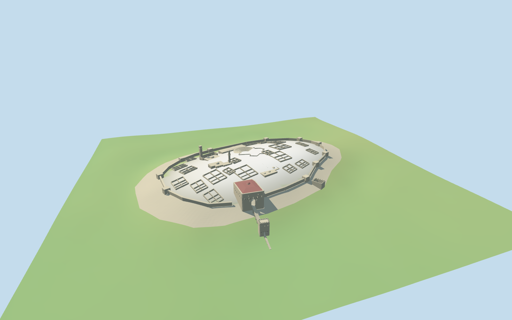

# Citadel of Aleppo

Citadel of Aleppo: oval stone-faced hill, inset irregular curtain/bastions, mapped ascending arch bridge, lower entry tower and broad upper gate/throne hall with pointed portal and muted red raised roof, two separate mosques/minarets, bath domes, low open theatre and selected roofless palace/room groups.

## Evidence and reconstruction

Published dimensions and reconstructed details are separated in spec.json. Primary references:

- [Reference](https://sana.sy/en/wp-content/uploads/2025/02/3-45.jpg)
- [Reference](https://footage.film/2415-large_default/syria-heritage-sites-clip-34.jpg)

Four existing shared256-square graphs provide limestone, ceramic tile, basalt trim and plain wood. No photograph, unique bitmap or embedded image.

## Model and axes

32,704 triangles; 98,112 vertices; 4 material groups; 3,927,440 bytes. Native bounds: -149.908, -39.930, -200.082 to 206.735, 22.987, 202.645. Source hash: `sha256:92037456ef21df1a6877f47d4684a4a45d891cffd055fa4a13ff5f915079fc10`.

{"x":"+along mapped approach from upper gate to lower gate/road","y":"+up","z":"+perpendicular to the approach"}

Native X follows the mapped southwest steps. The placement heading restores geographic east/south; original PMTiles controls are preserved in reconstruction.eastSouthParts/eastSouthBridge and pmtiles-fit.json. Heights, curtain inset, bastion cadence and room groups remain picture-led approximations.

## Reproduce

Run `node packages/worldgen/scripts/generate-additional-landmarks.mjs --ids=N0314` (or add `--check`). The generator preserves manually edited masters by checking their baseline hashes. Import through the standard authored-model workflow with optimization disabled; then capture all QA cameras, including shared-surface views.

## Pending work

- Upper curtain location, bastion cadence, heights, roof geometry, internal rooms and ornament are picture-led approximations, not a measured conservation plan.
- The retained standard terrain smooths the moat, hill top and terraces. Underarch clearance, wall contact and exact visitor-path joins remain approximate; there is no terrain carving at runtime.
- Selected room grids preserve open ruins but do not inventory every room or temple excavation. Modern service huts, war-damage inventories, furnishings, inscriptions and certified walkable collision are excluded.
- Physical laptop and phone frame-rate measurements remain pending.

This bundle follows the medium-fi standard. Medium-fi appearance and geographic fit are reviewed separately. Hash-bound visual acceptance is recorded separately after capture inspection.

## Additional geographic data

© OpenStreetMap contributors; Protomaps; Mapzen/USGS terrain tiles.
