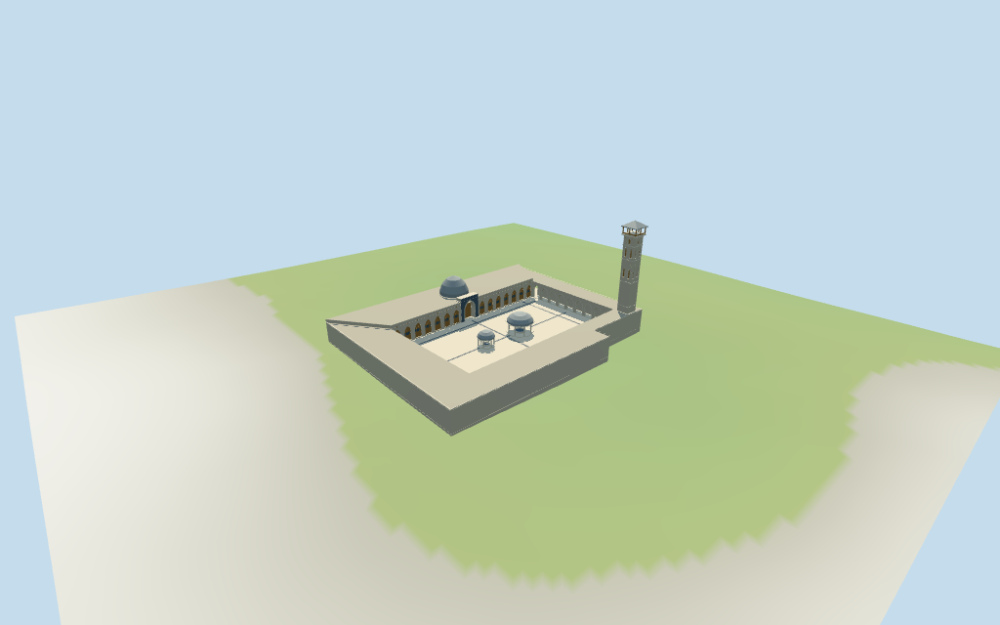

# N0432 — Great Mosque of Aleppo

Reviewed2026-10-17 against current bytes. Accepted for the stated historical medium-fi exterior and approximate horizontal fit. Four reference pictures date from2009;current damage/reconstruction/finish state is unverified. Component heights/positions,unseen roofs and exact ground joins remain approximate.

## Exterior and shared surfaces

Inspected all11 current portable views including the1024×640 summary. Banded square pale-stone minaret/open timber crown/shallow pyramidal cap,three pointed court arcades,closed timber prayer-facade fields/rectangular glazing and broad crossed transom bars,raised dark portal,grey prayer roof dome and two independent domed column pavilions. Court paving uses broad original bands. Two initial detail cameras were blocked by pavilions;both moved and overview turned north to show the prayer facade. Changed oversized blue transoms to shared timber with smaller rectangular glazing after comparing the2009 pictures. Profiles,unseen roofs/outer-wall details and all untagged dimensions remain approximate.

Inspected all11 current shared/geographic-flat views. Five existing256² ashlar,limestone,standing-seam metal,plain wood and mosaic graphs;seven merged groups. Pale stone,grey metal domes,warm timber and sparse dark portal bands use metric UVs/linear tints. Glass/water are local blue-grey. Zero embedded images,baked lighting/weathering or copied calligraphy/carved screens. Five graphs read once;unload zero live model geometries. Geographic fixture is flat;portable/medium-fi retain standard DEM. Souks,streets and city remain host content.

## Browser levels

| Level | Triangles | Bytes | Draws |
| --- | ---: | ---: | ---: |
| skyline | 693 | 71,908 | 1 |
| district | 1,862 | 181,844 | 7 |
| street | 7,371 | 688,728 | 7 |
| closeup | 10,695 | 990,452 | 7 |

Initial skyline plus district: **253,752 bytes**. Master **1,438,120 bytes /11,949 triangles**;runtime **1,437,480 bytes**. Five existing shared256² graphs,seven groups,zero embedded images;shared textures are additional.

Inspected all27 current medium-fi frames:Economy/High,noon/late,three distances,silhouette,six details,four matched LODs/four transitions. Skyline693 retains square minaret/open crown,main dome,two domed pavilions and eleven genuine coarse arcade recesses;prayer facade/portal close with distant proxies,pavilion posts reduce to four and fine paving/basins/niches omit. District1862 opens26 bays,adds pavilion basins/paving bands and coarse timber fields. Street7371/close10695 use33-bay cadence,closed minaret niches,selected frames/round panels/brackets and broad timber lattice. One/seven draws,initial253752bytes plus shared textures. Separate POSITION/NORMAL;CPU/GPU reservations equal. Synthetic context and physical-device timings unverified.

## Placement and scope

Retained exact relation/71855 /Q1481968 matches current standard PMTiles whole52776558205103 (3*2^44+71855). Current single building control has six outer vertices/four court vertices,no tagged height or minaret component. Earlier six-vertex outer/four-vertex court retained separately. Anchor[37.156906549,36.199308821] and heading0.017131698562rad unchanged,no horizontal rescale. Native+X approximately east,+Z south/model prayer range;minaret is estimated at the northwest court corner. Arcades follow actual current courtyard edges. Main portal,dome,pavilions,minaret and facade facing are picture estimates,not extra mapped controls. Neighbouring souks,streets and other city buildings remain host content. Retained height/width/length fact arrays and the current PMTiles building height tags are empty. Working exterior heights are picture-based estimates:arcade/outer eaves7.8m,main range9.2m,raised prayer portal10.5m,main roof dome17m and square minaret45m including finial. Large/small courtyard pavilions8.4m/6.4m. Minaret shaft5.1m across and decorative stage heights,roof/pavilion profiles/openings are estimates within about3m/5m vertically and facing about4°. These are working visualization dimensions,not measured or independently documented heights. Four inspected2009 photographs establish a historical exterior;present damage/reconstruction/finish and engineering remain unverified. Standard viewer DEM datum389.814833m;whole perimeter0.08..2.09m relative to anchor. Working floor2.385m uses maximum bilinear core sample at2m spacing plus0.3m. Raw DEM retained without cutout/flattening;footings extend below it and crossY=0. Paving stays inside whole footprint. This clearance plane is not surveyed paving;exact altitude,street/threshold/terrain joins and walking remain unverified. All216 actual viewer-footprint checks cover the selected current whole building and preserve35 separate neighbouring hosts across source,runtime/four LODs. Current raw polygon/properties independently reunited from PMTiles,earlier closed six-point outer/four-point court retained separately.1950 bilinear DEM samples checked. Approximate horizontal fit accepted;component placements/heights and current restoration state are not map-verified.

Individual medium-fi Great Mosque of Aleppo exterior from four inspected2009 pictures:banded square stone minaret/open timber crown and shallow pyramidal cap,rectangular court with three pointed arcades,tall closed timber prayer-facade fields/raised dark-patterned portal,grey prayer roof dome,two independent domed column pavilions and broad original court paving bands. Five existing shared256² graphs,at most seven merged groups,four authored budgeted browser levels. Current six-point outer/four-point court controls retain exact plan;all untagged heights and landmark component plans are explicit picture estimates. Historical exterior approximation;current restoration state,unseen roofs/interiors and precise terrain contacts unverified. Retained height/width/length fact arrays and the current PMTiles building height tags are empty. Working exterior heights are picture-based estimates:arcade/outer eaves7.8m,main range9.2m,raised prayer portal10.5m,main roof dome17m and square minaret45m including finial. Large/small courtyard pavilions8.4m/6.4m. Minaret shaft5.1m across and decorative stage heights,roof/pavilion profiles/openings are estimates within about3m/5m vertically and facing about4°. These are working visualization dimensions,not measured or independently documented heights. Four inspected2009 photographs establish a historical exterior;present damage/reconstruction/finish and engineering remain unverified. Standard viewer DEM datum389.814833m;whole perimeter0.08..2.09m relative to anchor. Working floor2.385m uses maximum bilinear core sample at2m spacing plus0.3m. Raw DEM retained without cutout/flattening;footings extend below it and crossY=0. Paving stays inside whole footprint. This clearance plane is not surveyed paving;exact altitude,street/threshold/terrain joins and walking remain unverified. Four actually inspected2009 pictures guide the historical minaret/crown,closed timber facade and two pavilion forms. One current control/ten raw vertices retains exact plan/properties;retained fact arrays have no height/width/length and no map height tags were invented. Working45m minaret,17m prayer dome,8.4/6.4m pavilions,7.8/9.2m ranges and component positions are picture estimates,not measured facts. Outer massing and unseen roofs are simplified;current damage/reconstruction/finish state remains unverified. Floor2.385287m is raw DEM clearance from1950 samples plus0.3m,not surveyed paving. Raw terrain remains without cutout/flattening. Precise altitude/street/threshold/terrain joins,unseen rooms/stairs,free walking,engineering,physical-device timing and exact court fixtures unverified. Fine inscriptions,carved screens/lattice,paving motifs,rails/wires/signage/fixtures omitted or abstracted. No bespoke surveys or redistributed pictures.

## Verification

**49 current frames inspected;612 geometry probes;216 footprint checks.** Six Khronos validations:zero errors/warnings/images. Targeted byte reproduction,scene validation,30-tick simulation and current input/recipe/source/runtime/LOD/capture/material bindings pass. Five graphs read once;unload zero live model geometries. Existing package builds reused;next routine full source checkpoint N0432–N0449.

Source: sha256:a9ac3199639ee0065d7e25dfefc7fcb1a38ba368fead48d4c2cec43515b27a00

Runtime: sha256:360ff32be144da4aeec86575ff16518ea03368683b46fc1316af97243b9c42db

Input: sha256:adb0ce51c87ca2605ee81f7a055e6ce42ff5afccf9e79aa6c8a66f5d2d19c308

Simulation: sha256:e3f5489cdd96598b7f1d1f9cd24c647027d99d6ea53ccc2ccaa26963eecddf25

Commands:targeted generate/import/LOD/register --ids=N0432;generate --check;portable reflections/antialias/fitted shadows;shared reflections/adaptive clipping/bounded placement;medium-fi reflections;scene validate/sim30. Bulk captures ignored.

## Inspected pictures

[Dosseman — 2009-04-08](https://commons.wikimedia.org/wiki/File:Aleppo_Great_Mosque_front_at_courtyard_8991.jpg). CC-BY-SA-4.0. Pale masonry prayer-hall courtyard facade with tall timber/glazed lower fields,pointed lattice transoms,small round upper panels,projecting eaves/brackets and a taller dark geometric portal surround. Fine carvings/art are candidates for broad abstractions,not bespoke textures.

[Dosseman — 2009-04-09](https://commons.wikimedia.org/wiki/File:Aleppo_Great_Mosque_courtyard_9204.jpg). CC-BY-SA-4.0. Court contains large and small grey metal domed ablution pavilions on pale columns. Prayer range has central raised portal and grey roof dome;opposite range has pointed open arcade. Cream/light-grey paving with broad dark bands;precise decorative patterns and freestanding lighting can be omitted.

[Dosseman — 2009-04-08](https://commons.wikimedia.org/wiki/File:Aleppo_Great_Mosque_minaret_from_courtyard_8973.jpg). CC-BY-SA-4.0. Tall square pale-stone minaret with stacked horizontal bands,mostly plain lower stages,small paired upper pointed fields/round details,projecting bracketed upper gallery and dark open timber stage under shallow pyramidal roof/finial. Courtyard arcade includes repeated pointed bays,parapet/eaves brackets and a light timber canopy. Exact dimensions and present reconstruction state are unverified.

[Dosseman — 2009-04-09](https://commons.wikimedia.org/wiki/File:Aleppo_Great_Mosque_courtyard_9203.jpg). CC-BY-SA-4.0. Reverse court confirms two independent domed column pavilions,pointed arcade on three sides,closed timber fields on prayer facade,cream stone parapet with broad brackets and a timber canopy at a corner. Pavilions have broad rims and faceted/ribbed grey roofs.
