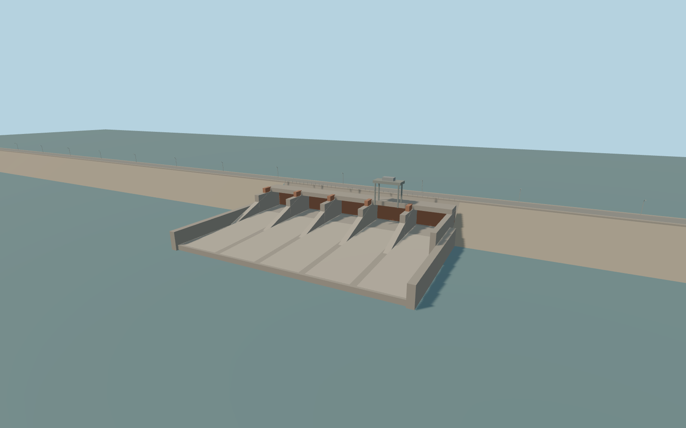

# Kadiran Dam

Kadiran Dam’s 2.56 km mapped regulating crest, concrete spillway and rust-painted gate works, crest road with curved lamps, the mapped powerhouse, its service apron and the adjacent tailrace.

Rebuild: `node packages/worldgen/scripts/generate-kadiran-dam.mjs`;append `--check` for exact source bytes. Select import/LOD/placement with `--ids=kadiran_dam`. Detailed source and four browser tiers are separate ignored GLB outputs.

The fixed vertical origin is 253.0441 m in the standard terrain frame. The road follows approximate sampled grades and reaches 263.35 m beside the powerhouse. Nearby level 14 and 15 water probes give 253.64–253.66 m for the pool and 246.75–247.50 m for the tailwater.

The five modeled spillway bays are an exterior interpretation of the photographed works. Exact bay count and gate operation remain unconfirmed.

The powerhouse footprint is mapped. Its roof height, window layout, paved apron, and tailrace portals are exterior approximations fitted to the standard terrain and waterways.

The separate downstream bridge and service roads remain native. Operating equipment and interiors are outside the exterior asset.

Original geometry:repository license. Map:© OpenStreetMap contributors,ODbL-1.0;Protomaps. Standard terrain:terrain-grid.json. Ordinary pictures stay local and are not redistributed or used as textures. Current acceptance:qa.json.
