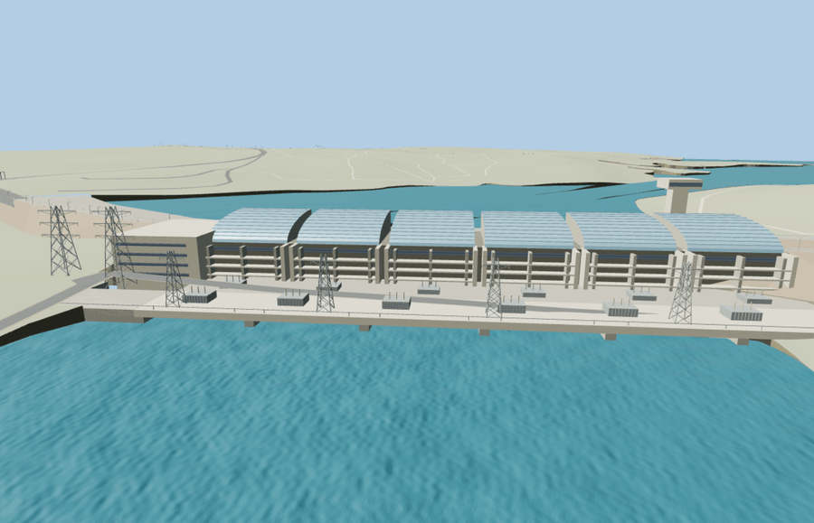

# Tishrin Dam

The authored exterior includes the long curved embankment, gray reservoir face, divided crest road with painted curbs, six pale blue vaulted roof bays, concrete galleries, control tower, electrical apron and six recessed outlet faces.

The dam follows the signed PMTiles outline and native approaches. The Earth viewer now gives the reservoir and the downstream Euphrates representative stages of 326.55 m and 316.64 m. The lower stage meets the outlet apron below the six blue powerhouse roofs.

The Earth fixture retains the native access roads and the nearby mapped building. Failed loading preserves the native layers. Eviction restores the ground and releases the model geometry.

| Detail level | Triangles | Download bytes | Draws |
| --- | ---: | ---: | ---: |
| skyline | 804 | 69,828 | 1 |
| district | 3,910 | 355,568 | 6 |
| street | 5,832 | 539,336 | 6 |
| closeup | 13,260 | 1,226,904 | 6 |

Skyline and district total 425,396 bytes. Six GLBs pass Khronos validation and contain zero embedded images. Six shared material graphs bind in the viewer. The review covers 85 renders and 180 geographic samples.

The paired stages represent exterior visualization estimates. The model datum follows the host reservoir elevation sample. Ground and water contact depend on the host supplying the retained Protomaps IDs and comparable terrain.

The apron equipment, outlet recesses and embankment details follow visual estimates.

[Mapped site frame](map-frame.json) · [Terrain and water fit](site-fit.json) · [QA evidence](qa.json)
