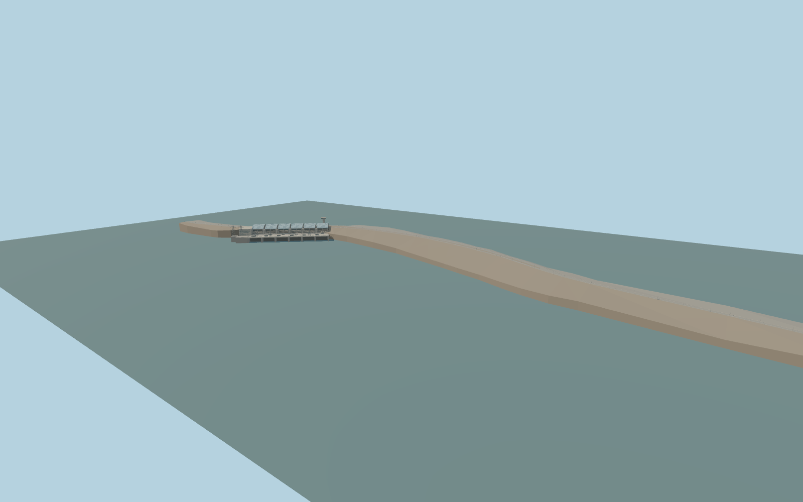

# Tishrin Dam

Tishrin Dam’s curved embankment, west concrete section, six curved blue powerhouse roof bays, service galleries, switchyard and the crest road.

Rebuild: `node packages/worldgen/scripts/generate-tishrin-dam.mjs`;append `--check` for exact source bytes. Select import/LOD/placement with `--ids=tishrin_dam`. Detailed source and four browser tiers are separate ignored GLB outputs.

The standard Terrarium reservoir sample at [0, −640] sets 326.55 m. The downstream review plane is 316.64 m. The production sampler returns 327.20 m upstream and 304.96–314.82 m downstream across the retained windows.

The original exterior follows the signed crest, reservoir and tailrace outlines and six photographed blue powerhouse bays. Foundation grades, electrical equipment and outlet recess dimensions are interpreted.

PMTiles groups the separated upper reservoir and upper tailrace under feature 11423860. The review fixture uses the signed components and measured terrain, while the live viewer determines water elevations per polygon and tile. Downstream datum is pending.

The retained map includes divided crest lanes and separate service roads. This model leaves the native transportation and building layers present. Plant grades and the exact distance of the buried pipe runs are unknown.

Original geometry:repository license. Map:© OpenStreetMap contributors,ODbL-1.0;Protomaps. Standard terrain:terrain-grid.json. Ordinary pictures stay local and are not redistributed or used as textures. Current acceptance:qa.json.
