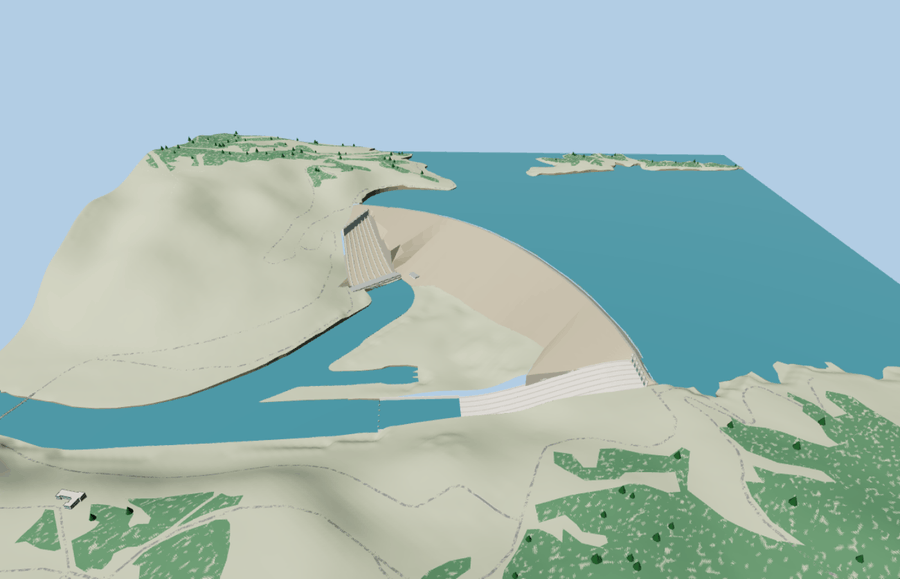

# Atatürk Dam

The curved rock-fill barrier, eight penstocks, generating hall and control house, six closed gates, divided chute, and open stilling basin are visible in the authored complex.

The chute and stilling basin now align to the four terminal corners of mapped PMTiles canal 4830821252. The Earth viewer keeps the chute dry and shows the stilling basin joining the Euphrates at 387 m. The reservoir is displayed at 530.4 m, preserving the modeled rise above the pool.

The Earth fixture retains all three mapped service road records. The ground opening follows the upper central arch. Failed loading preserves the native layers. Eviction restores the ground and releases model geometry.

| Detail level | Triangles | Download bytes | Draws |
| --- | ---: | ---: | ---: |
| skyline | 959 | 94,976 | 1 |
| district | 3,263 | 331,004 | 7 |
| street | 11,759 | 1,134,040 | 7 |
| closeup | 26,763 | 2,632,324 | 7 |

Skyline and district total 425,980 bytes. Six GLBs pass Khronos validation and contain zero embedded images. Six shared material graphs bind in the near viewer tiers. The review covers 75 renders and 125 geographic samples.

The chute-to-basin transition was estimated from aerial photographs. The operating water levels, penstock and gate details and terrain around the powerhouse apron remain approximate. The model depicts the static exterior with closed gates.

The viewer uses one terrain datum for the entire dam. The fit was checked with the retained Protomaps features and Terrarium raster. Surrounding terrain and shore edges retain their coarse source resolution.

[Mapped site frame](map-frame.json) · [Terrain and water fit](site-fit.json) · [QA evidence](qa.json)
