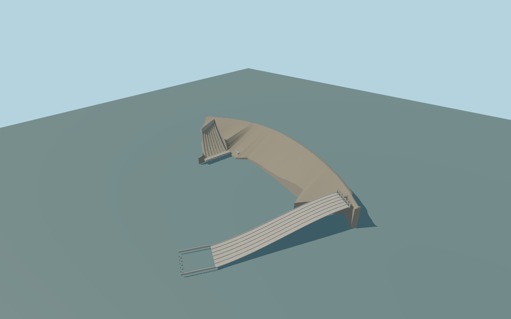

# Atatürk Dam

Whole curved Ataturk rock-fill barrier and mapped crest road,eight exposed penstocks with intake headwall and lower saddles,long native-plan powerhouse and adjacent control house,and the separate eastern gated spillway with broad divided chute and stilling-basin retaining walls. Independent terraced hills,roads,settlement,transmission infrastructure and river islands remain native context. Static closed gates;no lettering,logos,people,vehicles or fluid simulation.

Rebuild: `node packages/worldgen/scripts/generate-ataturk-dam.mjs`;append `--check` for exact source bytes. Select import/LOD/placement with `--ids=ataturk_dam`. Detailed source and four browser tiers are separate ignored GLB outputs.

Whole curved Ataturk rock-fill barrier and mapped crest road,eight exposed penstocks with intake headwall and lower saddles,long native-plan powerhouse and adjacent control house,and the separate eastern gated spillway with broad divided chute and stilling-basin retaining walls. Independent terraced hills,roads,settlement,transmission infrastructure and river islands remain native context. Static closed gates;no lettering,logos,people,vehicles or fluid simulation.

One common Y=0 reference equals the standard viewer reservoir sample at local[0,-700],530m. Estimated crest+14m and foundation-155m retain the169m height fact as an overall illustrative envelope,not a surveyed crest/base pair. Tailwater-143m,hall floor-130m,12m hall height,13m control-house height,penstock paths and spillway profile are picture-scale interpretations. No independent component terrain snapping or surrounding field flattening.

Exact-Q retained dam way45183487,current standard PMTiles and two ordinary aerials. Retained169m height and1820m length are source facts;selected1842.967m longitudinal plan extent is a different control. Crest,foundation,water levels,industrial bays,penstock paths/radii,six gate bays,spillway profile and concealed machinery are explicitly approximate. The model omits copied DSI lettering,logos,people,vehicles and interiors. Native terraced hills and100 independent building components remain context. No bespoke survey research. Physical-device/dense-city timings and numerical LOD errors remain unmeasured.

Six existing shared256px graphs:gravel,stone_basalt,concrete_plain,metal_standing_seam,metal_painted,window_grid. Seven near material groups maximum and one far palette group;metric UVs,linear colours,zero embedded/private images. Gravel/stone rock fill,concrete hydraulic walls/road,industrial roof metal,painted penstock/gate steel and actual shared glazing retain semantic slots. No common-library edits invalidate other models. Every tier retains whole curved embankment,mapped crest road,eight separate exposed penstocks,intake headwall,native-plan powerhouse/control house,six gates,divided spillway and open stilling basin. Near tiers add actual recesses/outfall openings,pipe collars/saddles,crest rails,roof services and gate head details. Numerical LOD errors12/6/2/.7m are unmeasured authoring guidance.

Gate threshold corrected toY=-4 and closed-gate centerY=4 below the unchangedY=15 crest bridge. Lower chute outlet remainsY=-142. The floor stays below the visible gate faces;all elevations remain illustrative estimates.

Original geometry:repository license. Map:© OpenStreetMap contributors,ODbL-1.0;Protomaps. Standard terrain:terrain-grid.json. Ordinary pictures stay local and are not redistributed or used as textures. Current acceptance:qa.json.
