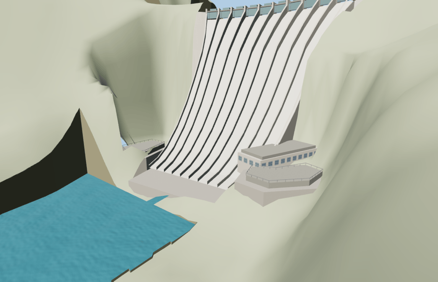

# Karakaya Dam

The original exterior includes the curved concrete arch, ten tapered ogee chutes with gate leaves and splitters, the crest decks and railings, the southeast yellow gantry, the lower powerhouse and both platforms. The arch underside and chute sides are closed with structural concrete. The review includes both faces and all four runtime tiers.

The native Earth fixture renders the headwater at 681 m and the local downstream reach at 561 m. The ten chutes, gate deck, gantry, powerhouse and terraces remain visible. Three local grades tie the structures to the canyon shoulders. The focused fixture replaces the mapped powerhouse footprint and retains the other five buildings and all 33 road records, including the downstream bridge.

Failed loading preserves the native layers. Eviction restores the ground and releases model geometry.

| Detail level | Triangles | Download bytes | Draws |
| --- | ---: | ---: | ---: |
| skyline | 930 | 83,012 | 1 |
| district | 1,950 | 178,988 | 5 |
| street | 5,530 | 500,880 | 5 |
| closeup | 6,982 | 633,508 | 5 |

Skyline and district total 262,000 bytes. Six GLBs pass Khronos validation and contain zero embedded images. Four shared material graphs bind in the viewer. The review covers 71 renders and 75 geographic samples.

The static stages, dry-abutment tie-ins and bank profiles approximate the standard map and terrain tiles. The wider Atatürk Reservoir has its own water setting. Farther canyon shores retain visible terrain steps.

The exterior depicts the dam, chutes and powerhouse. Operating discharge, interiors and buried equipment are outside its scope.

[Mapped site frame](map-frame.json) · [Terrain and water fit](site-fit.json) · [QA evidence](qa.json)
