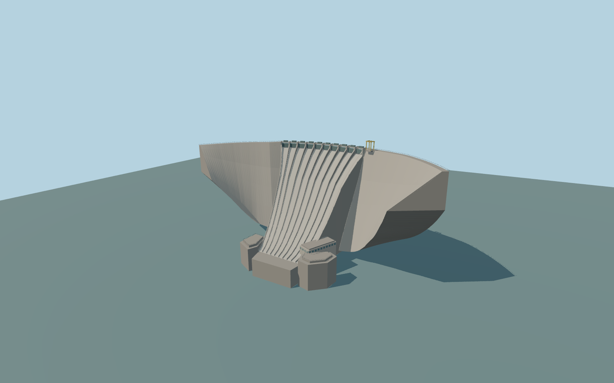

# Karakaya Dam

Signed PMTiles arc across the Euphrates, ten central ogee spillway chutes and crest machinery. The mapped lower powerhouse, stepped concrete terraces, and crest machinery complete the visible complex.

Rebuild: `node packages/worldgen/scripts/generate-karakaya-dam.mjs`;append `--check` for exact source bytes. Select import/LOD/placement with `--ids=karakaya_dam`. Detailed source and four browser tiers are separate ignored GLB outputs.

The signed native reservoir edge and photo match establish the arch and downstream facing. A standard terrain sample at local [0, −360] provides one 681 m datum. The crest is 16 m above that datum, and the downstream reach is modeled 120 m below it. Surveyed operational elevations, chute thickness and exact rock contacts are approximate.

A static medium-fi exterior with a dry spillway state. Chute invert, gate mechanisms, powerhouse facade, abutment and access platform details are interpreted from two ordinary photos and 12 m terrain samples. Only the near dam structures are modeled. The existing downstream bridge and unrelated buildings remain native.

Original geometry:repository license. Map:© OpenStreetMap contributors,ODbL-1.0;Protomaps. Standard terrain:terrain-grid.json. Ordinary pictures stay local and are not redistributed or used as textures. Current acceptance:qa.json.
