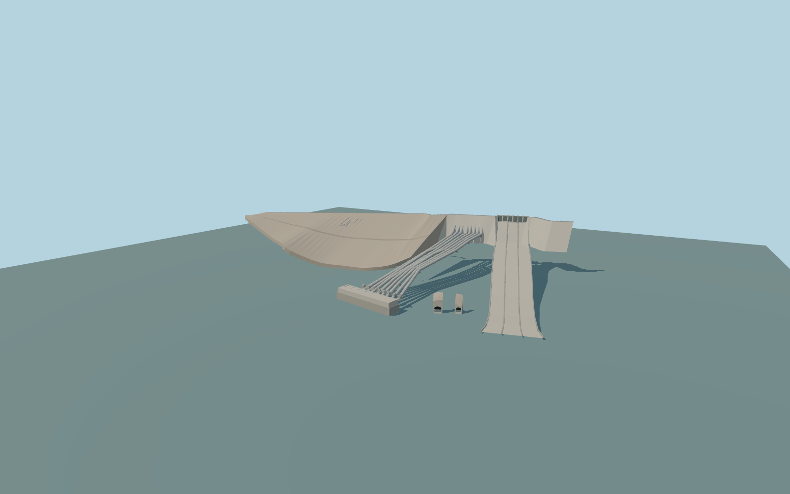

# Keban Dam

The complete near-site Keban dam exterior, with its north rock-fill wedge, DSİ slope lettering, six crest gates, three concrete spillway lanes, eight mapped penstocks, twin lower outlet portals, and shore powerhouse and switchyard.

Rebuild: `node packages/worldgen/scripts/generate-keban-dam.mjs`;append `--check` for exact source bytes. Select import/LOD/placement with `--ids=keban_dam`. Detailed source and four browser tiers are separate ignored GLB outputs.

Single 823.5 m reservoir datum from the standard Terrarium sample at local [−150, −430]. The crest, pipe supports, portal headwalls and chute toe use the signed map and local terrain shape. The illustrative tailwater is 133.5 m below this datum.

The main footprint and orientation follow retained exact way 28431893, while the penstocks, powerhouse, and downstream portal mouths use native PMTiles controls. Gate heights, pipe diameters, chute grade, portal crowns, and electrical equipment are visually interpreted. The modeled water levels are approximate; the gates show a static operating state.

Original geometry:repository license. Map:© OpenStreetMap contributors,ODbL-1.0;Protomaps. Standard terrain:terrain-grid.json. Ordinary pictures stay local and are not redistributed or used as textures. Current acceptance:qa.json.
