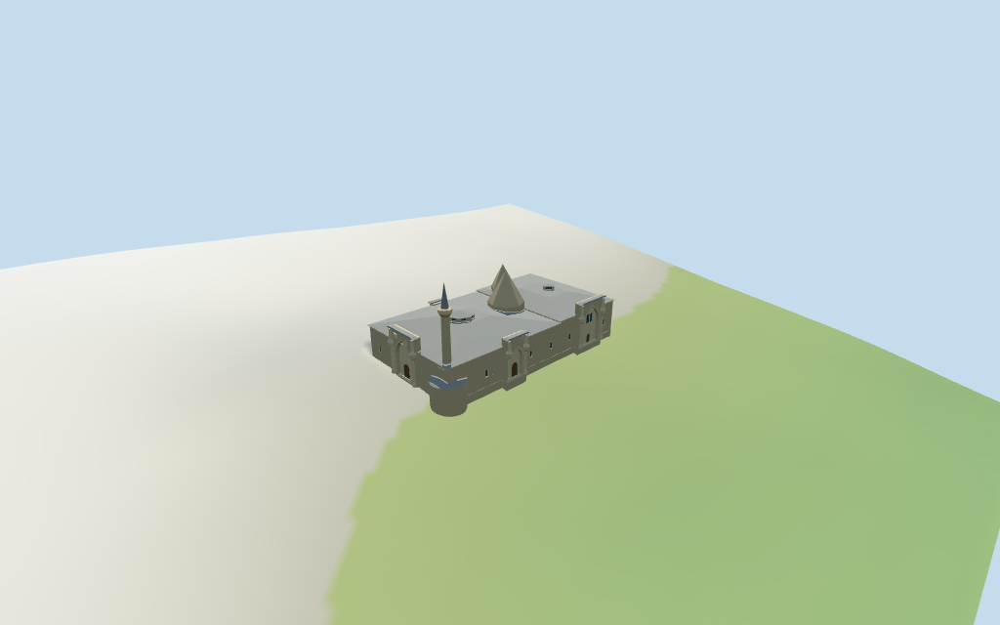

# Divriği Great Mosque and Hospital

Individual adjoining Divriği Great Mosque and Hospital medium-fi exterior. Stepped metal hip roofs,eight-sided mihrab stone pyramid,smaller six-sided tomb cone,two low windowed roof lanterns,minaret on rounded northwest buttress,four distinct projecting portal treatments including broad vegetal north entry and tall pointed hospital entry with upper divided window. Exact mapped whole;all internal divisions,heights and relief are picture-proportioned estimates. Shared surfaces,four complete browser levels. Fine calligraphy/carving,interiors,present restoration state,precise steps/site joins and engineering remain unverified.

## Evidence and reconstruction

Published dimensions and reconstructed details are separated in spec.json. Primary references:

- [Reference](https://commons.wikimedia.org/wiki/File:Divrigi_Mosque_from_Kale1.jpg)
- [Reference](https://commons.wikimedia.org/wiki/File:Divrigi_mosque_North_gate009.jpg)
- [Reference](https://commons.wikimedia.org/wiki/File:Divrigi_Darussifa_entrance.JPG)

Four existing shared256² coursed sandstone,continuous sandstone,standing-seam metal and plain wood graphs;five merged roles including local opaque glazing. Original broad relief geometry,metric UVs,linear tints and faceted roofs. No embedded images,unique facade atlas,copied calligraphy or baked light.

## Model and axes

5,628 triangles; 16,884 vertices; 5 material groups; 678,688 bytes. Native bounds: -34.010, -3.457, -20.522 to 37.184, 31.096, 21.622. Source hash: `sha256:27db3320ac63fb69505f0d23f5396961e385e99313a06df8d8845f4e580e2e72`.

{"x":"north-northeast mosque north portal;negative hospital","y":"up","z":"east-southeast side;negative western entrances"}

Standard viewer DEM datum 1064.3363692424045m. Floor -0.40351488990222606m is median of 111 outside-perimeter samples every2m at1m offset plus0.25m. Raw whole-site DEM range -2.8730978666028477..2.394331876592105m. Footings adapt below raw ground;the visible-model cutout follows the mapped outline and the estimated round buttress. Preview101² grid is locally seated beneath that boundary;raw161² DEM remains intact. This is a visualization plane on a sloping site,not a surveyed plinth. Exact uphill/downhill approaches,retaining walls,street/threshold joins and vertical datum bias remain unverified.

## Reproduce

Run `node packages/worldgen/scripts/generate-additional-landmarks.mjs --ids=N0448` (or add `--check`). The generator preserves manually edited masters by checking their baseline hashes. Import through the standard authored-model workflow with optimization disabled; then capture all QA cameras, including shared-surface views.

## Pending work

- Retained exact way/104787977 /Q581641 identifies the adjoining Divriği Great Mosque and Hospital. Current35184476876809 (2*2^44+104787977) retains12 outer points and no hole. Original anchor[38.121882674,39.37131236] and heading1.08884488763rad unchanged,no horizontal rescale. Positive modelX runs north-northeast toward the mosque north portal;negativeX is the hospital;negativeZ is the western facade with both projecting entrances. Pictures resolve the signed axis. The current map records only one combined outer footprint:mosque/hospital division,cones,lanterns,round buttress,minaret and unrecorded portal depth are explicitly estimated. Nearby city,castle,gardens,streets and retaining walls remain host content.
- No retained height,width or length facts and no current height/min_height tags. All vertical values are picture-proportioned working estimates,not measured dimensions:mosque eaves10.2m/hip12.8m,hospital eaves10.8m/hip12.6m,north portal14.2m,western mosque portal12.6m,hospital portal14.5m,eastern upper doorway10.8m,main eight-sided stone roof13–23m,smaller six-sided tomb roof12.6–20.6m,mosque octagonal lantern12.8–15m,hospital square lantern12.6–14m,minaret31.5m on round5.5m buttress with balcony23.8m. Plan divisions,portal profiles/relief,windows and roof junctions are estimates. Allow several meters of vertical uncertainty. Unseen interiors,precise carved motifs,door/step/ground joins and present restoration state remain unverified.
- Standard viewer DEM datum 1064.3363692424045m. Floor -0.40351488990222606m is median of 111 outside-perimeter samples every2m at1m offset plus0.25m. Raw whole-site DEM range -2.8730978666028477..2.394331876592105m. Footings adapt below raw ground;the visible-model cutout follows the mapped outline and the estimated round buttress. Preview101² grid is locally seated beneath that boundary;raw161² DEM remains intact. This is a visualization plane on a sloping site,not a surveyed plinth. Exact uphill/downhill approaches,retaining walls,street/threshold joins and vertical datum bias remain unverified.
- Three principal overall/north/hospital photographs and one extra capital detail inspected. No bespoke surveys or redistributed images. Individual medium-fi adjoining exterior retains the combined map footprint;internal mosque/hospital boundary,cones,lanterns,round buttress,minaret and all height/relief values are picture estimates. Broad north vegetal relief,west geometric band and hospital pointed portal/upper divided window distinguish the entries;fine stone carving/calligraphy is abstracted,not a facsimile. Portals/windows close on opaque recessed faces;unseen interiors,vaults,medical rooms and tomb contents are not modeled. Present restoration state,exact roof/ground joins,stairs,retaining walls,engineering and physical-device timing remain unverified. Nearby castle/city are excluded;synthetic context buildings are review fixtures.

This bundle follows the medium-fi standard. Medium-fi appearance and geographic fit are reviewed separately. Hash-bound visual acceptance is recorded separately after capture inspection.

## Additional geographic data

©OpenStreetMap contributors;Protomaps;Mapzen/USGS terrain tiles.
