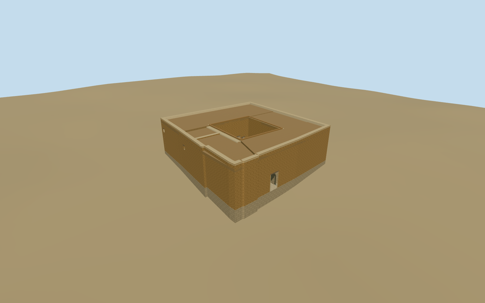

# Dura-Europos Church

A reconstruction around 250 CE of the converted mudbrick house at Dura-Europos. Surveyed trapezoidal perimeter, open court, earthen roofs, south assembly hall and the painted baptismal niche.

Authoring state: **review-in-qa.json**. Current completion evidence is in [qa.json](qa.json) and the [completion ledger](../../../../qualla-structures/batches/qualla-003.PROGRESS.md).

- [Dura-Europos Church](https://qualla.com/dura-europos-church/)

The model reconstructs the worship phase around 250 CE on the modern surveyed coordinates. Roof edges, secondary doors, exterior paint, partition locations without published dimensions and reconstructed plaster details are approximate.

The basin and canopy follow Pearson’s recorded section. The painted plaster is represented by muted tonal modeling without reproducing the complete mural cycle. Nearby buildings, city walls and the later embankment are outside the selected footprint.

Build: `node content/worldgen/source/places/sy/syh/dura_europos_church/models/generate-dura-europos-church.mjs`. Add `--check` to verify exact regeneration. 1752 triangles; 5 materials; no embedded photographs.
