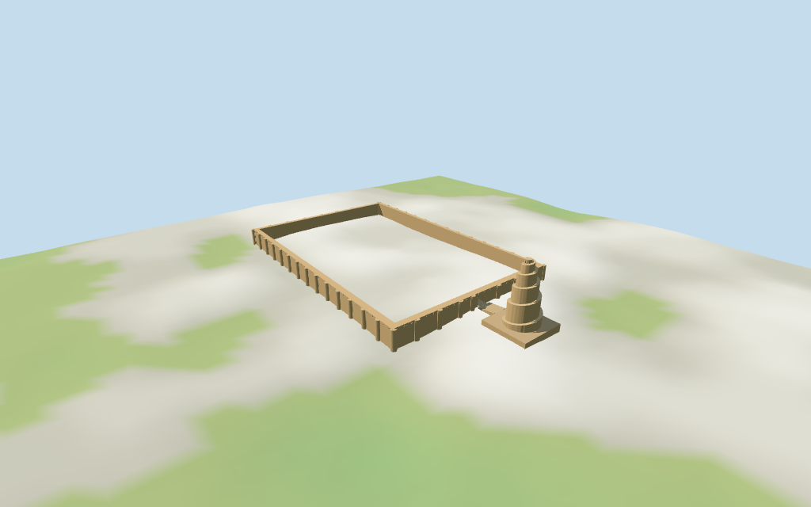

# Great Mosque of Samarra

Individual medium-fi Great Mosque of Samarra ruin exterior:actual open enclosure ring,repeated rounded buttresses and selected shallow frieze fields,one breached northern passage,separate low platform/approach,and broad five-coil helical minaret with an open arched summit crown. Two shared graphs,three merged material roles,four authored browser levels. Current ramp geometry/heights guide the spiral;the complete upper turn reaches the crown and the final52m platform becomes its cap. The large archaeological fence and open interior are not filled or roofed. Unseen interior,current damage,exact buttress/door counts and thresholds remain approximate;no historical roof reconstruction or navigable interior.

## Evidence and reconstruction

Published dimensions and reconstructed details are separated in spec.json. Primary references:

- [Reference](https://commons.wikimedia.org/wiki/File:Malwiya_Minaret_(30553349415)_(2).jpg)
- [Reference](https://commons.wikimedia.org/wiki/File:Samarra,_Iraq_(25270211056).jpg)

Two existing shared256² brick/fired-clay graphs,three merged wall/cap/foundation roles with metric UVs and linear tints. Source retains383 map controls and all height tags. Zero embedded images,unique atlases,baked light or photographic art.

## Model and axes

10,916 triangles; 32,748 vertices; 3 material groups; 1,312,384 bytes. Native bounds: -177.201, -1.531, -81.083 to 130.763, 56.180, 89.996. Source hash: `sha256:e0f7358574aae37c8eb7f1640510f085ece8434f1296c0b31caf86bfd2db232a`.

{"x":"positive toward separate northern minaret","y":"up","z":"across mosque enclosure"}

Standard viewer DEM datum 82.184284 m;working floor 4.813216 m from maximum principal-wall/platform/approach2 m bilinear sample plus0.25 m. Relative sample range -1.159..4.563 m. The minaret uses its own platform-footprint2m working plane 4.180113 m (389 samples,max plus0.25m);the approach joins the two planes. Terrain is unflattened;footings extend below it and crossY=0. Exact archaeological ground levels,terraces,thresholds and walking remain unverified.

## Reproduce

Run `node packages/worldgen/scripts/generate-additional-landmarks.mjs --ids=N0441` (or add `--check`). The generator preserves manually edited masters by checking their baseline hashes. Import through the standard authored-model workflow with optimization disabled; then capture all QA cameras, including shared-surface views.

## Pending work

- Retained exact-QID way/1232333692 is the large archaeological-site fence,not the mosque wall. Original anchor[43.879900384,34.206219804] and heading1.263002799727 rad retained. Current named compound POI35185604422524 matches that fence. Inside it,current Malwiya relation14135984 /52776572269232 supplies the11-point enclosure and10-point open interior;platform35185431953743 and approach35185431960014 have separate exact outlines. All380 height-tagged minaret ramp parts are retained as inputs. The northern/positiveX minaret and approach establish the compound hand;two inspected exterior pictures support its ruin/enclosure/spiral form within15°visual orientation uncertainty. The fence grounds are not extruded or filled. Doorway location and unseen interior remains approximate.
- Current PMTiles enclosure height11 m,platform and approach2.7 m,and380 building-part top heights2.73..52 m are retained. The model keeps52 m as overall minaret summit and11 m for wall/buttress caps. All379 ramp controls through51.87 m guide the complete coalesced helical solid;the final52 m platform footprint is represented by an approximate open summit crown48.2..52 m. Runtime levels resample the continuous slope rather than drawing individual13 cm treads. No min_height tags. Retained width facts156/52 m and length239/240 m are preserved without silently turning the52 m width entry into a height claim. Map outline/current base geometry sets horizontal scale;its outer buttress envelope is larger than the older nominal dimension facts. Buttress count/radii,frieze/openings,weathered edges and crown subdivisions are visualization estimates;vertical/map uncertainty is not a surveyed guarantee.
- Standard viewer DEM datum 82.184284 m;working floor 4.813216 m from maximum principal-wall/platform/approach2 m bilinear sample plus0.25 m. Relative sample range -1.159..4.563 m. The minaret uses its own platform-footprint2m working plane 4.180113 m (389 samples,max plus0.25m);the approach joins the two planes. Terrain is unflattened;footings extend below it and crossY=0. Exact archaeological ground levels,terraces,thresholds and walking remain unverified.
- Medium-fi ruin exterior with an open enclosure,44 approximate rounded buttresses,selected top frieze recesses,one approximate northern breach and separate helical minaret/platform/approach. No fence-ground slab,historical hall roof or navigable reconstruction. All379 ramp profiles through51.87m guide the complete coalesced continuous spiral;the final52m platform becomes the approximate summit cap. Internal sectors fill the solid mass;individual13cm treads are omitted from runtime levels. Exact damage,restoration,interior foundations,buttress/door/frieze counts and fine walking clearance remain unverified. Physical-device timing remains unverified.

This bundle follows the medium-fi standard. Medium-fi appearance and geographic fit are reviewed separately. Hash-bound visual acceptance is recorded separately after capture inspection.

## Additional geographic data

©OpenStreetMap contributors;Protomaps;Mapzen/USGS terrain tiles.
