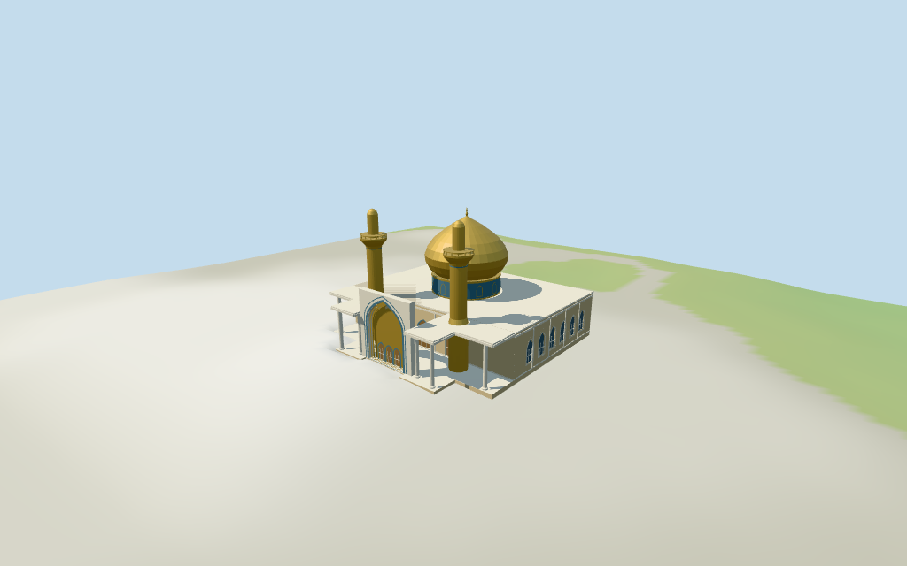

# N0453 — Al-Askari Shrine

Reviewed2026-10-17 for the stated medium-fi historic core exterior and approximate map fit. The68m dome map tag remains unresolved;this visualization uses a picture-proportioned35.5m dome. Precise construction state,vertical subdivisions,artwork and terrain joins remain limited.

## Exterior and shared materials

Inspected all 11 current portable frames including the compact summary: broad gold bulb dome on a blue drum, paired cylindrical gold minarets with single balconies and rounded upper caps, flat pale marble portico roofs on columns, tall blue-bordered pointed iwan with nested gold arch facets and three wood doors, and recessed arched side/rear windows. Fine tile and calligraphic art, exact muqarnas, temporary lights, flags, scaffolding and unseen interiors remain omitted. The two inspected photographs show construction work; the model represents a simplified finished core rather than its precise construction phase.

Inspected all 11 final shared/geographic-flat views, including the north-up placement overlay. Six shared 256² sandstone, marble, cast-bronze, mosaic, lime-plaster and wood graphs serve seven merged roles including opaque blue-grey glazing. Metric UVs and linear tints; no embedded images or unique facade atlas. Each graph is read once and eviction leaves zero live model geometries. The main outline and heading remain fixed, with the mapped dome/minaret centers retained. Flat placement captures verify transforms and replacement, not local terrain accuracy.

## Browser levels

| Level | Triangles | Bytes | Draws |
| --- | ---: | ---: | ---: |
| skyline | 580 | 59744 | 1 |
| district | 1745 | 156228 | 7 |
| street | 5358 | 469660 | 7 |
| closeup | 8564 | 743288 | 7 |

**215,972 bytes for initial skyline plus district**,plus shared textures. Six shared256² graphs,seven roles,zero embedded images.

Inspected all 27 final medium-fi frames: Economy and High, noon and late light, three distances, untextured silhouette, six details, four matched LODs and four transitions. Also inspected the matched skyline at full size. Skyline 580 retains the bulb dome, paired single-balcony minarets and open marble portico; district 1745 adds doors/window rhythm and blue/gold borders, street 5358 adds wall recesses and details, closeup 8564 refines curves and balcony posts. Initial skyline plus district is 215972 bytes plus shared textures, one/seven draws. Corrected the skyline balcony floor height before final captures. Switches add glazing, trim, rounded profiles and rails visibly; the synthetic Mediterranean neighbors and coarse terrain are fixtures. Some grazing roof shadow striping remains a renderer artifact in the shared rig. Physical laptop/phone measurements remain pending.

## Placement and height conflict

Retained exact way1188251537/Q309484 is current viewer building35185560340369. Its12 raw outline vertices and12m body height,original anchor and heading remain unchanged. Current building parts locate the central dome and two front minarets. PositiveX ENE across the shrine;positiveZ SSE toward the projecting marble portico and forecourt. The northern expansion,other domes,galleries and city remain separate host buildings. Current tile properties omit the QID;retained exact identity supplies the binding. Normal viewer DEM datum83.47183983893558m;floor-0.33405444613394764m is median of118 outside-perimeter samples every2m at1m offset plus0.25m. 719 raw footprint samples range-1.4503527652346406..1.0631131244933698m. Preview terrain seats the footprint and1.5m margin;the source footing follows the retained perimeter. Exact marble paving,steps,thresholds,roof reconstruction,current construction state and host terrain joins remain unverified. Independently reunited the current main outline and three mapped parts: 50 raw vertices total, including 12 main-footprint vertices. All 162 renderer footprint checks pass across six GLBs: main, dome and two minaret controls covered, 23 exterior host buildings preserved. Reproduced 719 raw footprint samples, 118 outside-perimeter samples and 413 seated preview terrain samples. The 68 m dome map tag remains unresolved and is retained separately from the 35.5 m visualization estimated from pictures; body 12 m and minaret 36 m map heights are retained. The northern expansion and its smaller domes remain host content; no terrain is embedded in runtime geometry. Exact paving, stairs, thresholds and host terrain joins remain unverified.

Individual medium-fi Al-Askari historic shrine core:raw mapped main outline,12m flat-roofed body,gold bulb dome on blue drum,twin gold single-balcony minarets,open marble portico and tall blue-bordered pointed golden iwan. Surrounding expansion,courtyard structures and other shrine buildings remain host content. Picture-proportioned dome differs from an unresolved68m map part tag;all vertical subdivisions and fine details are estimates. Shared materials,four browser LODs,no unique tile art or furnished interior. Mapped body height12m is retained. Current minaret parts carry36m and their tips use36m above the review floor. The dome part carries68m;this conflicts with picture-proportioned heights of the bulb and twin minarets and is retained as an unresolved map-height claim,not silently treated as a measured dome. This visualization estimates a12–17m blue drum,17–33m gold bulb and2.5m finial,35.5m overall;all subdivisions and dome height remain estimates requiring better map/reference reconciliation. Portico frame18m,canopy roof12m,window/door rhythm and gilded recess profiles are picture estimates. Temporary construction scaffolds,light strings,banners,fine tile/calligraphy and unseen interiors are omitted. Two inspected pictures from 2021 and 2023 guide an original medium-fi core exterior. No surveyed height or precise construction-phase claim. The unresolved dome map-height conflict remains visible in source and this review. Roof and portico partitions, door and window rhythm, small relief, finish and unseen rear details are estimates. No bespoke survey sources, redistributed photographs, copied tile art or furnished interior.

## Verification

49 current views inspected;168 FrontSide rays;162 renderer footprint checks;six Khronos validations with zero errors,warnings or embedded images. Source,runtime,input,LOD,frame,report,shared-graph and placement hashes agree. Targeted source reproduction,placement check,scene validate/sim30,vertex layout and recipe/registration Biome pass. Prior N0432–N0449 full source checkpoint retained;next routine batch N0450–N0469.

Source:sha256:b5f3de6d622267dcf794b8659e7e015e4d769d7fd9cdadbb4d462ddde1b70626

Runtime:sha256:2255e1964bae7e78725de43d913685d12b480b4d488652574fd4bc1f57bbfe8b

Input:sha256:fb0e24b965fadd227489016eb170ea1d39dc1b75ad157c2c305b0dc5f642749c

Commands:targeted generate/import/LOD --ids=N0453;register-landmark-previews --ids=N0453;generate --check;placement --check;portable reflections/antialias/fitted shadows;shared reflections/adaptive clipping/bounded placement;medium-fi reflections;selected LOD checks;scene validate/sim30;recipe/registration Biome. Bulk captures remain local and ignored.

## Inspected picture references

[Anas moheb — 2023-05-14](https://commons.wikimedia.org/wiki/File:%D8%B6%D8%B1%D9%8A%D8%AD_%D8%A7%D9%84%D8%A7%D9%85%D8%A7%D9%85%D9%8A%D9%86_%D8%A7%D9%84%D8%B9%D8%B3%D9%83%D8%B1%D9%8A%D9%8A%D9%86.jpg). CC-BY-SA-4.0;viewed only. Inspected complete960×640 courtyard-night photograph. Broad gold bulb dome between two gold minarets;single balconies,rounded upper shaft caps;flat pale marble columned portico with a taller rectangular central frame,blue patterned pointed iwan and golden recessed vault. Construction framing and scaffolds remain visible;green light strings are illumination,not paint. Surrounding court,pilgrims,temporary umbrellas and side domes are outside this individual core.

[Mohammed Al-Tufaili — 2021-01-03](https://commons.wikimedia.org/wiki/File:Golden_Dome_and_Two_Minarets_of_Al-Askari_Shrine_-_Jan_3,_2021_01.jpg). CC-BY-3.0;viewed only. Inspected complete960×540 daylight roof-level image. Rounded gold bulb with a tapered finial and flared lower profile;gold cylindrical minaret with projecting single balcony and a narrower rounded upper shaft. Visible scaffolding and strings are temporary and omitted. Foreshortened view does not resolve the conflicting68m dome map tag.
