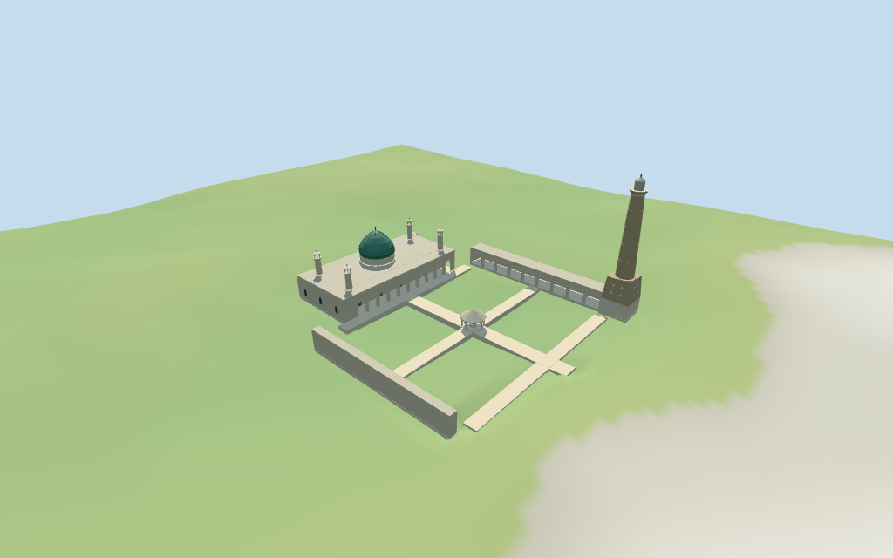

# Great Mosque of al-Nuri

Individual rebuilt al-Nuri mosque visualization: retained hall plan, a green central dome, four short corner turrets, pointed hall gallery, side courtyard arcades, small octagonal fountain pavilion and the separate tall northwestern brick Al-Hadba minaret. Shared low-contrast textures, original geometry, no copied photographs, inscriptions, furnished interiors or museum/visitor-center additions. The site extension and vertical proportions remain explicitly approximate.

## Evidence and reconstruction

Published dimensions and reconstructed details are separated in spec.json. Primary references:

- [Reference](https://commons.wikimedia.org/wiki/File:Great_Mosque_of_al-Nuri_Feb_2025_2.jpg)
- [Reference](https://www.independent.co.uk/news/iraq-mosul-old-city-syria-unesco-b2817825.html)

Six existing shared256² coursed/raw limestone, lime plaster, brick, painted metal and plain wood graphs serve seven roles including palette glazing. Metric UVs and linear tints; no embedded images. Original coarse brick relief, no copied photographs, inscriptions or unique texture atlas.

## Model and axes

7,515 triangles; 22,545 vertices; 7 material groups; 906,004 bytes. Native bounds: -40.581, -1.004, -76.000 to 41.200, 45.623, 12.620. Source hash: `sha256:73f33ddeac572a8fe29e3f1b94e0f3f31337d2ec60b3b242296c457de2273e11`.

{"x":"east-northeast along hall","y":"up","z":"south-southeast; court is negative Z"}

Normal viewer DEM datum 231.67538504646745 m. Working floor 0.6233996862299194 m is the median of 66 outside hall/minaret perimeter samples at1 m offset plus.3 m. 335 raw samples under modeled masks span -0.6537850464674477..2.5059655799239238 m. Adaptive foundations sample outlines at<=2.5 m stations. Ground cutouts follow the hall, arcade strips, minaret base and narrow paths; garden ground between them is preserved. Preview terrain seats only these masks with1.5 m margin. Exact modern courtyard grade and thresholds are unverified; this coarse DEM is a visualization fixture.

## Reproduce

Run `node packages/worldgen/scripts/generate-additional-landmarks.mjs --ids=N0469` (or add `--check`). The generator preserves manually edited masters by checking their baseline hashes. Import through the standard authored-model workflow with optimization disabled; then capture all QA cameras, including shared-surface views.

## Pending work

- Retained Q5599605 / way468118902 anchor [43.126768234,36.342740215] and heading -0.096841454998 rad remain unchanged. The six-vertex hall plan is the retained map-axis outline, not a newly extracted current building polygon. Current named mosque POI35184840207734 still says ruins; the inspected2025 pictures show rebuilt architecture. Current named Al-Hadba POI17596477684205 supplies the northwest minaret point [-36.0811989170203,-71.4911008586867]. A second Arabic minaret marker17597058803445 lies near the court center; it conflicts with the northwestern tower seen beside the hall and is retained as excluded ambiguity, not a second tall minaret. Current four-vertex garden35184869293474 constrains the east garden; courtyard arcades and narrow paths are inferred around it. Positive X east-northeast along the hall; positive Z south-southeast; the court/front faces negative Z. Site extension and lean bearing are approximations.
- No retained published height/width/length facts and no current PMTiles part heights are available. All vertical values are explicit picture/footprint-scale estimates: hall roof8.5 m, main drum10.8 m, green dome19 m/finial20.5 m, four short turret finials16.8 m, Al-Hadba finial45 m with an estimated1.6 m eastward offset, courtyard arcade eaves7 m and fountain pavilion roof6.8 m. The lean direction/magnitude are not surveyed. Gallery bay count, dome profiles, minaret bands, fountain, paving and site extension are visualization reconstruction. Retained historic=ruins is preserved verbatim rather than presented as current appearance.
- Normal viewer DEM datum 231.67538504646745 m. Working floor 0.6233996862299194 m is the median of 66 outside hall/minaret perimeter samples at1 m offset plus.3 m. 335 raw samples under modeled masks span -0.6537850464674477..2.5059655799239238 m. Adaptive foundations sample outlines at<=2.5 m stations. Ground cutouts follow the hall, arcade strips, minaret base and narrow paths; garden ground between them is preserved. Preview terrain seats only these masks with1.5 m margin. Exact modern courtyard grade and thresholds are unverified; this coarse DEM is a visualization fixture.
- Current map still labels the mosque ruins and supplies no building polygon. The hall uses the retained rounded six-vertex plan; the site extension, garden-side arcades and minaret base are approximations guided by named points and pictures. The duplicate central minaret marker is not modeled as another tower. Exact restored interiors, decorative brickwork, hidden roof construction, inscriptions, engineering and physical-device performance are unverified. Neighborhood buildings and visitor/museum facilities remain host content.

This bundle follows the medium-fi standard. Medium-fi appearance and geographic fit are reviewed separately. Hash-bound visual acceptance is recorded separately after capture inspection.

## Additional geographic data

©OpenStreetMap contributors; Protomaps; Mapzen/USGS terrain.
