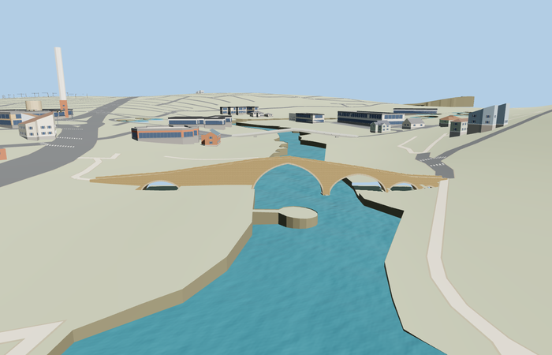

# Delal Bridge

Reviewed 2026-10-26. **Scoped medium-fi exterior and approximate native placement complete.**

Inspected 55 current images:9 portable,8 shared-material asset views,25 medium-fi context/LOD views and13 native frames. The asymmetric five-opening bridge, dominant pointed arch, sloping cobbled walk, raised parapets, arch rims and rock bases remain recognizable across the complete LODs. Both faces, vaults, walk, Economy/High, noon/late light, all four native levels, both approach joins and load failure were inspected. Flat shared asset views verify materials; native captures separately prove the geographic transforms and approximate terrain fit.

Three existing256 px shared graphs: stone_sandstone, stone_sandstone_raw and stone_drywall, with metric UVs and linear component tints. No embedded/private bitmap images or copied photo pixels. Shared graph reads are deduplicated; material and model disposal pass.

Detailed source 11454 triangles; browser skyline/district/street/closeup542/914/2986/7118 triangles and50884/89548/283260/675924 bytes. Initial skyline plus district140432 bytes, below phone and laptop initial-download targets. Physical laptop/phone timing remains unmeasured.

Named standard-PMTiles Delal Bridge footway at [42.695,37.136111], heading1.619969253844741 rad; +X north along the crossing, +Z east. This is a reviewed name/photo association with catalog Q2571655, not an exact-QID map match. Source origin435.1 m and native water436.371948 m are approximate Mapzen visualization controls. All four runtime levels meet the connected footways within 0.01226 m at the tested joins. Five bounded opening-channel caps and reconstructed rock beds keep the coarse native terrain out of the openings. No raw DEM or water edits. The114 m retained nominal length and121.07 m mapped approach route describe different extents;4.7 m width and arch profiles remain photo-based approximations.

All six GLBs validate without errors or warnings.138 geometry probes, current shared-material bindings and failure/unload checks pass. Review-status prose was clarified after capture; exact model/material/scene/map/placement and image pins support reuse of those inspected renders. Bulk captures remain local.

Ordinary pictures already recorded in model-brief.json and standard PMTiles/Mapzen guide the reconstruction. Individual stones, concealed foundations, exact arch dimensions, river stage, channel caps and bank contact are approximate. Nearby quays, current flags/furniture and private buildings are outside this model.
