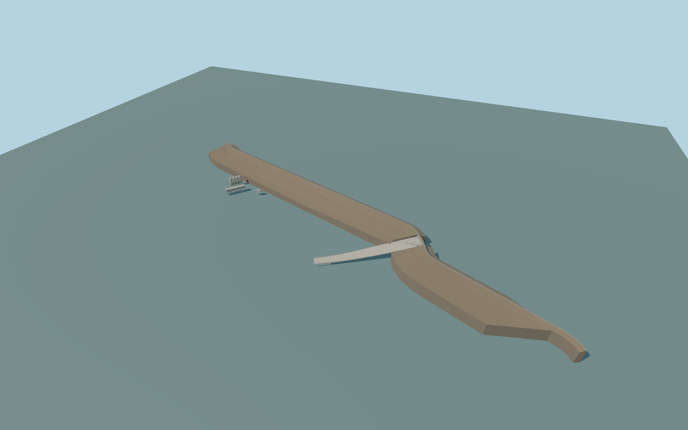

# Mosul Dam

Whole map-associated bent Mosul barrier and crest road,five-gate service spillway with open lower apron to its mapped canal mouth,western native-plan main powerhouse and smaller outlet house,four native-plan surge cylinders and connecting plinths. Separate residential/maintenance buildings,substation,roads,islands and hills remain native context. Emergency spillway beyond the pictured/mapped principal hydraulic core remains unverified;not invented. Static closed gates;no lettering,logos,people,vehicles or baked whitewater.

Rebuild: `node packages/worldgen/scripts/generate-mosul-dam.mjs`;append `--check` for exact source bytes. Select import/LOD/placement with `--ids=mosul_dam`. Detailed source and four browser tiers are separate ignored GLB outputs.

Whole map-associated bent Mosul barrier and crest road,five-gate service spillway with open lower apron to its mapped canal mouth,western native-plan main powerhouse and smaller outlet house,four native-plan surge cylinders and connecting plinths. Separate residential/maintenance buildings,substation,roads,islands and hills remain native context. Emergency spillway beyond the pictured/mapped principal hydraulic core remains unverified;not invented. Static closed gates;no lettering,logos,people,vehicles or baked whitewater.

One model datum equals the standard viewer reservoir sample307.003906m at local[0,-700]. Crest+30m,foundation-82m,tailwater-55m,powerhouse floor-37m,small outlet floor-39m,tank bottom-35m/top+13m and all hydraulic profiles are picture/map-scale estimates. Historical3400m length and selected3485.370m mapped road trace are distinct controls. No exact-Q OSM way or surveyed height claim;heading0 retains actual east/south geometry with ESE crest and NNE reservoir.

Named map and two ordinary aerials identify the modeled principal core. The separate emergency spillway beyond the reviewed core is not claimed. Terrain/tailwater and section elevations are standard-tile and picture-scale estimates. No exact-Q OSM way claim. Nearby roads, independent buildings, and tailrace remain native. Physical-device and dense-scene timings remain unmeasured.

Original geometry:repository license. Map:© OpenStreetMap contributors,ODbL-1.0;Protomaps. Standard terrain:terrain-grid.json. Ordinary pictures stay local and are not redistributed or used as textures. Current acceptance:qa.json.
