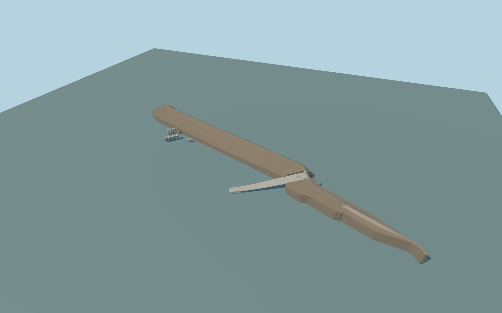

# Mosul Dam

Mosul Dam exterior with the bent embankment and crest road, five-gate service spillway, powerhouse, outlet hall, four surge cylinders, and the eastern saddle dam and dry emergency spillway. The tailrace, neighboring buildings, substation and islands are native map context.

Rebuild: `node packages/worldgen/scripts/generate-mosul-dam.mjs`;append `--check` for exact source bytes. Select import/LOD/placement with `--ids=mosul_dam`. Detailed source and four browser tiers are separate ignored GLB outputs.

One model datum equals the standard viewer reservoir sample307.003906m at local[0,-700]. Crest+30m,foundation-82m,tailwater-55m,powerhouse floor-37m,small outlet floor-39m,tank bottom-35m/top+13m and all hydraulic profiles are picture/map-scale estimates. Historical3400m length and selected3485.370m mapped road trace are distinct controls. No exact-Q OSM way or surveyed height claim;heading0 retains actual east/south geometry with ESE crest and NNE reservoir.

The eastern dry spillway is an exterior interpretation of the aerial and retained PMTiles. Widths and elevations are estimated, the viewer water stages are illustrative, and the model contains no hydraulic or internal engineering detail.

Original geometry:repository license. Map:© OpenStreetMap contributors,ODbL-1.0;Protomaps. Standard terrain:terrain-grid.json. Ordinary pictures stay local and are not redistributed or used as textures. Current acceptance:qa.json.
