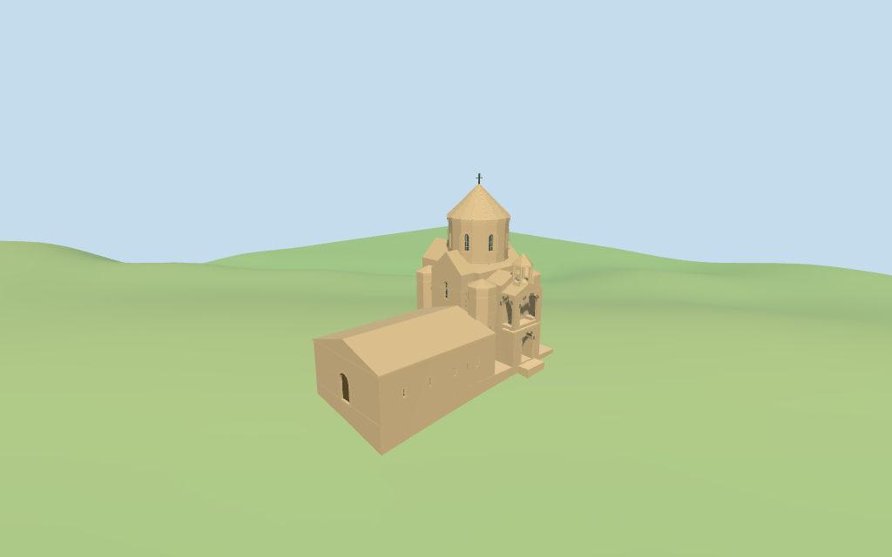

# N0399 — Armenian Cathedral of the Holy Cross review

Reviewed 2026-10-16 against current source/runtime bytes. Accepted for the medium-fi exterior and approximate horizontal placement. All heights, detailed component plans and exact host-ground joins remain estimates.

## Built result

Inspected all 11 final portable/source-terrain frames, including the 1024x640 summary. The individual warm-stone church has recessed cross arms, polygonal corner volumes, a faceted drum with narrow arched lights, a ribbed stone cone and cross, lower western narthex and northeast annex. The southern entrance has a deep lower portal, open upper front/side arches and a six-column bell pavilion with a pointed cap. Broad frieze/eyebrow rhythm and sparse medallion/cross reliefs are geometric abstractions. Corrected the overfilled main body, cone soffit gap, unsupported pavilion floor, hidden lower western light and excessive south roof height behind the pavilion. Lowered estimated south roof now leaves the pavilion air visible above it. Fine narrative carvings and hidden joins remain approximate.

Medium-fi exterior from three actually inspected western/southern photographs: Rupen Janbazian 2013, Mcdrwal 2010 and Ozlmktv 2022, plus standard viewer PMTiles/DEM. No bespoke surveys or redistributed reference images. The map has one coarse whole outline with no height/level tags or independent dimension facts; all heights, architectural sub-plans and concealed roof joins are explicitly estimated. Famous narrative reliefs and inscriptions are represented by sparse band/medallion/cross abstractions, not exact iconographic sculpture. Frescoes, full interiors/bells, surrounding monastery ruins, island paths/planting, current finish, engineering and precise host contact are excluded or unverified.

## Shared surfaces and four browser levels

Inspected all 11 final shared/geographic frames. Five existing cached 256-square ashlar, continuous sandstone, basalt, plain wood and cast-bronze graphs serve seven material groups. Sandstone is shared by trim and stone roofs, with separate slots. Warm linear tints, metric UVs, flat architectural normals and local blue-grey glazing; no embedded images, private facade maps, photograph textures or baked lighting. Alternating pale/dark arch stones use existing graphs. All graphs read once; unload leaves zero live model geometries.

| Level | Triangles | Bytes | Draws |
| --- | ---: | ---: | ---: |
| skyline | 806 | 75,516 | 1 |
| district | 1,987 | 179,892 | 7 |
| street | 6,129 | 511,412 | 7 |
| closeup | 6,845 | 574,716 | 7 |

Initial skyline plus district geometry: **255,408 bytes**. Detailed master: **825,648 bytes / 6,845 triangles**. Runtime: **824,996 bytes**. Five shared 256² graphs; zero embedded images. Geometry downloads exclude graph definitions/runtime texture generation. POSITION/NORMAL streams are separate and CPU/GPU reservations match.

Inspected all 27 final medium-fi frames: Economy/High, noon/late, three distances, texture-free silhouette, six details, four matched whole LODs and four transitions. Skyline 806 triangles retains the faceted drum/cone/cross, recessed cross-body, low extensions, stacked bell entrance and open pavilion. District 1987 adds shared textures, slit/drum lights and alternating arch stone. Street 6129 adds recesses, roof ribs and frieze/eyebrow rhythm. Close-up/master 6845 refine selected medallions, jambs, pavilion columns/capitals and cornices. The distant lower facet count and omitted small reliefs are intentional. Synthetic Anatolian houses are style fixtures. Physical laptop/phone timing remains pending.

## Geographic and height scope

Retained exact way/191563484 and Q1281985 match current whole **35184563652316** and its same-ID multilingual cathedral POI. All **eight current raw points/properties** and earlier **eight distinct whole points/tags** remain source inputs. Anchor **[43.036987917,38.340335015]** and heading **−0.050814185243 rad** are unchanged. +X points east to the main sanctuary, −X west to the low narthex, and +Z south to the stacked bell entrance. Approximate facing uncertainty is 4°. No horizontal rescale.

There are no mapped heights, levels, architectural parts or independent dimension facts. Estimates include main walls **11.4 m**, west/east/north arm ridges **14 m**, lower south arm eave/ridge **10.2/11.4 m**, corner volumes **10.4/11.15 m**, drum **12.4–18 m**, stone cone **22.1 m** and cross **23.5 m** above the estimated **0.5 m** floor. Narthex **5.5/7.4 m**, northeast annex **5.4/7.2 m**, bell stages **4.5/9.4 m**, gable **10.6 m**, pavilion **10.6–12.7 m** and cap **14.2 m** are also estimates. Lowering the inferred south roof makes the pavilion visible above it, consistent with the entrance picture. The raw whole supplies a conservative low base envelope; detailed cross arms/corner projections do not claim measured sub-footprints.

Standard DEM datum **1661.326535 m**, current whole perimeter **−2.63 to +0.59 m**. Footings cross Y=0 and extend below samples. No terrain cutout, flattening or road replacement. The **54 actual viewer-footprint checks** cover whole/narthex/core/annex and preserve a distant northwest mapped building plus west/south/east/north open-ground probe regions. Exact island terrace, paths, entrance treads, base clipping, absolute altitude and walking remain unverified. Synthetic Anatolian neighbors are style fixtures, not reconstructed island buildings.

## Verification

**49 final frames inspected**: 11 portable/source-terrain, 11 shared/geographic and 27 medium-fi. **204 actual geometry probes** cover closed roofs and main cross, upper bell-porch front/side air, pavilion air in both axes and recessed door/glass backing. Six Khronos validations have zero errors, warnings and images. Source/import/LOD/input/capture bindings, recipe/source inventory/schema, targeted byte reproduction, scene validation and 30-tick simulation pass.

Source: `sha256:88044abe3078fe7e9d29f82a024e0201b74fdc25cacc69624f05b22761726081`

Runtime: `sha256:0da407322142386fda1d4fb1de2191f246a90f6ad290ec40fe505ffee2f612b0`

Model input: `sha256:24abd01f19e6ddef01297889b712cb6f5eaa1771af11d7f81bc8ec9dc0a9cd77`

Simulation: `sha256:f0159e384ccf5b10ab4fade4ee0f0ae5c58c8a41c0248f0f1805ff864e11bdc1`

Commands: targeted generate/import/LOD/register-landmark-previews `--ids=N0399`; generation `--check`; portable captures with reflections/antialiasing/fitted shadows; shared captures with adaptive clipping/bounded placement; medium-fi captures; scene validation and 30-tick simulation. Bulk renders stay ignored. Next routine full source checkpoint: **N0392–N0409**.

## References

Actually inspected [Rupen Janbazian 2013 west oblique](https://commons.wikimedia.org/wiki/File:The_Church_of_the_Holy_Cross_on_Akhtamar_Island.JPG), [Mcdrwal 2010 south oblique](https://commons.wikimedia.org/wiki/File:AkdamarIslandChurch.jpg) and [Ozlmktv 2022 south entrance](https://commons.wikimedia.org/wiki/File:Akdamar_Kilisesi_-_ön_cephe.jpg). Source metadata retains licenses, crops and observations. No linked photograph is redistributed or used as a texture.

## Limits

Narrative reliefs and inscriptions are sparse geometric abstractions, not faithful iconographic carvings. Fine masonry details, frescoes, full interiors/bells, monastery ruins and island paths/planting are excluded or simplified. All heights/sub-plans, concealed roof joins, current finish, exact terrain contact and physical phone/laptop timing remain unverified. This accepts the stated medium-fi exterior and approximate horizontal scope; the 1,000-candidate project remains incomplete.
