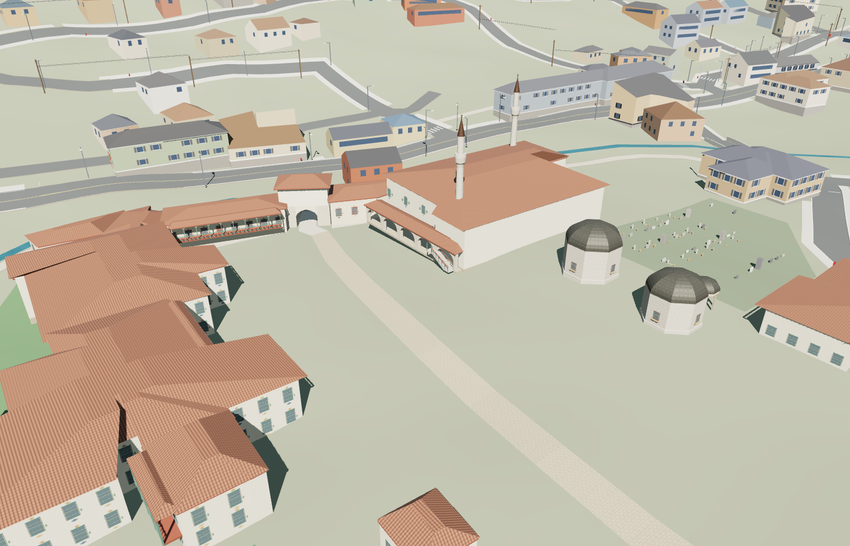
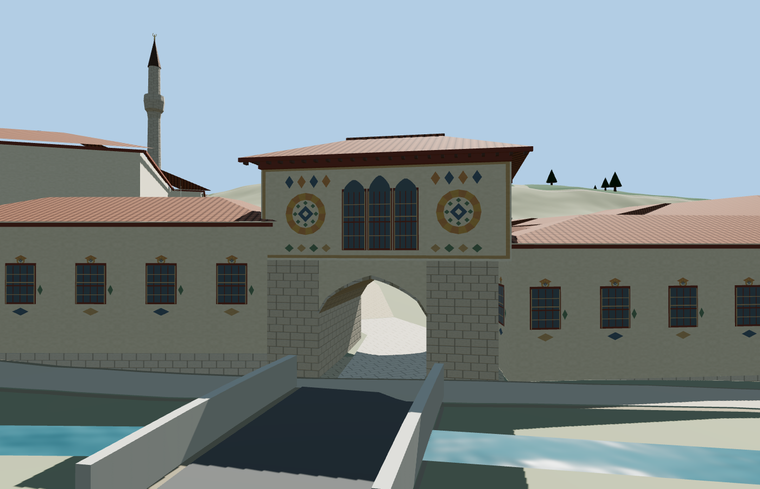

# Khan's Palace (Hansaray) review

Reviewed 2026-11-14. The palace is active in the Bakhchysarai placement catalog.

The model follows 17 mapped footprints and includes the painted North Gate, the Great Khan Mosque and its twin minarets, the palace galleries, Falcon Tower, fountains and domed tombs. At all four detail levels the North Gate offers at least 2.72 m of sampled clearance. The viewer retains the Churuk-Su, the native approach bridge, 386 surrounding buildings and 160 road and path records in the fixture.

Six GLBs passed validation and 24 viewer frames were inspected. The skyline and district total about 373 kB. The four levels load six reusable material graphs across the model, with no embedded images. [Placement, material and unload checks](shared-capture-report.json)

The exterior reflects the historic reference photographs. Court paving, individual tombs and ornament are interpreted, and host terrain can affect the approach grade. [Reference photographs](https://commons.wikimedia.org/wiki/Bakhchisaray_Palace)

