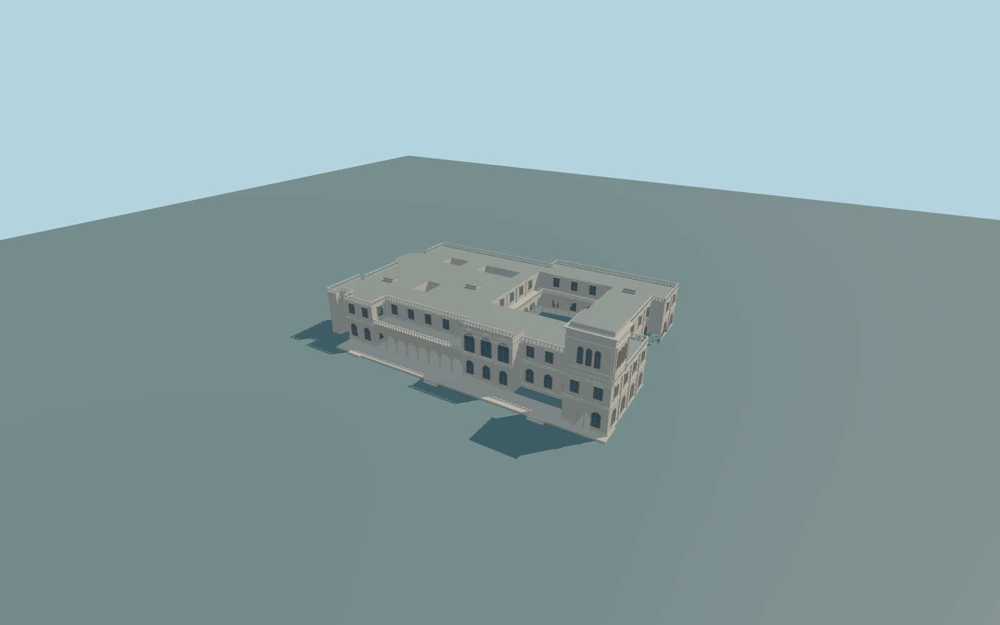

# Livadia Palace

Complete principal white palace exterior:irregular two-storey ranges,four mapped open courtyard/lightwell voids,actual deep Italian-court arcades andupper gallery,long open garden loggia,three-light square tower/open base passage,raised middle garden pavilion,rounded ESE bay,flat roof terraces/balustrades andcourtyard fountain. Independent church,service blocks andwider park remain native context.

Rebuild: `node packages/worldgen/scripts/generate-livadia-palace.mjs`;append `--check` for exact source bytes. Select import/LOD/placement with `--ids=livadia_palace`. Detailed source and four browser tiers are separate ignored GLB outputs.

Complete principal white palace exterior:irregular two-storey ranges,four mapped open courtyard/lightwell voids,actual deep Italian-court arcades andupper gallery,long open garden loggia,three-light square tower/open base passage,raised middle garden pavilion,rounded ESE bay,flat roof terraces/balustrades andcourtyard fountain. Independent church,service blocks andwider park remain native context.

The roof cap subtracts all four mapped openings. Main Italian court opens beyond its column line into three-meter-deep real galleries;upper rooms remain behind the balustraded terrace. Actual curved arch soffits andround columns replace opaque wall infill. The northern tower passage crosses the full mapped entrance block. All external windows face the actual corresponding masonry edge.

Approximate151m sea-level datum from unchanged129x129/2m standard viewer global Terrarium field(two tiles). Exterior foundations follow field-.35m;Italian-gallery floors follow field+.12m under common spring4.5m/ceiling6.9m. Bounded garden terrace at+.4m has visible retaining faces andthree broad flights toward the unchanged field. Tower entrance floor ramps from terrace tothe field. Original photo-proportional main eave12.1m,pavilion14.4m,tower22.2m/cap23.55m;generalized native11m height is not surveyed. No terrain flattening. Exact historic levels/thresholds/accessibility approximate.

Original interpretation of three ordinary pictures andstandard PMTiles/global terrain. Fine window/frieze/baluster/lantern/fountain inventories,roof joins andhistoric grades approximate. All four mapped roof/court voids retained;small lightwell interiors andoptical room interiors not authored. Independent church/service blocks,park planting andfurniture excluded. Shared graph tint/metric UVs only;no private/embedded images orcopied inscriptions/sculpture. Physical laptop/phone/dense-city timings unmeasured.

Five existing256px plaster,limestone,painted-metal,window-grid andpainted-wood graphs;metric UVs/linear colors. Small fountain water uses a flat shared-color material,not a private image. Skyline preserves all four voids,tower/gate,gallery volumes,garden loggia andcentral fountain while simplifying arches to broad openings andomitting glazing/ornament. District has coarse curved arcades andsparse glazing;street adds actual4/5court bays,eight garden bays andflat frames/railings;close-up keeps shaped balusters,denser curved soffits andflat curved frame ribbons;master keeps denser round profiles andfull curved frame sections. Error estimates3/1.5/.7/.25m are not measured mesh errors. Physical device timing unmeasured.

Original geometry:repository license. Map:© OpenStreetMap contributors,ODbL-1.0;Protomaps. Standard terrain:terrain-grid.json. Ordinary pictures stay local and are not redistributed or used as textures. Current acceptance:qa.json.
