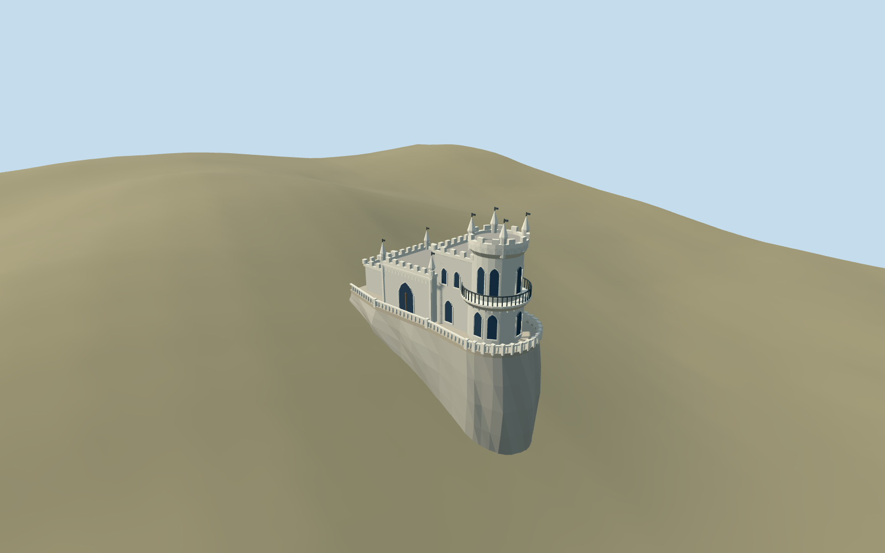

# Swallow's Nest

Small limestone seaside folly with a stepped rectangular hall, four low pinnacles, a round eastern tower with four tall crown spires, projecting balcony and wraparound terrace.

## Evidence and reconstruction

Published dimensions and reconstructed details are separated in spec.json. Primary references:

- [Reference](https://xn-----6kcbqggkggtcllvchedg5cwa0j.xn--p1ai/galereya)
- [Reference](https://www.culture.ru/institutes/13925/lastochkino-gnezdo)
- [Reference](https://www.openstreetmap.org/way/103635688)
- [Reference](https://ru.krymr.com/a/photo-lastochkino-gnezdo-rekonstruktsiya/30968661.html)

No third-party geometry, photograph or bitmap texture is embedded. Shared surface graphs come from the central library; vertex tints carry model colors. Glazing uses PBR materials; transparent surfaces are declared per model.

## Model and axes

9,435 triangles; 28,305 vertices; 5 material groups; 1,135,508 bytes. Native bounds: -11.909, -5.537, -4.673 to 12.234, 18.000, 5.551. Source hash: `sha256:4165df4bac8bc31cfc353823c17aca24e0d23ce69746449c513efa3a424d1e66`.

{"up":"+Y","longitudinal":"+X east-northeast, about19.92degrees north of east","front":"+X tower above sea; -X entrance toward approach","origin":"Site anchor; Y0 standard PMTiles working datum."}

Two inspected aerial pictures show the stepped limestone hall, eastern round tower, balcony and four crown spires. Cached exact building outline and standard viewer PMTiles set orientation/location. Reconstructed terrace6.4m above the working anchor sample clears the coarse hillside; bounded foundations seat it against the sampled ground. Exact cliff edge and balcony clearances remain approximate. Anchor 34.128585443,44.430632946; heading 0.347692146382; standard PMTiles datum 21.217927594329787m. Floors are reconstructed and foundations extend below the coarse sampled ground. The former smooth support is replaced by a faceted weathered-limestone apron beneath the immediate terrace. Rock apron dimensions are approximate.

## Reproduce

Run `node packages/worldgen/scripts/generate-signature-towers.mjs --ids=N0271` (or add `--check`). The generator preserves manually edited masters by checking their baseline hashes. Import through the standard authored-model workflow with optimization disabled; then capture all QA cameras, including shared-surface views.

## Pending work

- Two reference pictures and standard PMTiles define approximate current exterior fit; no bespoke survey sources.
- Detailed original source geometry remains unchanged. An independent derivative adjusts vertical datum and bounded foundation skirts.
- Stepped hall, round eastern tower, four tall crown spires, four low pinnacles, balcony and perimeter terrace provide identity. Openings, flags, balusters and floor heights remain simplified.
- Coarse terrain cannot reconstruct the sheer rock face or exact balcony contact. A bounded immediate rock apron bridges the coarse PMTiles surface to the terrace; the sheer cliff face, long approach, vegetation and interiors are outside scope. No terrain cutout.
- Four shared material graphs plus local opaque glass; no embedded texture images. Physical-device timing and continuous-motion shimmer remain pending.

This bundle follows the medium-fi standard. Medium-fi appearance and geographic fit are reviewed separately. Hash-bound visual acceptance is recorded separately after capture inspection.

## Additional geographic data

© OpenStreetMap contributors, ODbL-1.0; museum and November2020 press photographs used only as visual references.
