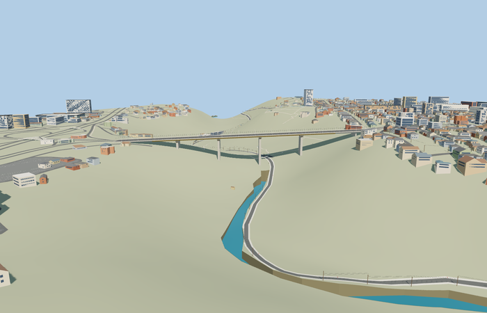

# Davtashen Bridge — completed current pass

Reviewed2026-10-25. **Scoped medium-fi bridge exterior and approximate native placement complete.**

## Shape and shared materials

Inspected 54 current frames: 9 portable, 9 shared, 25 medium-fi and 11 native. Complete497.033m bridge with four paired tall concrete pier stations, shallow yellow steel girders, concrete approaches, six-lane deck, two walks, open pale rails, inward lamps and close trolley contacts. Source-local original analytic geometry, not downloaded meshes. Corrected coplanar slab/girder flange flickering during the same authoring pass. Native approach retaining walls are explicitly approximate visualization support outside the mapped crossing.

Two existing256px shared graphs, concrete_plain and metal_painted. All browser concrete, asphalt, painted steel, rails and markings share those graphs with metric UVs and linear component tints. No embedded/private images or copied photographs. Each graph is read once per resident fixture; skyline uses one mean-color draw and the other levels two draws. Separate position/normal GPU streams and complete disposal pass.

| Level | Triangles | Bytes | Draws |
| --- | ---: | ---: | ---: |
| skyline | 892 | 83524 | 1 |
| district | 3808 | 346128 | 2 |
| street | 13120 | 1185516 | 2 |
| closeup | 26440 | 2383312 | 2 |

Detailed source40444triangles/4855960bytes and canonical import4855532bytes remain separate from browser levels. Skyline/district/street/closeup: 892/3808/13120/26440 triangles, 83524/346128/1185516/2383312 bytes. Initial skyline+district 429652bytes. Levels retain the full bridge and paired pier rhythm, reducing girder stiffeners, posts, lamps and contact wires by distance. Physical ordinary-laptop and phone/tablet timings remain pending.

## Placement and preservation

Exact-QID bridge anchor[44.493313519,40.209637037], heading-0.977148492357rad: +X southeast to Arabkir, -X northwest to Davtashen, +Z southwest. Source road centerY92m, native origin1014.15m and inferred4.37% longitudinal visualization grade give endpoint decks1095.30/1117.00m. Eight native road/footway joins are within0.007m. A bounded48x34.8m Arabkir approach ground cap at sourceY100.3m and three terrain-fit retaining support walls keep the connected lanes visible without sky holes in the inspected bank view. This is an approximate fit to standard PMTiles/Mapzen, not a surveyed profile: the coarse gorge is shallower than ordinary photographs and occludes lower foundations. Published92m height datum, structural sections and precise span allocation remain unresolved.

All 1512 resident/2290 wider native buildings and 1856 independent road records remain. Eight selected connected approaches retain their routes and exact per-lane joins; original road inputs, raw heightfield and native water remain unchanged. Two outside-ground probes remain within0.014m of raw sampled heights; only the declared approach cap changes rendered ground. Failure keeps original map content and no support/cap. Unload restores native ground bytes and releases every model/support geometry. No new engine or dependency changes were needed for this model.

## Checks

Selected source reconstruction, strict medium-fi audit, scene validation and30-tick simulation pass. Six clean GLBs,180 mesh probes and current inspected frames bind source/runtime/LOD/placement hashes. Normal model work did not run dependency audits or the repository-wide engine suite. Bulk captures remain local; two summary previews remain with source.

## Evidence and limits

Ordinary Commons pictures from2025 and earlier, the retained exact-QID OSM footprint, standard Protomaps20261020 and Mapzen Terrarium tiles guide this pass. See reference-metadata.json, map-frame.json, approach-terrain.json and native-fit.json. Photo pixels and third-party meshes are not redistributed. The modeled approach retaining support is inferred visualization geometry; it is not an independently counted landmark or a claim about surveyed historic construction. Hidden structure, temporary banners/signs, utility lines crossing the gorge and present traffic/trolley operation are outside this asset.
