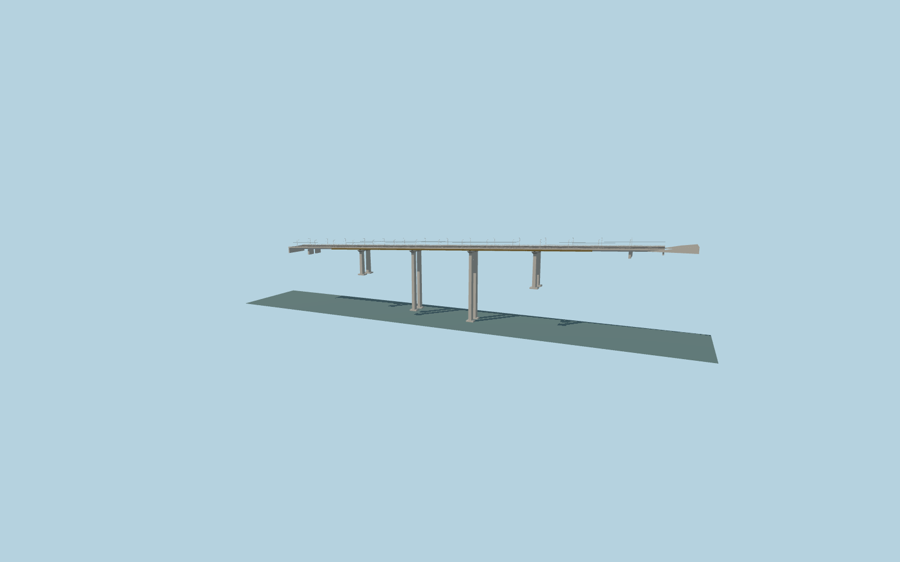

# Davtashen Bridge

The complete mapped Yerevan gorge crossing: yellow steel box girders, four paired tall concrete pier stations, shallow approach viaducts, a broad six-lane road, two sidewalks, open white rails and inward-reaching lamps.

## Evidence

- [Primary reference](https://commons.wikimedia.org/wiki/File:Davtasjenbron_20250923.jpg)
- [Primary reference](https://commons.wikimedia.org/wiki/File:Davtashen_bridge_03.jpg)
- [Primary reference](https://commons.wikimedia.org/wiki/File:Davtashen_Bridge_E5027.jpg)
- [Primary reference](https://www.openstreetmap.org/way/1134619158)

Published dimensions and reconstruction assumptions are separated in spec.json. Source photos were consulted; no photos or third-party geometry are embedded. Map plan attribution: © OpenStreetMap contributors, ODbL-1.0.

## Source

40444 triangles; 4855960 bytes; 4 material groups. SHA256: sha256:66154292b876a71051465d0037104e8378da8d500a6e5a2140390a4ca744478a.

Shared surfaces (concrete_plain, metal_painted) are loaded through the central library; any transparent materials use local PBR parameters. Axis and provisional vertical datum are in spec.json.

Regenerate with node packages/worldgen/scripts/generate-researched-bridges.mjs --ids=davtashen_bridge; append --check to verify. Import and capture through the standard structure-catalog scripts. Geometry validation does not substitute for current-frame visual review.

## Reconstruction limits

- Foundation elevations, structural sections and precise span/end allocation are approximate photo interpretations. A 4.37% longitudinal visualization grade follows the standard native bank endpoints; it is not an as-built surveyed road profile.
- Nominal 92 m height has an unresolved datum; native terrain is coarse in the gorge. Native placement is not approved until current viewer renders are inspected.
- Hidden structure, temporary signs/banners, vehicles, exact present traffic and trolley operation, adjoining retaining walls and utility lines crossing the gorge are excluded.
- Physical laptop and phone/tablet timing measurements remain pending.
- Bounded48×34.8m Arabkir approach retaining cut at sourceY100.3m; three original modeled support walls meet the sampled native ground at its exposed perimeter. Bridge and road centerlines remain exact; these walls are visualization support inferred from the standard terrain, not surveyed bridge members. Original DEM, water, paving and outside ground remain; unload restores native ground.
