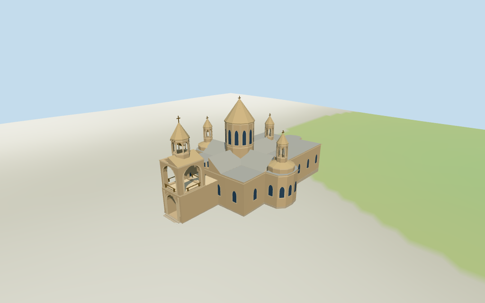

# Etchmiadzin Cathedral

Individual Etchmiadzin cathedral exterior with faceted main drum/conical stone roof, gray metal crossing roofs, open western bell portico/gallery/belfry, three smaller roof belfries, connected eastern range, arched windows, simplified stone motifs, plinth and steps.

## Evidence and reconstruction

Published dimensions and reconstructed details are separated in spec.json. Primary references:

- [Reference](https://www.tripadvisor.in/Hotels-g666440-Vagharshapat_Armavir_Province-Hotels.html)
- [Reference](https://www.armenianchurch.org/en/news/amanor-en-30-12-2025/12105)

Five existing shared256-square graphs supply sandstone walls/trim/cones, gray standing-seam roofs, raw stone foundations, bronze bells/crosses/rails and wood doors. Linear tints and metric UVs; glazing uses vertex colors. No unique embedded image.

## Model and axes

18,613 triangles; 55,839 vertices; 8 material groups; 2,238,316 bytes. Native bounds: -30.200, -1.077, -17.143 to 28.992, 27.650, 18.435. Source hash: `sha256:138865a977a4f5a0ac59e6aaaec6b3975d2a7c2a34da0971bcc61c76e45fb48c`.

{"x":"east along church toward eastern range","y":"up","z":"south apse"}

Two inspected close aerial/front pictures and standard viewer PMTiles/DEM guide an individual cathedral exterior. Untagged heights/roof roles, doorway design, ornament and exact plaza contact remain approximate. ©OpenStreetMap contributors,ODbL-1.0.

## Reproduce

Run `node packages/worldgen/scripts/generate-additional-landmarks.mjs --ids=etchmiadzin_cathedral` (or add `--check`). The generator preserves manually edited masters by checking their baseline hashes. Import through the standard authored-model workflow with optimization disabled; then capture all QA cameras, including shared-surface views.

## Pending work

- The retained exact-QID/current parent is the only mapped building control.27m overall/core29x23m facts and two pictures guide the architecture; all drum/eave/portico/belfry splits and eastern-range roof roles are estimates. The full55m mapped envelope is retained. East roof-belfry location is picture-led, without a separate map part.
- NativeY0 follows standardDEM874.764015m. Estimated0.65m common floor clears coarse perimeter−0.73..0.47m; foundation/plaza/doorstep joins remain approximate. Surveyed levels, interiors and certified walking/collision surfaces are excluded.
- Skyline retains the main cone, western bell silhouette, three roof pavilions and eastern range with simple surfaces. District restores principal openings/shared textures; street/closeup restore complete galleries, bells, cornices, drum windows, rails and simplified stone motifs. Intermediate detail/profile changes remain visible.
- Exact reliefs, sculpture, lettering, structural plans and interiors are not reconstructed. The surrounding monastic compound, gates, vegetation and separate churches remain host content. Physical laptop/phone measurements remain pending.

This bundle follows the medium-fi standard. Medium-fi appearance and geographic fit are reviewed separately. Hash-bound visual acceptance is recorded separately after capture inspection.

## Additional geographic data

©OpenStreetMap contributors; Protomaps; Mapzen/USGS terrain tiles.
