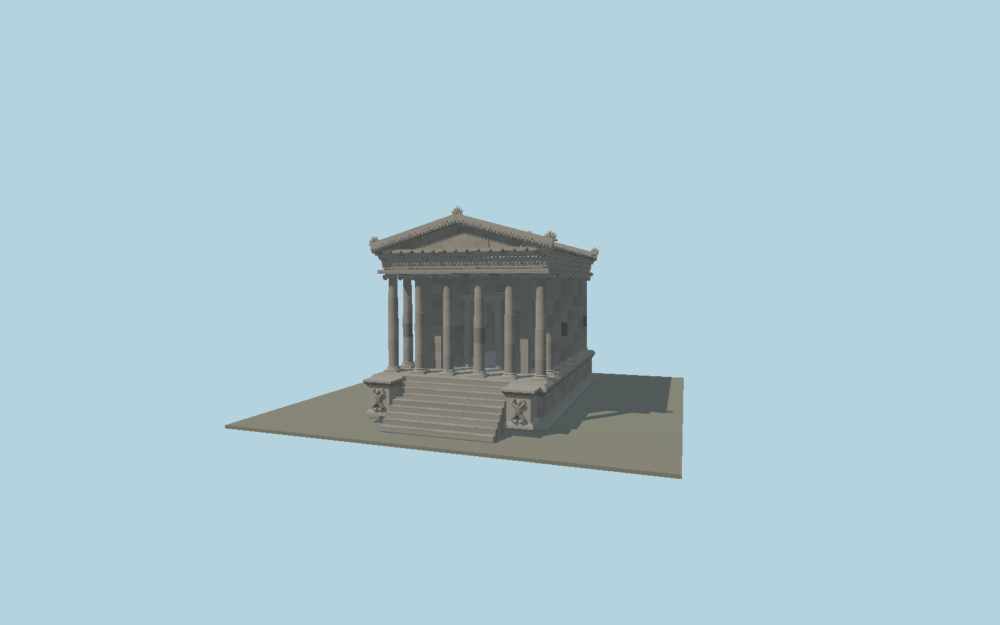

# Garni Temple

Restored basalt peripteral temple with twenty-four smooth entasis columns assembled in drums, Ionic spiral capitals, an open cella doorway and barrel vault, sculpted entablature, dentils, coffered portico soffits, paired pediments, individual stone roof tiles, palmette acroteria and nine steps flanked by kneeling relief figures.

## Identity and geometry

Catalog garni_temple, [Q684072](https://www.wikidata.org/wiki/Q684072). Sahinyan’s restoration measurements define the podium, order, column axes, doorway and cella. Modern photographs establish smooth drum shafts, varied restoration stones and carved decorative zones. The broad OSM outline is not used to stretch the measured temple dimensions.

Temple axis in plan, at the bottom-stair ground datum. +Z is the northern entrance and nine-step stair; signed geographic fit requires review; +Y is up. The geographic proposal identifies its anchor and orientation evidence separately from remaining terrain and azimuth uncertainty.

Source facts and measured references are recorded in spec.json. References: [1](https://arar.sci.am/dlibra/publication/39737/edition/35633?language=en), [2](https://armeniahiddengems.aua.am/monument/garni-temple/), [3](https://www.openstreetmap.org/way/108255791). Reference pages and images are not redistributed.

## Original source and shared materials

Geometry is authored in `packages/worldgen/scripts/garni-temple-model.mjs`. Shared material graphs with metric repeat UV0 and original vertex tints; GLB PBR fallback remains self-contained. No per-model texture duplication. No third-party mesh or photograph is embedded.

1,209,206 triangles; 2,357,358 vertices; 2 material groups; 99,377,272 source bytes. Source hash: `sha256:5b4c456559e7d7c305dfecee73f2fb232f0d01951deb884a615bf5b9eee0da77`. Geometry validation checks finite Float32 coordinates, indices, triangle area and winding before export.

Regenerate with `node packages/worldgen/scripts/generate-heritage-towers.mjs garni_temple`; add `--check` for reproducibility. The generator refuses to overwrite a master whose hash differs from source.json. Import uses `--no-optimize` to preserve facade recesses.

## Remaining detail and review

- Complete static medium-fi exterior of the reconstructed Garni temple: measured6-by8 arrangement with24Ionic columns, entasis and bases, open cella doorway and visible vaulted chamber, high podium and nine entrance steps with paired relief cheeks, open peristyle walks and coffered ceiling, molded entablature/dentils, two triangular pediments, basalt tile roof and palmette acroteria. The original1209054triangle source recipe remains reproducible; the reviewed full master retains that detailed sculpture and corrects the podium stair recess so all nine steps stay exposed. Four whole-temple browser levels reduce roundness, drum joints, ashlar blocks, capital curls and sculpted motifs. Sculpture is a stylized interpretation, not a reproduction of each distinct ancient vine, lion, coffer or human portrait. Photograph and map registration are approximate; the broad mapped rectangle is retained as a comparison and does not rescale the measured temple. Position tolerance5m and heading5° acknowledge generalized mapping and unsurveyed stair offset. Ground0 is the bottom stair/site platform. The separate palace, bathhouse, church ruins, canyon, adjacent precinct and visitor objects are not part of this temple asset. Absolute elevation, detailed surrounding grade and physical phone/laptop timings remain unmeasured.

Named near/far cameras are included for lit visual review. A valid export is not maximum-fidelity certification.
