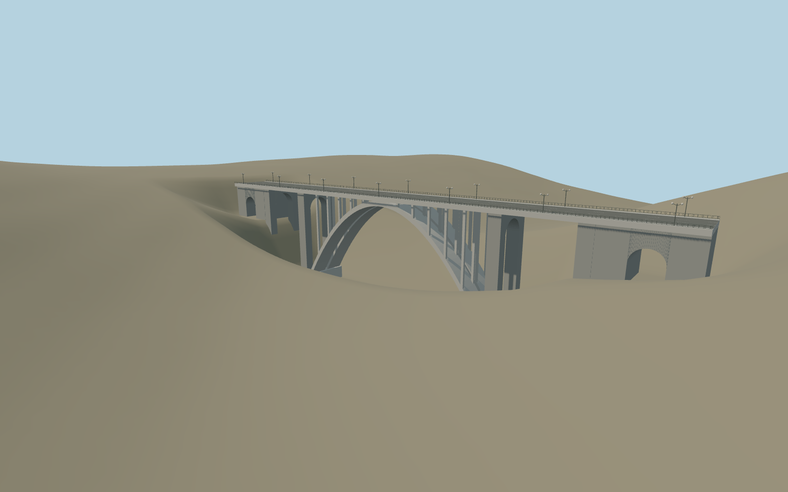

# Great Bridge of Hrazdan (Kievyan Bridge)

Compact Kievyan paired-vault bridge with basalt transverse portals, approach access arches, deck and recognizable rosette railings. Original detailed master independently preserved.

## Evidence

- [Primary reference](https://visityerevan.am/places/details/819/en/)
- [Primary reference](https://www.yerevan.am/en/news/kiewyan-kamowrjn-amboghjowt-yamb-norogvowm-e/)
- [Primary reference](https://www.yerevan.am/hy/news/kiewyan-kamrji-himnanorogowmn-ent-ats-k-i-mej-e/)
- [Primary reference](https://www.yerevan.am/edfiles/video/KIEVYAN%20KAMURJ%2007.07.mp4)
- [Primary reference](https://commons.wikimedia.org/wiki/File:Great_Hrazdan_Bridge,_Yerevan.jpg)
- [Primary reference](https://commons.wikimedia.org/wiki/File:Kievyan_003.jpg)
- [Primary reference](https://commons.wikimedia.org/wiki/File:Hrazdan_bridge.JPG)
- [Primary reference](https://www.openstreetmap.org/relation/15750527)

Published dimensions and reconstruction assumptions are separated in spec.json. Source photos were consulted; no photos or third-party geometry are embedded. Map plan attribution: © OpenStreetMap contributors, ODbL-1.0.

## Source

31722 triangles; 3809808 bytes; 5 material groups. SHA256: sha256:503be133db247da8ef5fc5d728155b1d9241a38b246e5a929c0520dca29a757f.

Shared surfaces (concrete_plain, stone_basalt_raw, metal_painted) are loaded through the central library; any transparent materials use local PBR parameters. Axis and provisional vertical datum are in spec.json.

Regenerate with node packages/worldgen/scripts/generate-researched-bridges.mjs --ids=great_bridge_of_hrazdan; append --check to verify. Import and capture through the standard structure-catalog scripts. Geometry validation does not substitute for current-frame visual review.

## Reconstruction limits

- One inspected river-level picture confirms the paired broad concrete vaults, open spandrel posts and stone-faced portal supports. Standard viewer PMTiles named Kievyan road confirms northeast axis and retained272.304m exposed outline; differing351/364m owner totals include longer approaches and are not used to stretch this source. Western road1029.9605m at native[-150,0] gives approximatebase971.6605m against modelroad58.3m. The opposite road sample differs11m in coarse gorge terrain. Retain the authored level deck and photo-based115m arch; exact vertical curve/bank joins remain uncertain. Narrow live ground opening and a16m preview contact corridor blended to raw by60m remove coarse bridge terrain imprint. This is approximate exterior visualization, not a gorge or foundation survey.
- Original detailed master and map geometry retained. Compact source uses shared basalt/concrete/painted metal; individual masonry joints, cast tooling, cap edges, deck girders and maintenance rails are simplified. Skyline merges the paired vaults; street/closeup restore both vaults and rosette impressions. Physical-device timings remain unmeasured.
