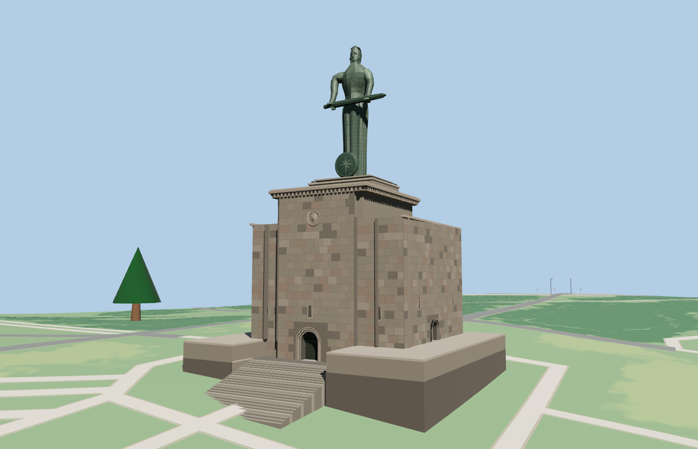

# Mother Armenia

The 22 m copper figure holds the 11 m sword across her waist, with the radial shield at her feet. The 51 m monument includes the stepped museum pedestal, recessed doors, carved arch and dentil cornice. A shared volcanic stone material approximates the polished black tuff. [City monument and museum description](https://www.visityerevan.am/places/details/70/en/)

The named artwork and museum points and three mapped building polygons establish the southwest-facing placement. The podium and approach stairs fit the standard terrain using a 1,142 m datum. Small carvings, facial details and folds are photograph-based approximations.

The native viewer replaces only the three mapped museum footprints and retains 7 nearby building features and 69 roads. The 24 stair treads and recessed main portal were checked in the street and close-up models. The fallback retains the mapped buildings, and eviction disposes the authored geometry.

The 18,116-triangle source master rebuilds from the model recipe. The skyline and district GLBs total 461,340 bytes. Six GLBs passed validation. The native and portable reviews covered 38 views.
