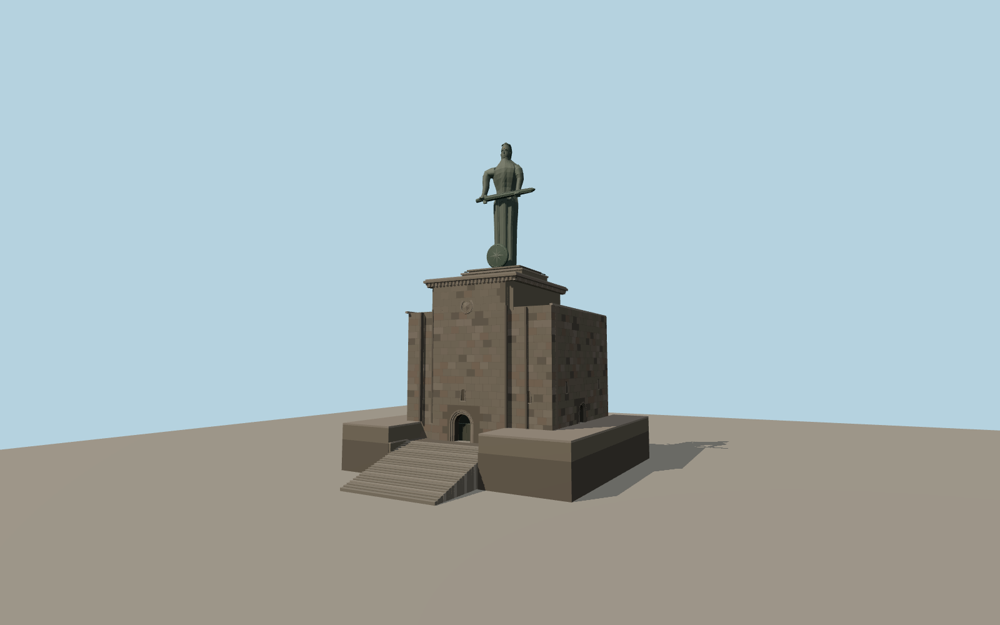

# Mother Armenia

Mother Armenia stands with an 11 m sword held across her waist and a round shield at her feet. The dark tuff museum pedestal has a recessed carved portal, side entries, flanking wings and a dentil cornice. Broad steps lead up from Victory Park.

Run `node packages/worldgen/scripts/generate-mother-armenia.mjs` to rebuild the source master. Append `--check` to compare the exact bytes. Use `--ids=mother_armenia` for targeted import, LOD generation and placement.

The model follows the city’s published 51 m combined height, 22 m copper statue and 11 m sword. Museum massing, carved ornament, folds and facial features are reconstructed from photographs.

The named statue, museum point and three mapped building polygons define the southwest-facing placement. The stairs and embedded podium use the standard Terrarium grade.

A shared volcanic stone material approximates the photographed black tuff. The museum entrance recess and side portals are modeled. Interior galleries and surrounding military exhibits are outside this asset.

Original geometry follows the repository license. Map data is © OpenStreetMap contributors under ODbL-1.0 via Protomaps. Terrain samples are described in terrain-grid.json. Ordinary pictures stay local and are not redistributed or used as textures. Current acceptance is recorded in qa.json.
