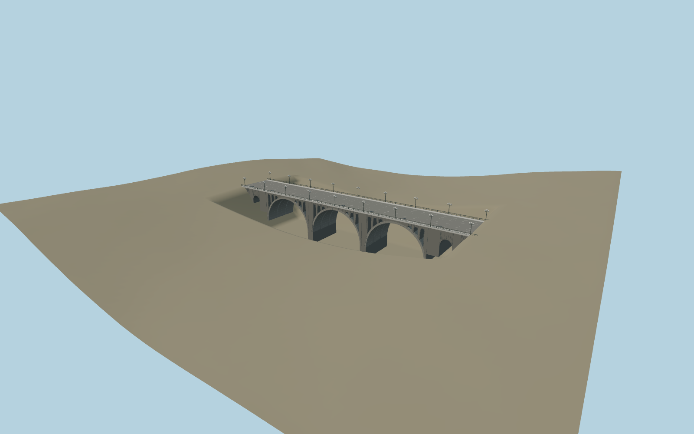

# Haghtanak (Victory) Bridge

Medium-fi Victory Bridge exterior: three basalt arches, three transverse vault units, six open spandrels per span, four approach passages, simplified intersecting-circle iron lattice, three-globe lamps and six-lane road markings. Detailed original master remains independently reproducible.

## Evidence

- [Primary reference](https://www.visityerevan.am/places/details/820/en/)
- [Primary reference](https://commons.wikimedia.org/wiki/File:Segerbron_20260401.jpg)
- [Primary reference](https://commons.wikimedia.org/wiki/File:Haghtanak_bridge_01.jpg)
- [Primary reference](https://commons.wikimedia.org/wiki/File:Haghtanak_bridge_04.jpg)
- [Primary reference](https://commons.wikimedia.org/wiki/File:Haghtanak_bridge,_Yerevan_18.jpg)
- [Primary reference](https://www.openstreetmap.org/way/1164537616)

Published dimensions and reconstruction assumptions are separated in spec.json. Source photos were consulted; no photos or third-party geometry are embedded. Map plan attribution: © OpenStreetMap contributors, ODbL-1.0.

## Source

52248 triangles; 6273348 bytes; 6 material groups. SHA256: sha256:ed9986a8558a2f7f2c75eb6a75c7c8ec86709fcbab3a579ed08290f68a3948d8.

Shared surfaces (stone_basalt_raw, concrete_plain, stone_granite, metal_painted) are loaded through the central library; any transparent materials use local PBR parameters. Axis and provisional vertical datum are in spec.json.

Regenerate with node packages/worldgen/scripts/generate-researched-bridges.mjs --ids=N0014; append --check to verify. Import and capture through the standard next-1000 scripts. Geometry validation does not substitute for current-frame visual review.

## Reconstruction limits

- Approximate picture/PMTiles exterior and orientation fit; no bespoke survey or local-data research.
- Original detailed324MB master is preserved by its unchanged recipe/map inputs and exact reproduced hash. Independent medium-fi source replaces modeled masonry courses with shared basalt texture, simplifies the intersecting-circle cast iron and retains main/spandrel/approach openings, transverse units and lamps. Browser levels reduce these further.
- PMTiles western approach anchors the road at modelY34; coarse under-bridge terrain does not resolve the canyon. Bounded ground opening is a visualization approximation. Precise river, bank walls and endpoint joins are not certified. Footprint replacement off; physical-device timing remains pending.
