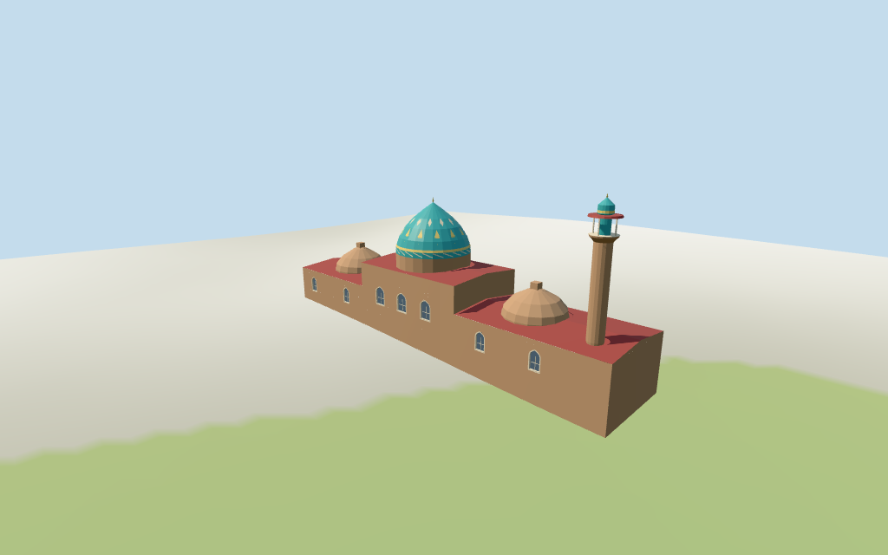

# Blue Mosque

Individual medium-fi Yerevan Blue Mosque prayer-hall exterior:exact narrow mapped shell,large pointed turquoise dome with sparse original geometric bands,red shallow roofs,two lower weathered brick cupolas,selected pointed windows and a single east-end brick minaret with projecting balcony/tiled cap. Six shared graphs,eight merged roles,four authored browser levels. Separate courtyard ranges remain map-host context. Heights,northern entrance and unseen fabric remain estimates;no copied calligraphy or navigable interior.

## Evidence and reconstruction

Published dimensions and reconstructed details are separated in spec.json. Primary references:

- [Reference](https://commons.wikimedia.org/wiki/File:Yerevan_Blue_mosque_2023_dome_and_minaret.jpg)
- [Reference](https://commons.wikimedia.org/wiki/File:Blue_Mosque_Yerevan_Dome.JPG)

Six shared256² brick,limestone,standing-seam metal,mosaic tile,plain wood and bronze graphs;eight merged material roles with metric UVs/linear tints;local blue-grey glazing. Sparse original geometric dome bands abstract the pictured blue/yellow motifs. Zero embedded images,unique atlases,baked light or copied calligraphy.

## Model and axes

3,643 triangles; 10,929 vertices; 8 material groups; 441,832 bytes. Native bounds: -33.216, -2.036, -7.348 to 33.173, 25.665, 7.287. Source hash: `sha256:aceab09939ce1cb7d74c36baeaa25eca9e5ce2bda830b9e734cf58b8e66be5c4`.

{"x":"positive toward east-end minaret","y":"up","z":"positive toward photographed southern wall"}

Standard viewer DEM datum 986.701526 m;working floor 1.664943 m from maximum whole-footprint1 m bilinear sample plus0.25 m. Relative sample range -1.686..1.415 m. Unflattened terrain;footings adapt below it and cross Y=0. Exact terraces,thresholds,ground joins and walking remain unverified.

## Reproduce

Run `node packages/worldgen/scripts/generate-additional-landmarks.mjs --ids=N0440` (or add `--check`). The generator preserves manually edited masters by checking their baseline hashes. Import through the standard authored-model workflow with optimization disabled; then capture all QA cameras, including shared-surface views.

## Pending work

- Retained exact way/235841246 / Q1979112 matches current building35184607930078 (2*2^44+235841246) and Blue Mosque place-of-worship POI. Original anchor[44.505559877,40.177860566] and heading-0.007333900588 rad retained. Current seven-point,66.39×14.60 m narrow prayer-hall outline is preserved. Separate west/north courtyard ranges and nearby buildings remain host context;the courtyard is not filled by this asset. A south-side2023 exterior picture places the lone minaret at positiveX/east and the large turquoise dome slightly west of center. This is an approximate asymmetric assignment with15-degree visual uncertainty,not a surveyed bearing. The courtyard-side doorway and unseen northern fabric remain approximate.
- Retained height fact24 m has no reference URLs or datum/component qualifier. The visualization uses24 m for the minaret tip above the working floor;its assignment remains approximate rather than a confirmed component measurement. Main brick shell10 m,drum10.6..12.4 m,turquoise dome20.5 m/finial21.4 m;low wing eaves5.8 m/red roof ridge6.6 m,two brick cupolas10.5/10.2 m;minaret balcony19.1 m/neck21.6 m/cap23.5 m/tip24 m. Relative dome/minaret shapes follow two inspected south-side exterior pictures;estimated vertical uncertainty±3 m. No current height/min_height tags. Roof subdivisions,facade/window counts,northern entrance and exact current finish remain approximate.
- Standard viewer DEM datum 986.701526 m;working floor 1.664943 m from maximum whole-footprint1 m bilinear sample plus0.25 m. Relative sample range -1.686..1.415 m. Unflattened terrain;footings adapt below it and cross Y=0. Exact terraces,thresholds,ground joins and walking remain unverified.
- Medium-fi prayer-hall exterior only. Exact source way controls the seven-point outline. Separate courtyard ranges remain map-host context. Main dome/cupola/minaret subdivisions,roof joins,window counts,northern entrance,exact current finish and thresholds remain approximate;no navigable interiors. Retained unqualified24 m fact is used as approximate minaret-tip height,not independently confirmed. Dome bands/medallions are sparse original geometry without copied calligraphy. Physical-device timing remains unverified.

This bundle follows the medium-fi standard. Medium-fi appearance and geographic fit are reviewed separately. Hash-bound visual acceptance is recorded separately after capture inspection.

## Additional geographic data

©OpenStreetMap contributors;Protomaps;Mapzen/USGS terrain tiles.
