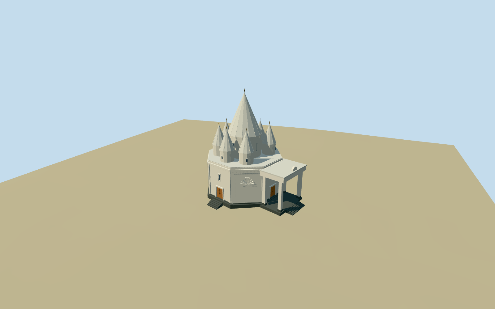

# N0535 — Quba Mere Diwane

Reviewed2026-10-19 in one continuous author/build/inspect/fix round.

## Appearance

Inspected 48 final current source/shared/medium-fi/native-site/fallback views in one continuous brief/build/inspect/fix round. Specific octagonal pale stone body with dark plinth, engaged pilasters, narrow recessed windows, three closed timber door bays, simplified original fan/dentil reliefs, central windowed drum and tall ribbed cone, seven smaller peripheral drums/cones, restrained gold spindle finials and a real open square-post east portico with short stairs. Same-round renders prompted continuous fan backing and clean raised ribs, and a corrected inset material slot so production rendering retains the intended dark tint. No copied text, sculpture atlas or full interior.

## Shared materials and browser levels

Five existing shared 256-square graphs: stone_marble for body/roof, stone_granite for plinth/stairs, wood_plain for timber doors, metal_bronze_cast for finials, metal_painted for dark closed window insets. The inset uses the trim slot because the production window slot deliberately ignores vertex tints for precolored glass textures. Metric UVs and linear muted tints; each graph read once by the production resolver. Four authored levels meet triangle/draw/download caps, initial geometry 422,400 bytes. Zero embedded images or unique atlas, separate GPU streams and matching CPU/GPU byte accounting. Eviction releases all model geometry.

| Level | Triangles | Bytes | Draws |
| --- | ---: | ---: | ---: |
| skyline | 784 | 81484 | 1 |
| district | 3924 | 340916 | 6 |
| street | 4860 | 436976 | 6 |
| closeup | 4860 | 436976 | 6 |

Inspected noon/late, economy/high, whole silhouette, cone/turret/finial, door/window/fan and open-portico details, all four levels and transitions. Skyline retains the octagonal body, central cone and all seven smaller cones, open portico and small foundation approaches while omitting window/door carving and finial detail. District adds the recessed facade vocabulary, basic roof ribs and finials; street/close retain the raised fan ribs and restrained timber relief. Flat shared stages can expose terrain-relative feet; source/native terrain carries contact judgment. Green fallback terrain and neighboring procedural shells are host context, not a reconstruction of garden paving or the nearby Ziarat temple.

## Approximate map fit

The standard PMTiles building/POI 35185101801767 names Quba Mere Diwane at the candidate location and supplies its octagonal body/east-side portico shell. Anchor 44.1618,40.1402; heading 0, internal angle +0.262rad, body center [6.3,-0.65]m relative to the anchor. Replace only that matching native shell with 2cm numeric tolerance. All 47 independent in-tile building inputs, including the separately named Ziarat temple about 45m west, remain byte-equivalent. Original 6m native terrain and water remain unchanged. A small local level body/porch plinth has grade-buried bottom edges; short approaches descend toward local ground. No broad precinct slab, flattening or ground/water cutout. Loaded levels retain 47 native records; failure retains all 48 originals; unloading releases geometry.

## Limits

Accepted medium-fi standing exterior from two inspected ordinary exterior pictures and standard PMTiles/Mapzen. Main body size follows the roughly 24x20m mapped outline; central roof/finial about 26m and smaller cones about 17m above the local floor are picture-led approximations. Seven turret stations, doorway inventory, concealed facades, exact fan/dentil/roof-rib patterns, stone courses and thresholds remain simplified allocations. Closed painted window insets approximate the narrow dark bays; no physical interior/glass construction is claimed. Nearby Ziarat temple, cemetery/memorials, landscape and paving remain independent host context. Coarse DEM does not resolve exact plinth/doorway thresholds. No bespoke survey/archive research. Physical-device/dense-city timings remain pending.

## Selected checks

Six Khronos files: zero errors/warnings.122 actual geometry/contact probes; 48 current inspected views. Scene validation/sim30 and strict selected medium-fi audit pass. Source and runtime hashes/material bindings/LOD caps verified.

Rebuild: node packages/worldgen/scripts/generate-additional-landmarks.mjs --ids=N0535; node packages/worldgen/scripts/import-next-1000-models.mjs --ids=N0535; node packages/tooling/scripts/generate-landmark-lods.mjs --ids=N0535 --force.

Source: sha256:85cced86edf661a18e97f87588af35293dbb5b56335ecea6c233d14d3c0a2e23

Runtime: sha256:743a95817f1208408625fe764e1710c55881391b864e7a2e3064891fd5b56c9f

Input: sha256:ae670612df96be190d9f2cf73920bd9193890065be685c235cef9cf6ee7d2544

## Viewed ordinary pictures

https://commons.wikimedia.org/wiki/File:Quba_M%C3%AAr%C3%AA_D%C3%AEwan%C3%AA.jpg — Dor Shabashewitz; CC BY4.0. Viewed only; no pixels copied.

https://commons.wikimedia.org/wiki/File:Jezida_templo_en_aknali%C4%89o.jpg — AndyHM; CC BY-SA4.0. Viewed only; no pixels copied.

## Source binding maintenance — 550 checkpoint

Exact prior input reconstructed using prior recipe list and preserved helper text. Seven helper edits change only the first comment line, making existing source recipes explicit. All six approved model files are unchanged. Existing visual acceptance is retained through byte-equivalent rebuilding; this is not a new visual review.

Previous input: sha256:ae670612df96be190d9f2cf73920bd9193890065be685c235cef9cf6ee7d2544

Current input: sha256:36436a56a7a5d588c6ed6f27d6f410337d66c68ef4eaa7c51cfef18d194a26ea
