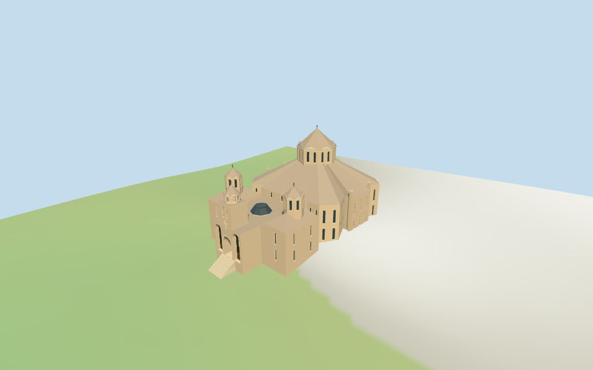

# Saint Gregory the Illuminator Cathedral

Individual Saint Gregory the Illuminator Cathedral, Yerevan: warm tan stone complex with large rear church and steep brown stone roof planes, tall paired-slit polygonal drum/faceted cone/cross, two lower western chapel pavilions and cupolas, projecting west gateway/bell shaft with paired slots, open small bell arcade, deep round central portal and stacked flanking bays. Flat narthex roof with a blue polygonal skylight, stacked side window strips, angular relief crosses and broad local entrance steps. Four existing shared ashlar/limestone/granite/wood graphs, linear tints, metric UVs, flat architectural normals and four browser levels. Current whole footprint/standard DEM. Detailed carving, inscriptions, exact masonry seams, glass artwork, hidden rear windows/rooms/roof joins, park/approach furniture, surveyed plaza/thresholds and certified walking excluded or approximate.

## Evidence and reconstruction

Published dimensions and reconstructed details are separated in spec.json. Primary references:

- [Reference](https://commons.wikimedia.org/wiki/File:2025-05-17_Saint_Gregory_the_Illuminator_Cathedral,_Yerevan.jpg)
- [Reference](https://commons.wikimedia.org/wiki/File:Saint_Gregory_the_Illuminator_Cathedral_from_air,_April_2019.jpg)

Four existing shared256-square ashlar, limestone, granite and plain wood graphs. Linear warm stone/brown roof tints, metric UVs and flat architectural normals. Dark-backed glazing/vaults, blue skylight and metal crosses use geometric PBR colors. No embedded images, bespoke facade maps or baked shadows.

## Model and axes

7,811 triangles; 23,433 vertices; 6 material groups; 940,968 bytes. Native bounds: -57.726, -5.669, -32.196 to 49.661, 54.400, 32.223. Source hash: `sha256:420fc27174dde1062cee5b0d98a1feb773b4167ea3dfe8b2931ae8ae1b4a0c2e`.

{"x":"east from projecting western portal toward large rear church/altar","y":"up","z":"south toward lower chapel and main side facade"}

Standard viewer DEM datum 989.258594m; display offset0.4m, mapped perimeter terrain -5.02..2.79m. Side footings follow coarse viewer terrain. Main portal threshold uses local DEM+0.22m with a minimum0.3m relative model floor; short local steps approximate the approach. Exact terrace/plaza grading, retaining walls, cut-fill, long approach stairs/ramps, absolute altitude and walking remain unverified. No global flattening or road replacement.

## Reproduce

Run `node packages/worldgen/scripts/generate-additional-landmarks.mjs --ids=saint_gregory_the_illuminator_cathedral` (or add `--check`). The generator preserves manually edited masters by checking their baseline hashes. Import through the standard authored-model workflow with optimization disabled; then capture all QA cameras, including shared-surface views.

## Pending work

- Retained exact-QID OSM way31622320/Q2942349 matches current main35184403711152. All36 raw vertices/tags remain exact after rigid rotation with no rescale, including two sub-millimetre map artifacts. Main height/min_height remain absent; there are no separate component controls in standard PMTiles. Retained54m whole height controls the main cross tip, not a stack of tower parts. Main church, two western chapels and entrance/narthex are picture-estimated partitions of the mapped envelope. Approximate levels: base12m, main wall21m/steep fan roof with40m apex hidden inside the drum (visible roof joins approximately32..35m); main drum21..42m (lower portion hidden by roof), cone52m/cross54m. Chapel walls18m/hips23m, drums18..30m (lower portion intersects roofs), cones34m/crosses36m. Entrance flat roof16m, bell shaft16..27m, octagonal bell arcade27..31m/cone35m/cross37m. Main drum center[16.5,0.6]m/radius11.2m, chapel drum centers from their mapped-envelope partitions/radius4.65m, front bell center[-44.7,1.2]m/radius3.65m and skylight[-27.5,1]m/radius5.5m are picture estimates, with approximately3m internal location uncertainty. Facet pediments, fenestration, dark-backed deep portal/flanking bays, stairs and hidden roof joins are approximate. Derived Boolean input rounds0.1mm and removes collapsed adjacent points; raw source remains intact. No engineering or survey accuracy claimed.
- Standard viewer DEM datum 989.258594m; display offset0.4m, mapped perimeter terrain -5.02..2.79m. Side footings follow coarse viewer terrain. Main portal threshold uses local DEM+0.22m with a minimum0.3m relative model floor; short local steps approximate the approach. Exact terrace/plaza grading, retaining walls, cut-fill, long approach stairs/ramps, absolute altitude and walking remain unverified. No global flattening or road replacement.
- Medium-fi exterior from inspected2025 west front and2019 aerial plus standard viewer PMTiles/DEM only. Two lower chapel cupolas, entrance belfry, main drum/roof, blue skylight and three deep front bays are individual architectural forms. Exact stone panel seams/carving/inscriptions, glass artwork, bells/interiors, hidden rear fenestration/rooms/roof joins, park/long approach/lamps and surveyed plaza/thresholds remain approximate or excluded. Native belfry openings are real voids; other doors/windows have closed geometric backing. Physical laptop/phone timing pending.
- Skyline keeps the complete massing, large/two smaller chapel cupolas, entrance belfry and skylight. District adds shared surfaces, flat slits/bays, relief cross and open small bell arcade. Street adds actual recesses, deep portal/backing and larger mullions. Closeup/master refine nested surrounds and triangular pediment trim. Synthetic cottage context is a review fixture.

This bundle follows the medium-fi standard. Medium-fi appearance and geographic fit are reviewed separately. Hash-bound visual acceptance is recorded separately after capture inspection.

## Additional geographic data

©OpenStreetMap contributors; Protomaps; Mapzen/USGS terrain tiles.
