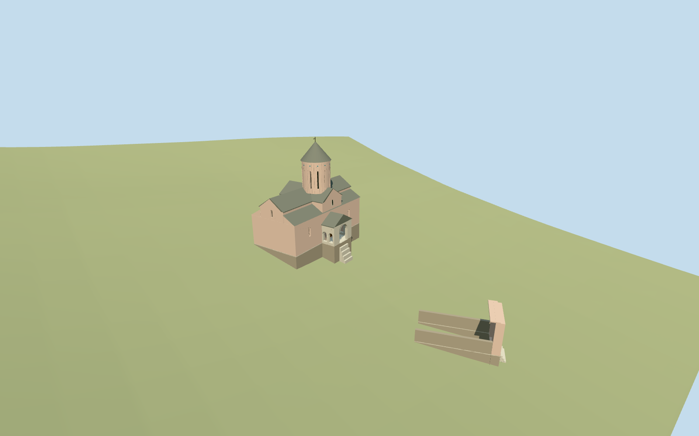

# N0555 — Timotesubani

Reviewed 2026-10-19 in one continuous author/build/inspect/fix round.

## Appearance

Inspected48 current source/shared/medium-fi/native/fallback views during this same construction pass. Specific pale brick cross-domed church with intersecting gables/lower aisle roofs, tall12-bay blind-arcaded slit drum, small original turquoise glazed diamonds, gray slab cone/cross and pale stone gabled porch with a true front passage/twin side arches. Separate mapped flat-topped pointed brick gateway with recessed wood leaves/low rear flanks. Construction renders caught reversed roof normals, absolute-vs-relative arch heights and an unwanted porch rear wall; corrected those, closed aisle ends and recessed east/west windows before final inspection. No copied fresco/inscription atlas or invented roofed belfry.

## Shared materials and browser levels

Six existing256-square graphs: brick_longformat, stone_limestone_raw, slate, wood_plain, tile_ceramic and metal_painted. Nine tinted roles reuse these graphs; each is read once in the full near-level view. Metric UVs/linear tints, zero embedded images and separate GPU streams. Master6110triangles/737056bytes. Four levels984/3632/6098/6110triangles,100292/342408/593156/594524bytes; initial442700bytes and at most six draws. CPU/GPU accounting matches and eviction frees model geometry.

| Level | Triangles | Bytes | Draws |
| --- | ---: | ---: | ---: |
| skyline | 984 | 100292 | 1 |
| district | 3632 | 342408 | 5 |
| street | 6098 | 593156 | 6 |
| closeup | 6110 | 594524 | 6 |

Inspected noon/late/economy/high context, silhouette, four levels/transitions and three detail views. Skyline keeps church/porch/gateway and open passages with merged distant porch-side openings; district restores twin arches, drum slits/arcades and recessed body/end windows, street adds slab seams/glazed accents/moldings, close-up adds simple original pier leaves. The flat shared fixture at anchor datum buries much of the gateway at floor-4.441977m and exposes church foundations at floor2.598045m; source/native/medium-fi terrain-bearing views show both complete. Native coarse hillside fit is approximate; synthetic neighbors are comparison context.

## Approximate map fit

Exact-QID OSMway296949746/Q1620674, named PMTileschurch35184669038578, dome part35185706781835 and gate35185475240414 fix measured positions/axes. Anchor43.51812575,41.8107202, heading0; main22.90x14.86m envelope has ENE long axis-.27563rad, independent12.90x5.93m gateway axis+.98280rad about37m south. Drum uses its own mapped center. Porch SSE/eastern-rear detail allocation remains picture-led with20degree facing uncertainty; copied camera geotags conflict with mapped layout and are not bearing evidence. Only three corresponding shells replaced with2cm tolerance/zero residual. All29 independent resident building records, original6m hillside/paths and native zero-water record set unchanged; loaded29/failure32 originals/disposal pass. Separate St Barbara/shop/cells remain independent. No broad monastery slab, ground/water cutout or terrain flattening.

## Limits

Accepted medium-fi standing church and gateway approximation from four ordinary2012/2014/2015/2023 photographs plus standard PMTiles/Mapzen. Same brief carried through building, inspection/fixes and selected acceptance; no separate research restart or bespoke survey. Eastern/rear articulation, heights, exact ornament/window inventory and gateway rear flanks are simplified picture/map estimates. Copied frescoes/fine sculpture, temporary scaffold/bell shelter, separate chapel/shop/cells and extended enclosure/landscaping are not claimed authored. Coarse6m terrain blurs the real terrace: occupied floors/variable exposed foundation depth and steep short approaches are visualization contact fits, not surveyed foundation sections or accessible staircase engineering. Physical phone/laptop/dense-city timings remain pending.

## Selected checks

Six Khronos files: zero errors/warnings.196 actual mesh/contact probes; 48 current inspected views. Scene validation/sim30 and strict selected medium-fi audit pass. Source and runtime hashes/material bindings/LOD caps verified.

Rebuild: node packages/worldgen/scripts/generate-additional-landmarks.mjs --ids=N0555; node packages/worldgen/scripts/import-next-1000-models.mjs --ids=N0555; node packages/tooling/scripts/generate-landmark-lods.mjs --ids=N0555 --force.

Source: sha256:056902ba32a945000ed2035787bade4be197a963f0a22379fdae0df880082fba

Runtime: sha256:b19cc2a87b792bc75128bc637d3264384d68a54e300a8bf80c745e0b3c2129b0

Input: sha256:076f4f10f00867b19bcaed1d26fd28d0a01d9e291e38ca8d328818a6e4774b0b

## Viewed ordinary pictures

https://commons.wikimedia.org/wiki/File:Timotesubani_church.jpg — Giorgi gugberidze; CC-BY-SA-4.0. Viewed only; no pixels copied.

https://commons.wikimedia.org/wiki/File:Timotesubani_monastery;_domed_church_and_gate.jpg — ILIA; CC-BY-SA-4.0. Viewed only; no pixels copied.

https://commons.wikimedia.org/wiki/File:Timotesubani_church,_Georgia_14.jpg — Kober; CC-BY-SA-4.0. Viewed only; no pixels copied.

https://commons.wikimedia.org/wiki/File:Timotesubani_church_31.jpg — Jonathan Cardy; CC-BY-SA-3.0. Viewed only; no pixels copied.
