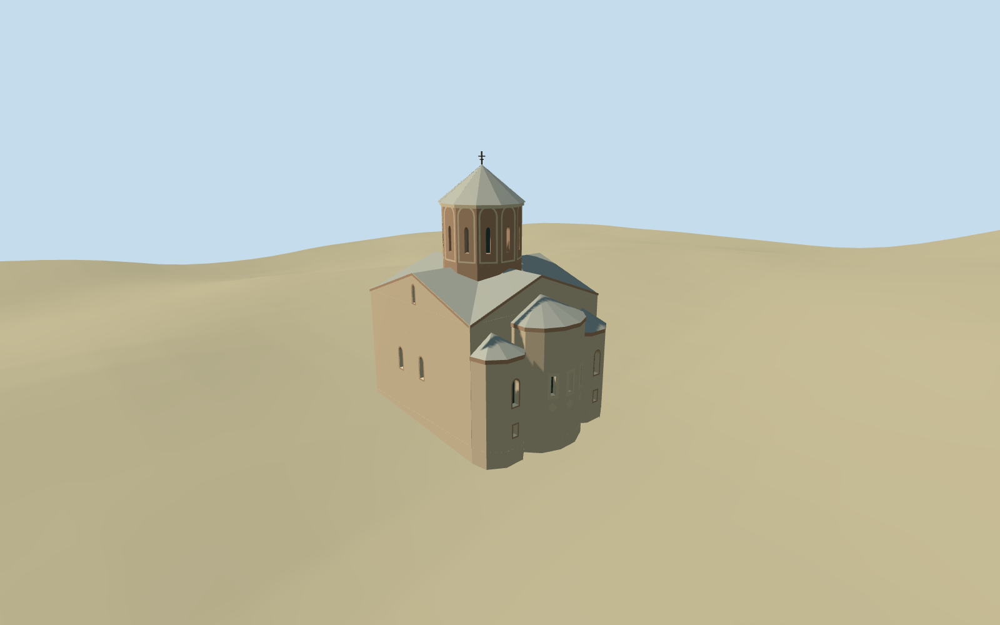

# Metekhi church

Specific standing Metekhi church: mapped stone body with intersecting gables, three projecting eastern apses and metal cap roofs, twelve-sided drum with narrow real window apertures/blind arched surrounds, grey conical standing-seam roof and metal cross. Projecting north porch has a gabled brick/stone front, real pointed side arches, two narrow front windows and a recessed timber church entrance. Shared ashlar/brick/metal textures, original simplified archivolts/lozenge relief and short local approaches. Natural cliff, terrace, river, monument and independent buildings remain host context. No full ritual interior or copied inscription/stone inventory.

## Evidence and reconstruction

Published dimensions and reconstructed details are separated in spec.json. Primary references:

- [Reference](https://commons.wikimedia.org/wiki/File:Metekhi_church_Tbilisi_eastern_facade.jpg)
- [Reference](https://commons.wikimedia.org/wiki/File:Metekhi_church_in_Tbilisi._View_from_the_south-west._December_2023.jpg)
- [Reference](https://commons.wikimedia.org/wiki/File:Metekhi_church,_view_from_the_north._Tbilisi,_Georgia._July_2023.jpg)

Deterministic specific Metekhi church geometry from seven matching parent/body/porch/apse/drum controls. Cross gables, three apses, real recessed apertures, twelve-sided arcaded drum, grey metal cone/cross and pointed north porch. Six existing shared256-square stone/brick/metal/wood graphs, metric UVs, linear tints and four browser levels; no embedded images or copied stone/text inventory.

## Model and axes

7,865 triangles; 23,595 vertices; 7 material groups; 948,144 bytes. Native bounds: -11.117, -1.318, -11.180 to 9.986, 25.390, 11.217. Source hash: `sha256:d654d3d89c90cc1257c5e359dd2c75f4713af188c54f28245b0ece299670aea0`.

{"x":"east","y":"up","z":"south"}

The geographic proposal uses exact-QID OpenStreetMap evidence. Map-derived orientation and estimated architectural details require real-site visual review; preview eligibility is distinct from geographic/fidelity approval. Map attribution: © OpenStreetMap contributors, ODbL-1.0.

## Reproduce

Run `node packages/worldgen/scripts/generate-additional-landmarks.mjs --ids=N0540` (or add `--check`). The generator preserves manually edited masters by checking their baseline hashes. Import through the standard authored-model workflow with optimization disabled; then capture all QA cameras, including shared-surface views.

## Pending work

- Specific standing Metekhi church: mapped stone body with intersecting gables, three projecting eastern apses and metal cap roofs, twelve-sided drum with narrow real window apertures/blind arched surrounds, grey conical standing-seam roof and metal cross. Projecting north porch has a gabled brick/stone front, real pointed side arches, two narrow front windows and a recessed timber church entrance. Shared ashlar/brick/metal textures, original simplified archivolts/lozenge relief and short local approaches. Natural cliff, terrace, river, monument and independent buildings remain host context. No full ritual interior or copied inscription/stone inventory.
- Exact-QID Q20577625/way1064270003 and named standard PMTiles building/POI35185436358835 identify the whole church. Six subordinate mapped building parts identify main body35184412940804, north porch35185436358834, three apses35185579262555..557 and drum35185579262558. Anchor44.811256736,41.690155211; heading0, internal local+x angle-1.484066758501rad (approximately north), local+z approximately east toward the apses. Roof/gable splits, door/window positions and hidden details are ordinary-picture/map-led allocations inside these envelopes.
- Retained catalog scale about24.5m above local church floor,20m long/16m core width, checked against ordinary pictures and mapped body/porch/apse/drum envelopes. Main wall about11m, cross-gable ridges14m, drum14.4..19.8m, conical metal cap19.8..23.3m and cross24.5m. Central apse about10.3m wall, flanks8.3m with low cap roofs; north porch5m eaves/7.4m gable. Catalog heights and map-part heights are approximate visualization cues, not surveyed construction dimensions; window/arch stations, patching, hidden facades and exact masonry courses are approximate.
- Retain original standard6m Mapzen urban/cliff terrain, water and every independent building. A small local level church plinth has constant grade-buried bottom edges sampled along the actual parent envelope; short porch approaches connect toward native grade. No broad cliff/terrace slab, flattening or ground/water cutout. Coarse DEM does not resolve cliff face, exact paved terrace, stairs or threshold levels; these remain approximate host context.
- Roof/gable/apse heights, window stations, blind drum arcade, northern side-arch geometry, opposite porch side, archivolts, masonry patching and exact thresholds are ordinary-picture/map approximations. No full ritual interior or copied inscription/stone inventory. Natural river cliff, terrace, monument, water and independent buildings remain host context.

This bundle follows the medium-fi standard. Medium-fi appearance and geographic fit are reviewed separately. Hash-bound visual acceptance is recorded separately after capture inspection.

## Additional geographic data

©OpenStreetMap contributors; Protomaps; Mapzen/USGS terrain.
