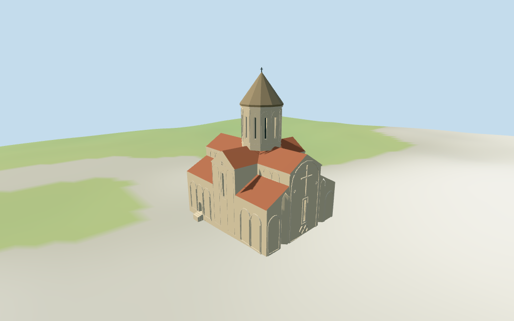

# Samtavisi Cathedral

Individual Samtavisi Cathedral main church:cream/tan rectangular stone body with red-tile central nave/cross gables and lower lean-to roofs,tall12-sided narrow-window drum,brown-gray conical roof/cross. Decorated east facade has two actual deep pointed V-section recesses,large geometric cross/slit field,round blind arcades,rosettes and paired diamond relief. Southern transverse gable carries high slit/round relief,with blind lower bays and a recessed small western-side door. Shared256-square masonry/limestone/tile/standing-seam metal/wood graphs,four browser levels,metric UVs/linear tints/flat normals. Separate compound bell tower/ruins excluded;fine carvings,interiors/engineering,hidden rear details and exact ground join simplified or unverified.

## Evidence and reconstruction

Published dimensions and reconstructed details are separated in spec.json. Primary references:

- [Reference](https://commons.wikimedia.org/wiki/File:Samtavisi_Cathedral.jpg)
- [Reference](https://commons.wikimedia.org/wiki/File:Exterior_view_of_Samtavisi_Cathedral.jpg)
- [Reference](https://commons.wikimedia.org/wiki/File:Samtavisi_Cathedral,_panoramic_view_from_the_east._Georgia.jpg)

Five existing cached256-square ashlar,limestone,flat tile,standing-seam metal and plain wood graphs.Linear tints,metric UVs,flat normals.Seven groups with local geometric glass/cross PBR.No embedded images,unique facade maps,baked shadows or reflections.

## Model and axes

8,326 triangles; 24,978 vertices; 7 material groups; 1,003,204 bytes. Native bounds: -14.815, -1.041, -9.966 to 13.627, 32.000, 11.197. Source hash: `sha256:8ef14b8a816db477e8f32109a906573f4709592a5dadac45e8793c249effcb5e`.

{"x":"east toward decorated cross facade","y":"up","z":"south toward narrow transverse gable and western-side door"}

Standard viewer DEM datum686.884168m;estimated floor0.6m,raw main perimeter-0.66..1.63m. Footings crossY=0 and extend below raw samples. No preview flattening or host DEM change. Exact churchyard/door/street contact,base clipping,absolute altitude and walking remain unverified. Separate bell tower,ruins,enclosure,archaeological trenches,nearby buildings and roads remain host content;no road replacement.

## Reproduce

Run `node packages/worldgen/scripts/generate-additional-landmarks.mjs --ids=samtavisi_cathedral` (or add `--check`). The generator preserves manually edited masters by checking their baseline hashes. Import through the standard authored-model workflow with optimization disabled; then capture all QA cameras, including shared-surface views.

## Pending work

- Retained exact-QID way/161568098/Q1269808 matches current whole35184533656930 by location and rigid rectangular envelope. All4 current vertices/raw tags and earlier5 distinct vertices/multilingual exact identity retained;no map heights,min_height,component controls or Wikidata height/width/length values. Retained heading0.194449913877rad signs+X toward decorated east facade,+Z south. No scale adjustment. Whole about26.75x19.45m supplies outer body;central nave width8.8m,transverse arm x[-2.4,5.1],12-sided drum center[1.35,0]/radius4.05m,roof partitions and all vertical levels are picture estimates. Estimated lower wall8.8m/inner lean roof11.6m,upper nave/cross wall13.8m/gable16.5m,drum15.8..24.3m,cone30.5m/cross31.4m above0.6m floor. Eastern pointed niches,large geometric cross/rosettes,blind arcade rhythm,doors and window positions are approximate. Fine carved inscriptions/figurative details and engineering accuracy not claimed.
- Standard viewer DEM datum686.884168m;estimated floor0.6m,raw main perimeter-0.66..1.63m. Footings crossY=0 and extend below raw samples. No preview flattening or host DEM change. Exact churchyard/door/street contact,base clipping,absolute altitude and walking remain unverified. Separate bell tower,ruins,enclosure,archaeological trenches,nearby buildings and roads remain host content;no road replacement.
- Medium-fi exterior from inspected2010/2019 photographs and2024 distant east context plus standard viewer PMTiles/DEM only.2019 red tile controls lower roof finish over older gray roofs;current finish remains approximate. Separate bell tower,ruins and compound walls remain host content. Fine sculpted interlace/inscriptions/figures,full interiors and exact engineering/thresholds excluded or simplified. Physical phone/laptop measurements pending.
- Skyline retains whole body,cross gables,cone and genuine eastern V niches. District adds shared materials,drum slits,door/window recesses,principal eastern cross/blind arches and small landings. Street adds side blind arcades and drum ribs. Closeup/master refine nested shallow stone ribs/rosettes. Synthetic cottages and generic detail crops are QA fixtures.

This bundle follows the medium-fi standard. Medium-fi appearance and geographic fit are reviewed separately. Hash-bound visual acceptance is recorded separately after capture inspection.

## Additional geographic data

©OpenStreetMap contributors;Protomaps;Mapzen/USGS terrain tiles.
