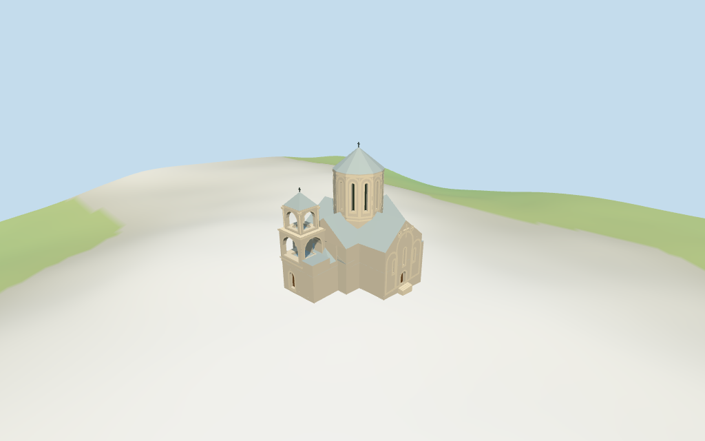

# Nikortsminda Cathedral

Individual Nikortsminda Cathedral: compact gray-tan stone church with cross-gabled silver metal roofs, tall12-sided narrow-slit drum/conical roof/cross, shallow round blind arcades with selected geometric crosses/rosettes and nested stone portal surrounds. Approximate western three-storey campanile with lower closed arched fields, open middle/narrower upper belfries, gray hipped roof/cross; lower porch and map-envelope ranges complete the body. Four existing shared ashlar/limestone/standing-seam metal/wood graphs, linear tints, metric UVs, flat architectural normals and four browser levels. Fine figurative carving/inscriptions/interlace, frescoes/full interiors/bells, hidden rear window/roof joins, exact tower separation and surveyed court/thresholds remain approximate or excluded.

## Evidence and reconstruction

Published dimensions and reconstructed details are separated in spec.json. Primary references:

- [Reference](https://commons.wikimedia.org/wiki/File:Nikortsminda_(1).jpg)
- [Reference](https://commons.wikimedia.org/wiki/File:Nikortsminda.jpg)
- [Reference](https://commons.wikimedia.org/wiki/File:%E1%83%9C%E1%83%98%E1%83%99%E1%83%9D%E1%83%A0%E1%83%AC%E1%83%9B%E1%83%98%E1%83%9C%E1%83%93%E1%83%90_Nikortsminda_Bell_tower.jpg)

Four existing cached256-square ashlar, limestone, standing-seam metal and plain wood graphs. Linear gray/tan stone/silver metal tints, metric UVs and flat architectural normals. Glass and metal crosses use geometric PBR colors. No embedded images, unique facade maps or baked shadows.

## Model and axes

7,265 triangles; 21,795 vertices; 6 material groups; 875,448 bytes. Native bounds: -12.252, -1.729, -10.276 to 12.427, 26.400, 11.435. Source hash: `sha256:7c27fe0d6de847c5f0536cfb2c59321f016bfc5e51bab2443327c548cd6f648f`.

{"x":"east from approximate western campanile/porch toward wider church body","y":"up","z":"south toward projecting lower porch/cross arm"}

Standard viewer DEM datum 1221.879417m; display floor0.6m, whole perimeter terrain -1.38..0.37m. Footings extend below coarse terrain; doorway thresholds0.3m above model floor with short local steps. Exact churchyard grading, west tower/porch joins, absolute altitude and walking remain unverified. No global flattening or road replacement.

## Reproduce

Run `node packages/worldgen/scripts/generate-additional-landmarks.mjs --ids=N0377` (or add `--check`). The generator preserves manually edited masters by checking their baseline hashes. Import through the standard authored-model workflow with optimization disabled; then capture all QA cameras, including shared-surface views.

## Pending work

- Retained exact-QID OSM way712271284/Q1802388 matches current main35185084360116. All18 current raw whole-outline vertices/tags and two tile fragments reproduce by rigid rotation without rescale. Height/min_height and separate component controls are absent. Western projection is interpreted as bell tower/porch zone; wider eastern/southward church body carries the drum. Campanile separation/connection is not independently mapped and its internal partition is approximate within about3m. Church roof/porch partitions and12-sided drum center[2.5,-0.8]m/radius4.7m are picture estimates. Estimated levels: base5m, main walls9m/cross gables13.4m, porch walls6m/roof8.4m, low ranges6.5m/roof7.2m, drum12..21m/conical metal roof24.8m/cross25.8m. Bell tower lower6m, open middle6.5..11.5m, narrower upper12..16m/metal roof18.4m/cross19.2m. All vertical dimensions, fenestration, shallow geometric blind arcades/carved crosses/rosettes and porch/portal details are approximate. No surveyed height or engineering accuracy claimed.
- Standard viewer DEM datum 1221.879417m; display floor0.6m, whole perimeter terrain -1.38..0.37m. Footings extend below coarse terrain; doorway thresholds0.3m above model floor with short local steps. Exact churchyard grading, west tower/porch joins, absolute altitude and walking remain unverified. No global flattening or road replacement.
- Medium-fi exterior from three inspected2007 church/drum/campanile pictures and current standard viewer PMTiles/DEM only. Old reference date and exact current roof finish remain limitations. Campanile internal partition/connection is approximate within about3m, with no independent mapped footprint; nearby unverified buildings are preserved. Fine figurative carving/interlace/inscriptions, frescoes/full interior/bells, hidden rear windows/roof joins and surveyed court/thresholds remain approximate or excluded. Physical laptop/phone timing pending.
- Skyline keeps complete mapped massing, silver cross gables, polygonal high drum/cone and western campanile. District adds shared textures, flat slits and real open bell tiers. Street adds wall/drum recesses, selected blind arcades/relief crosses/rosettes and bell columns. Closeup/master refine nested stone bands and simple cornice rhythms. Synthetic cottages are review fixtures.

This bundle follows the medium-fi standard. Medium-fi appearance and geographic fit are reviewed separately. Hash-bound visual acceptance is recorded separately after capture inspection.

## Additional geographic data

©OpenStreetMap contributors; Protomaps; Mapzen/USGS terrain tiles.
