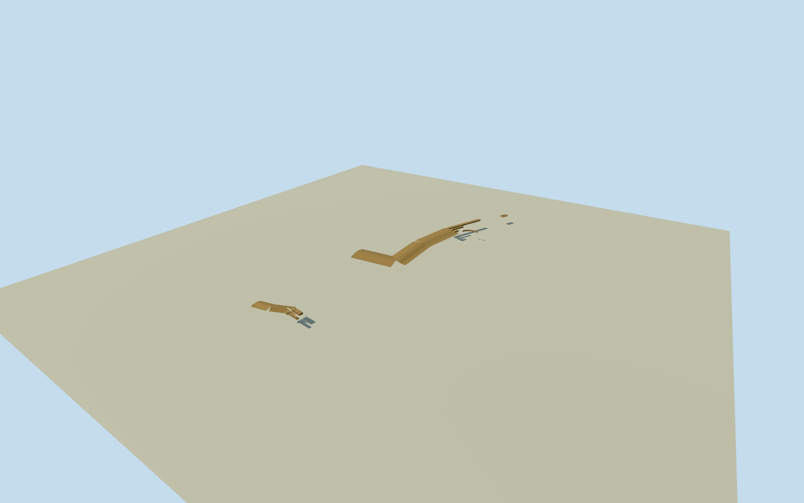

# Ancient Marib Dam, Yemen (1843 remains)

Complete ancient MaribDam remains in the1843Arnaudsurvey phase: both northern and southern sluice assemblies and their stone retaining moles, three north/two south rounded gate abutments, exposed sluice channels, remnant masonry/earthfill bank arms with the great central breach left open, intrinsic northern curved revetment and separate ancient distribution basin. Primary pace/unit dimensions and drawing topology are approximate; hidden heights/sections and individual ruin profiles estimated. Exclude modern1986dam/upstreamreservoir, natural Balaqmountains/wadi/rockcliffs, distant city/temples/inscriptions as lettering and archaeological elements outside this dam system. This is a ruined historical structure, not a hypothetical restored intact ancient dam.

Authoring state: **review-in-qa.json**. Current completion evidence is in [qa.json](qa.json) and the [local 100 ledger](../../../../qualla-structures/batches/PROGRESS.md).

- [Marib Dam](https://qualla.com/marib-dam/)

Complete ancient MaribDam remains in the1843Arnaudsurvey phase: both northern and southern sluice assemblies and their stone retaining moles, three north/two south rounded gate abutments, exposed sluice channels, remnant masonry/earthfill bank arms with the great central breach left open, intrinsic northern curved revetment and separate ancient distribution basin. Primary pace/unit dimensions and drawing topology are approximate; hidden heights/sections and individual ruin profiles estimated. Exclude modern1986dam/upstreamreservoir, natural Balaqmountains/wadi/rockcliffs, distant city/temples/inscriptions as lettering and archaeological elements outside this dam system. This is a ruined historical structure, not a hypothetical restored intact ancient dam.

Independent2048m129x129originalfield/16641heights/two rawTerrariumzoom14tiles/frame/datum1125.8859m acquired before north/south/basin floors and main masonry/earthbank sections. Original16mgrid and9.2115moutputpixels are not native survey accuracy or1843grade. Component floors fixed from original point samples+.5m; earthbank controls follow original independent field once, before geometry. Never flatten/reacquire/reframe/move floors or main sections for rendering.

Arnaud warns topographic distances and dimensions on paper are not proportionate. Whole site identities bound overall registration; individual extents/heights/ruin profiles explicitly estimated.

Exact archaeological survey not required, but both sluices/retainingmoles/remnantbankarms/openbreach retained as whole physical scope.

2012publishedphoto does not establish identical1843individualblocks or currentpost2015state.

Original independent modern relief is not1843grade; never flatten/reframe/move floors or main sections to improve render.

Original unit note resolves travellerpace≈.86624m andempan≈.21656m; source topographic distances explicitly not proportional. ±150m geographic control/±35degree individual component bearings/±35percent hidden extents and masses. Native north/south identities retain their779.2mspacing; original600paceannotation is not forced to agree.

Whole1843ruined dam phase, no restored continuous wall, water/gates/buildingroof/modernupstreamdam. Exact individual block-loss pattern and hidden foundation extents estimated.

Masonry bank/sluice returns remain open; stone course treatment authored from primary block character, no copied letter inscriptions.

Pregeometry source-map coarse outlines remain unchanged; actual narrow physical openings will come from final mesh footprints, not a broad terrain pad.

Build: `node content/worldgen/source/places/t4/t48/marib_dam/models/generate-marib.mjs`. Add `--check` to verify exact regeneration. 19347 triangles; 2 materials; no embedded photographs.
