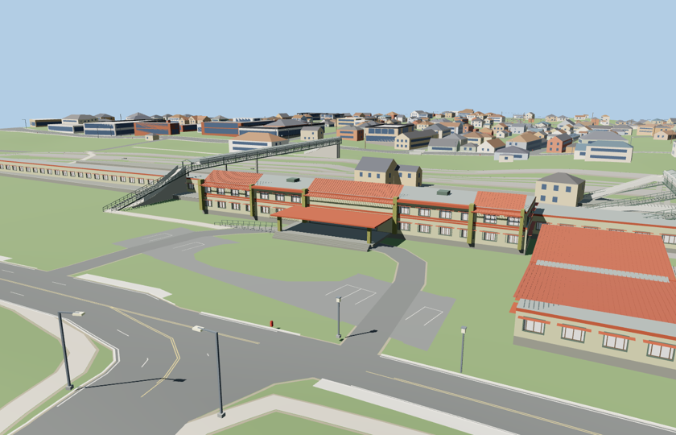

# Kollam Junction railway station

Reviewed 2026-11-18 for the Earth viewing date 2017-01-08.

The historical exterior includes the main terminal, attached annex, northern service building, open southern shed, platform canopy, three full platforms and both western footbridges. The shared surfaces give the walls, roofs, glazing, paving and handrails distinct material treatments. The dated renderer places Kollam Junction on the shared 16.72 m forecourt datum, with +X along the tracks to ENE and +Z toward the SSE entrance. Three platforms sit 1.1 m above grade, the entrance ramp and bridge approaches meet the sloped shoulders, and the open shed clears its three rail lines. It replaces six mapped fragments only when the model is available, retaining all other mapped buildings and transportation. The undated and out-of-range scenes preserve the original terrain and map-derived station.

The 2017-01-08 photograph documents the frontage. The retained October 2026 PMTiles plan fixes the older geometry and orientation. Dates of individual mapped features, unseen facades, roof heights and exact platform and bridge dimensions are approximate. Redevelopment geometry remains unverified.

The detailed source and four browser LODs validate without glTF warnings. The skyline and district tiers total 399,136 bytes. Seven standard materials are shared across models.

Rebuild with `node packages/worldgen/scripts/generate-kollam-station.mjs`. Use `--check` for exact source bytes and `--ids=kollam_junction_railway_station` for targeted import and LOD generation.
