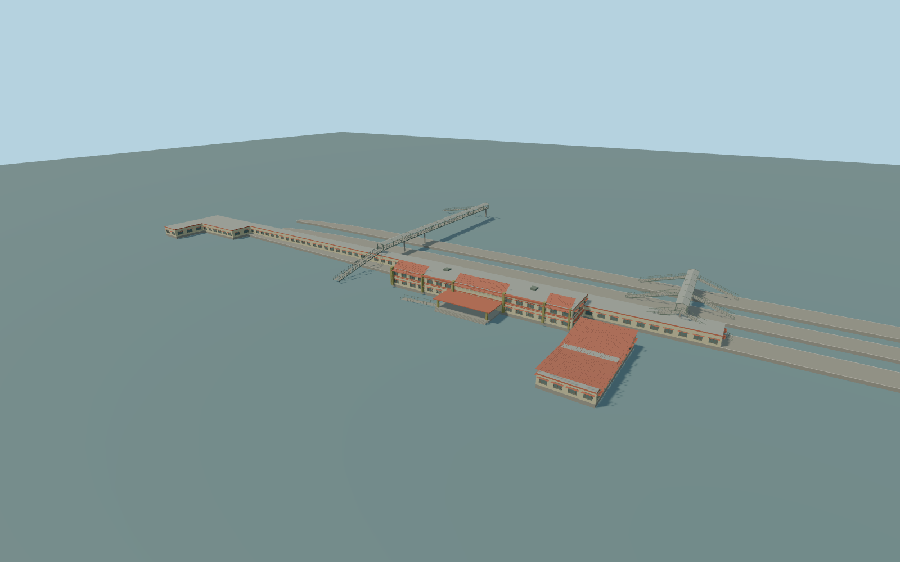

# Kollam Junction railway station (legacy map state)

Individual Kollam Junction legacy/map-state exterior: complete mapped main terminal and attached south annex, whole southern long railway hall and mapped platform canopy, small northern service building, all three whole mapped passenger platform polygons, and the two western mapped pedestrian footbridges with their mapped access stairs. Preserve independent railway properties, the eastern public crossing and the street/rail network. This is an explicitly dated legacy interpretation, not a claim that the ongoing 2026 redevelopment is finished or that the whole older terminal still survives. No speculative future terminal, construction-stage bridge, copied lettering, railway emblems, advertising, people, trains or private textures.

Rebuild: `node packages/worldgen/scripts/generate-kollam-station.mjs`;append `--check` for exact source bytes. Select import/LOD/placement with `--ids=kollam_junction_railway_station`. Detailed source and four browser tiers are separate ignored GLB outputs.

Individual Kollam Junction legacy/map-state exterior: complete mapped main terminal and attached south annex, whole southern long railway hall and mapped platform canopy, small northern service building, all three whole mapped passenger platform polygons, and the two western mapped pedestrian footbridges with their mapped access stairs. Preserve independent railway properties, the eastern public crossing and the street/rail network. This is an explicitly dated legacy interpretation, not a claim that the ongoing 2026 redevelopment is finished or that the whole older terminal still survives. No speculative future terminal, construction-stage bridge, copied lettering, railway emblems, advertising, people, trains or private textures.

Exact retained identity way/269160473 with Q12421499 supplies the mapped main terminal frame. Signed +X ENE follows the station tracks; +Z SSE faces the legacy main entrance. A January 2017 ordinary frontage photograph supplies cream walls, orange/red tile roof panels and awnings, olive pilasters, brown recessed windows and the projecting entrance porch. Current standard 20261031 PMTiles retains the older building plan. A July 2026 ordinary construction photo establishes unfinished bridge redevelopment but does not establish old-terminal demolition extent or the future completed building. Current-epoch verification remains pending; the construction photo is not blended into the legacy model. Only the small northern service building has native height5m. All other roof heights, unseen facades, platform/threshold grades and bridge sections are explicit medium-fi estimates. The long southern layer1 footprint crosses rail tracks; it is an open railway shed, not a solid hall or occupied ground mask. Source terminal/platform floor +1.1m above the unchanged standard forecourt datum [40,28] (16.715573555555558m absolute). Shared station grade, 8.1m main eaves/10.3m tile ridge,5.2m west wing,4.6m annex,6.4m shed/6m platform canopy and7.1m pedestrian deck/10.1m roof ridge are picture/map-scale estimates. Keep the native5m service height as a fact.

Dated January2017 entrance and retained20261031 map geometry. July2026 picture establishes ongoing redevelopment; actual demolition extent, present construction completion, hidden facades and exact threshold/platform/bridge levels remain unverified. Do not treat this legacy exterior as verified current2026 geometry. No imagined future terminal or construction-bridge completion. The long southern layer1 rail shed is open, without floor or terrain mask. Independent railway properties, eastern public crossing, roads, rails and water remain separate. Physical-device/dense-city timing and numerical LOD error remain unmeasured.

Seven existing shared256px graphs: plaster_lime, concrete_plain, tile_flat, metal_corrugated, metal_painted, wood_plain and window_grid. Seven merged near groups and one far palette group, metric UVs and linear colours. No private or embedded images. Cream/olive/red wall trims use plaster; the orange tiled awnings use tile_flat; corrugated platform/bridge roofs, concrete, painted metal, wooden window frames and actual glazing have proper slots. All four tiers preserve the full irregular terminal footprint, raised entrance frontage and tile/fascia rhythm, porch, whole annex, open southern shed, platform canopy/service building, three complete platform polygons and two mapped footbridges with stairs. Near tiers add recesses, louvres, pilasters, roof detail, rails, steps, columns and braces.

Original geometry:repository license. Map:© OpenStreetMap contributors,ODbL-1.0;Protomaps. Standard terrain:terrain-grid.json. Ordinary pictures stay local and are not redistributed or used as textures. Current acceptance:qa.json.
