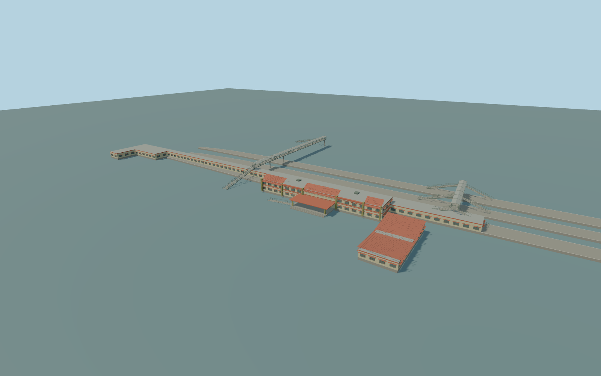

# Kollam Junction railway station (legacy map state)

Individual Kollam Junction legacy/map-state exterior: complete mapped main terminal and attached south annex, whole southern long railway hall and mapped platform canopy, small northern service building, all three whole mapped passenger platform polygons, and the two western mapped pedestrian footbridges with their mapped access stairs. Preserve independent railway properties, the eastern public crossing and the street/rail network. This is an explicitly dated legacy interpretation, not a claim that the ongoing 2026 redevelopment is finished or that the whole older terminal still survives. No speculative future terminal, construction-stage bridge, copied lettering, railway emblems, advertising, people, trains or private textures.

Rebuild: `node packages/worldgen/scripts/generate-kollam-station.mjs`;append `--check` for exact source bytes. Select import/LOD/placement with `--ids=kollam_junction_railway_station`. Detailed source and four browser tiers are separate ignored GLB outputs.

The legacy frontage represents the 2017-01-08 photograph. The retained 20261031 PMTiles station plan controls the footprint, track direction and roof spans. Exact dates of the other mapped features are uncertain.

Roof heights, unseen facades and platform and bridge sections are medium-fi estimates. The native map gives the northern service building a 5 m height.

The present-day view continues to use map-derived station geometry while the redevelopment is in progress.

Original geometry:repository license. Map:© OpenStreetMap contributors,ODbL-1.0;Protomaps. Standard terrain:terrain-grid.json. Ordinary pictures stay local and are not redistributed or used as textures. Current acceptance:qa.json.
