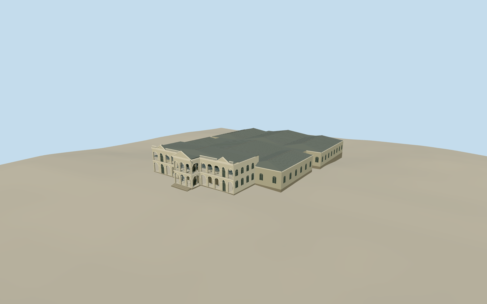

# Colombo National Museum

The Colombo National Museum has a white Italianate façade with two arcaded levels, a projected central portico, pediments and low linked exhibit wings.

Authoring state: **review-in-qa.json**. Current completion evidence is in [qa.json](qa.json) and the [completion ledger](../../../../qualla-structures/batches/qualla-003.PROGRESS.md).

- [Colombo National Museum](https://qualla.com/colombo-national-museum/)

The old image establishes the surviving front section. The roof divisions, rear and side elevations, smaller ornamental features and gallery heights are approximate.

The Natural History Museum, freestanding grounds monuments and museum interiors are outside the main-building scope.

Build: `node content/worldgen/source/places/tc/tc0/colombo_national_museum/models/generate-colombo-national-museum.mjs`. Add `--check` to verify exact regeneration. 14356 triangles; 6 materials; no embedded photographs.
