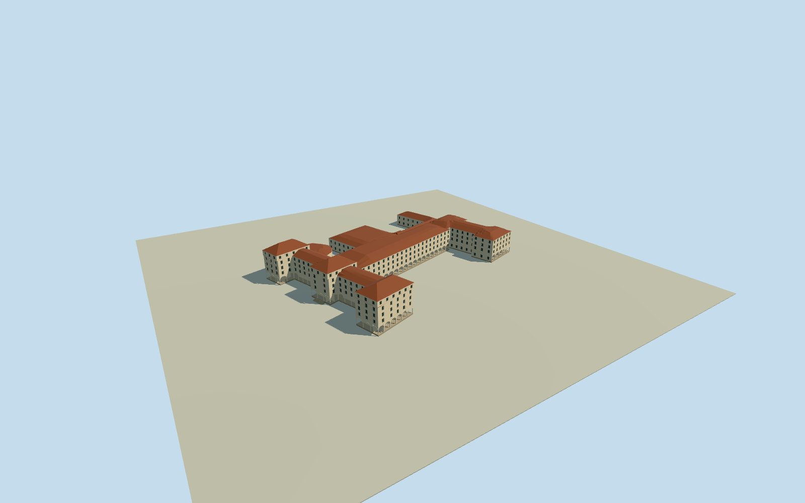

# Galle Face Hotel, Colombo (2022)

Whole Galle Face Hotel in approximate2022 restored form: complete native north heritage block/three projecting hipped pavilions and intrinsic octagonal Jubilee volume, long central connecting room/veranda wing, south Regency room block, attached low GrandBallroom/meeting/service range and link canopy. Actual four connected building outlines plus canopy, not the whole hotel property parcel. Historic1908 northfront supplies architectural type/details; primary owner restoration/history/venue text supports complete present complex, hidden roofs/heights/partitions/census/grade are estimates. Exclude detached shore bars/pool/gardens/event structures and neighboring residences/oldchancery/church.

Authoring state: **review-in-qa.json**. Current completion evidence is in [qa.json](qa.json) and the [completion ledger](../../../../qualla-structures/batches/qualla-002.PROGRESS.md).

- [Galle Face Hotel](https://qualla.com/galle-face-hotel/)

Whole Galle Face Hotel in approximate2022 restored form: complete native north heritage block/three projecting hipped pavilions and intrinsic octagonal Jubilee volume, long central connecting room/veranda wing, south Regency room block, attached low GrandBallroom/meeting/service range and link canopy. Actual four connected building outlines plus canopy, not the whole hotel property parcel. Historic1908 northfront supplies architectural type/details; primary owner restoration/history/venue text supports complete present complex, hidden roofs/heights/partitions/census/grade are estimates. Exclude detached shore bars/pool/gardens/event structures and neighboring residences/oldchancery/church.

Exact native1908book northfront photo is the only imagery, explicit US expired publication grant; individual plate photographer unassigned, current physical sections not falsely asserted photographed.

Native hotel property1430312630 establishes named ownership scope, not an extrudable building. Four connected building outlines/canopy control complete physical model. Separate1074017046 lies south outside the property and is excluded along with oldUSchancery/neighboringchurch/detachedshorebars/pool/landscape.

Choose complete source frame/independent original field before all floor/roof/main sections; preserve afterward. Hidden current roofs/partitions/heights/finish/census/registration/grade estimates allowed; no exact survey/full-current-photo gate.

Current approximate2022 whole complex uses actual4connected native polygons and linkcanopy, all67outercontrols; no propertyparcel/neighbor1074017046/oldchancery/church/detachedshorebar/pool/landscape proxy. The internal northmain/lowpolygonalhall split is a section estimate; exact namedJubilee/Grand room association within the low volumes is not surveyed.

1908 northfront plate70 establishes three projecting hip-roof pavilions, linking veranda facades and ground arcade. Owner describes successive north/central/south construction and2006/2015restoration. Current roof/clerestory/subdivision continuity from that reference is approximate; no claim all current sides were photographed.

All eaves/ridges/floor grades/roof pitches/pavilion extents, hidden courtyards and roofs, room/window/arcade/stair census, mouldings and finishcolour are estimates. Monochrome book is not calibrated colour; warm lime plaster/muted clay-red roof/dark timber/glazing chosen as an explicit medium-fi finish approximation.

Lower current hall and service wings follow native full footprint. All roofs use actual concave contours with clipped hip/valley geometry; three northfront tall hip roofs distinct. Upper windows closed/recessed glazing, ground arcade has true openings and deep inner wall; no facade photographs/interior props/art/logos/people.

Original independent coastal field absolute-1.9879..26.2187m at7.1865m west-lawn datum preserved. Coarse DEM/neighbor canopy/building artifacts can occlude lowstructure; no surveyed foundation or certified ground-contact/current2026 claim.

Four authored LODs retain whole building outlines/lowvolume/three highpavilions/linkcanopy and keyfrontentry, with fewer window/arch segments and roof subdivisions at distance. Source runtime and meaningful representative frontface probes/strictmediumfi/current visual review required.

Build: `node content/worldgen/source/places/tc/tc0/galle_face_hotel/models/generate-house.mjs`. Add `--check` to verify exact regeneration. 30088 triangles; 5 materials; no embedded photographs.
