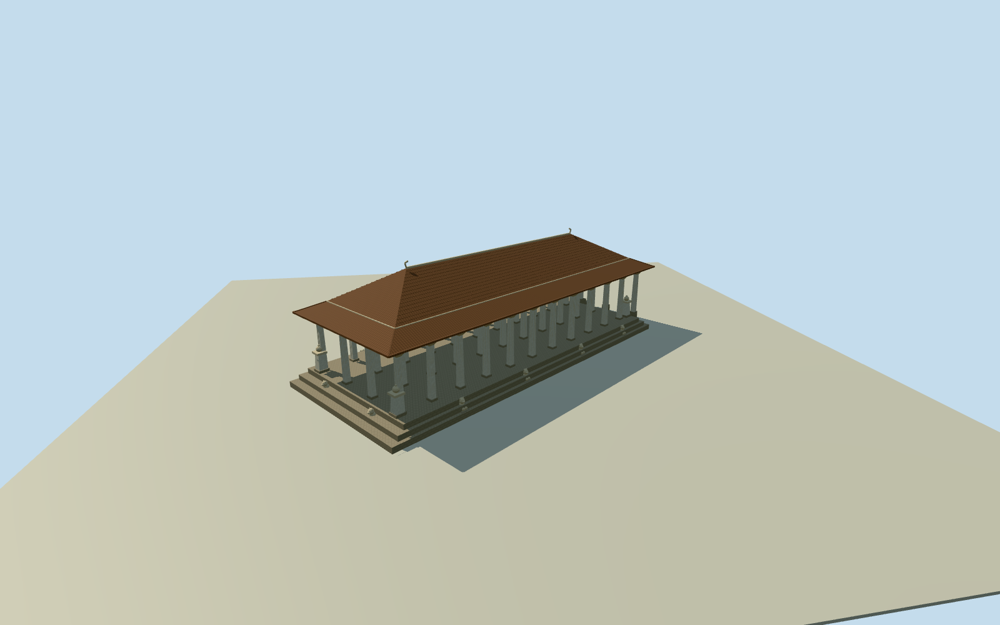

# Independence Memorial Hall — Colombo

Whole Independence Memorial Hall in Colombo: original12-control building/base envelope, complete basement/podium exterior and three-tier terrace/stairs, open-sided long rectangular concrete pavilion,48reported pillars with abstracted pekada capitals, four corner towers/pots,28frieze panels, complete two-pitched Kandyan hipped roof and symbolic seated lion motifs along allfour sides. Official tourist authority confirms Audience Hall inspiration/ornate columns/lions; the principal architect’s1953construction account is transmitted by a labeled2018report, not an original1953page-byte claim. Native plan controls horizontal scope. Vertical heights, column spacing/corner-tower distribution, roof pitches/breaks/overhang, terrace divisions, symbolic lion census, fine carvings and finish are estimates. Exact pictorial art, inscriptions and portrait sculpture not copied. Freestanding Senanayake statue, flagpoles, fountains, park and nearby shopping arcade are separate structures excluded. No imagery adopted or photographic fidelity claimed.

Authoring state: **review-in-qa.json**. Current completion evidence is in [qa.json](qa.json) and the [completion ledger](../../../../qualla-structures/batches/qualla-002.PROGRESS.md).

- [Independence Memorial Hall](https://qualla.com/independence-memorial-hall/)

Whole Independence Memorial Hall in Colombo: original12-control building/base envelope, complete basement/podium exterior and three-tier terrace/stairs, open-sided long rectangular concrete pavilion,48reported pillars with abstracted pekada capitals, four corner towers/pots,28frieze panels, complete two-pitched Kandyan hipped roof and symbolic seated lion motifs along allfour sides. Official tourist authority confirms Audience Hall inspiration/ornate columns/lions; the principal architect’s1953construction account is transmitted by a labeled2018report, not an original1953page-byte claim. Native plan controls horizontal scope. Vertical heights, column spacing/corner-tower distribution, roof pitches/breaks/overhang, terrace divisions, symbolic lion census, fine carvings and finish are estimates. Exact pictorial art, inscriptions and portrait sculpture not copied. Freestanding Senanayake statue, flagpoles, fountains, park and nearby shopping arcade are separate structures excluded. No imagery adopted or photographic fidelity claimed.

Primary designer construction account is explicitly transmitted through Randima Attygalle’s2018report identifying CEYLON Today September1953, not an original retrieved1953page. Official tourism independently confirms Magul Maduwa inspiration, decorated pillars and surrounding lions.48pillars/fourcorner towers/28panels/three tiers follow the documented designer description, not a certified contemporary object census.

Original12native outline controls fixed in geographic axes. Long/short pavilion basis derives from native edges. Native ring interpreted as outer podium/terrace envelope; exact foundation versus roof-edge role is not surveyed. Floor2.1m, column/roof heights, grid spacing, overhang/pitches and terrace divisions are explicit reconstruction estimates, not primary measured heights.

Complete hall/podium/basement exterior, open48pillar pavilion, fourcorner tower/urn forms,28frieze panels, two-pitched hipped Kandyan roof and twelve symbolic seated lion motifs along four sides retained. Exact carved folklore images, inscriptions, individual lion sculpture/census, decorative ridge outline and portrait sculpture are not copied; abstract original motifs only. Museum interior, free-standing Senanayake portrait monument, flagpoles, fountains, park and nearby shopping arcade excluded as separate structures.

Concrete construction includes the roof and reeper system; no timber structural material is claimed. Offwhite quartz-like concrete, roof pigment/tile appearance, relief pattern and age are procedural visualization estimates. No photographs/figures/drawings used; uncertain historical image grants remain untouched and unused. No photographic fidelity or exact2018condition claim.

Original independent128m/16641height terrain acquired before floor/main sections. Provider/coarse-DEM ground contact approximate. Original field/frame/floors/main parameters are preserved during geometry/render review, with no masks/flattening/cutouts/re-acquisition or visual refit. Dated2018preview, no automatic current-world replacement.

Build: `node content/worldgen/source/places/tc/tc0/independence_memorial_hall/models/generate-house.mjs`. Add `--check` to verify exact regeneration. 25232 triangles; 4 materials; no embedded photographs.
