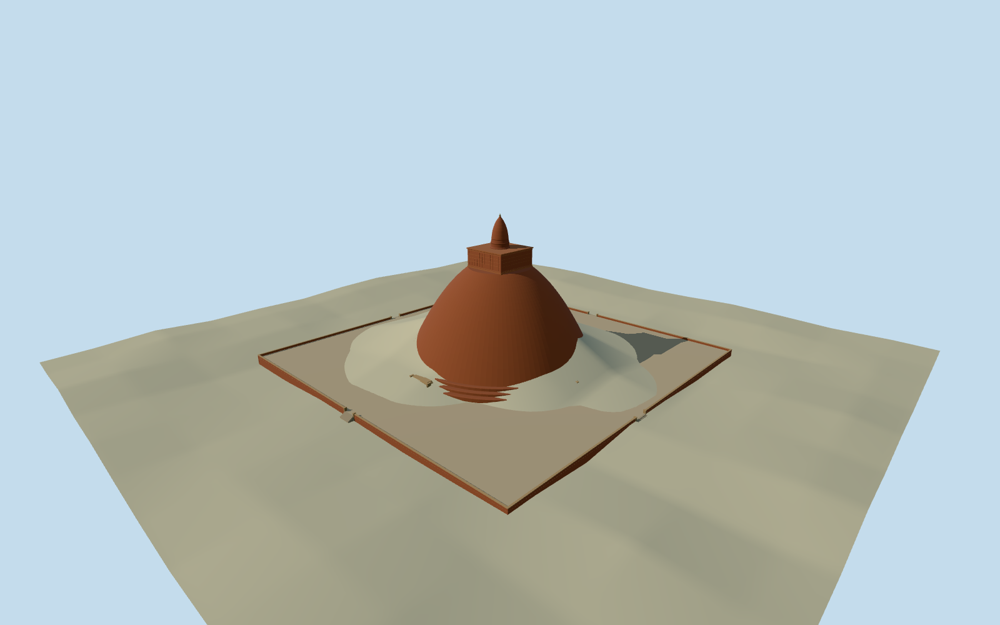

# Abhayagiri Vihāra

Anuradhapura’s restored Abhayagiri stupa with a brick dome, three basal rings, four stone frontispieces and a paved square terrace.

Authoring state: **review-in-qa.json**. Current completion evidence is in [qa.json](qa.json) and the [completion ledger](../../../../qualla-structures/batches/qualla-004.PROGRESS.md).

- [Abhayagiri Vihara](https://qualla.com/abhayagiri-vihara/)

Draft exterior: approximate photographic proportions and simplified ornament. It is not a survey, photogrammetric reconstruction or approved current geographic replacement.

Smither’s measured section as published by Parker establishes the three basal rings, square chamber, stone frontispieces and dome outline. The engineering survey and Central Cultural Fund records report the modern exterior size and the restoration of the brick cap and spire.

Terrain sampling/contact, geographic alignment and site activation remain pending. Runtime LODs are produced by the registered after-import pipeline and require visual review.

Reference photos remain in the local Qualla corpus; only provenance, paths and hashes are retained here.

Build: `node content/worldgen/source/places/tc/tc3/abhayagiri_vihara/models/generate-abhayagiri-vihara.mjs`. Add `--check` to verify exact regeneration. 14130 triangles; 5 materials; no embedded photographs.
