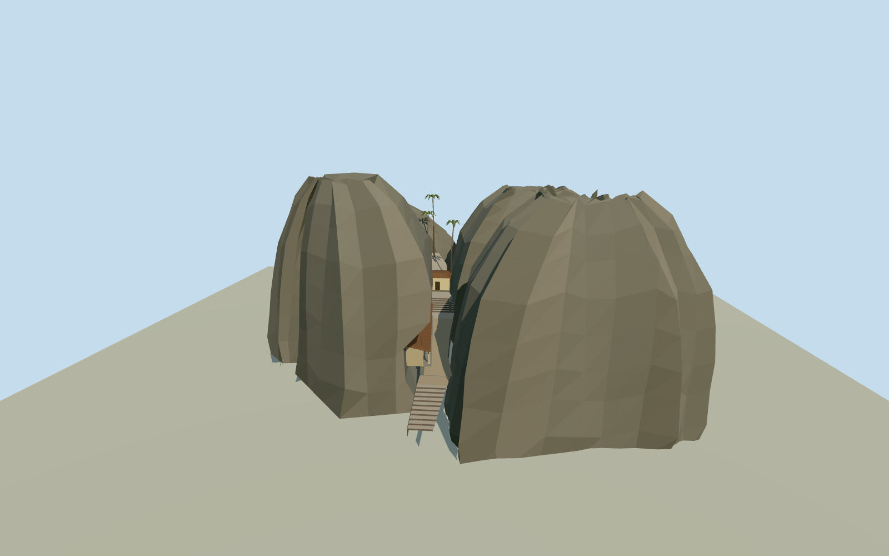

# Aluvihare Rock Temple

Aluvihare Rock Temple at Matale in 1896, with the low tiled cave veranda and stone steps between its mapped rock walls.

Authoring state: **review-in-qa.json**. Current completion evidence is in [qa.json](qa.json) and the [completion ledger](../../../../qualla-structures/batches/qualla-003.PROGRESS.md).

- [Aluvihare Rock Temple](https://qualla.com/aluvihare-rock-temple/)

The model depicts the photographed temple cleft in 1896. Rock plans follow present mapped outcrops. Heights, fractures, beyond-entrance volumes, and the reconstruction of the small upper shrine are estimated.

The heightfield is preserved independently. Its broad slope is used for terrain registration. Local passage and stair grades are approximate, with a bounded cut confined to the approach and cleft.

The modeled scope is the visible sanctuary entrance, stone steps, and adjacent rock faces. Buried cave rooms, murals, present-day annexes, and other parts of the monastery are outside the representation.

Build: `node content/worldgen/source/places/tc/tc3/aluvihare_rock_temple/models/generate-aluvihare-rock-temple.mjs`. Add `--check` to verify exact regeneration. 4834 triangles; 8 materials; no embedded photographs.
