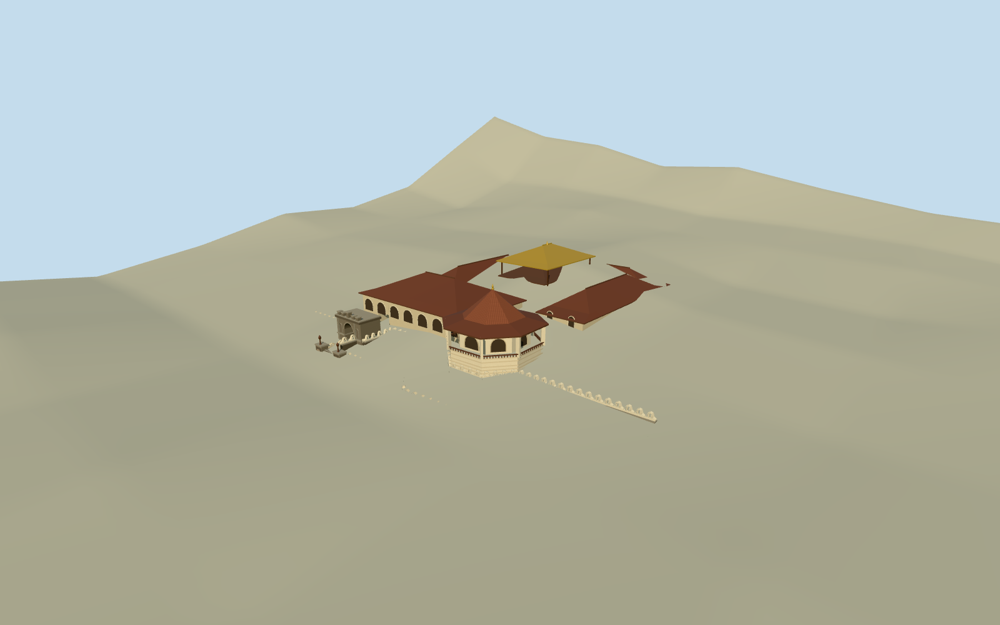

# Temple of the Tooth

Kandy’s public stone gateway, moat, covered octagonal pavilion, courtyard shrine and gilded canopy.

Authoring state: **review-in-qa.json**. Current completion evidence is in [qa.json](qa.json) and the [completion ledger](../../../../qualla-structures/batches/qualla-004.PROGRESS.md).

- [Temple of the Tooth](https://qualla.com/temple-of-the-tooth/)

Draft exterior: approximate photographic proportions and simplified ornament. It is not a survey, photogrammetric reconstruction or approved current geographic replacement.

Scowen’s exterior and portal views calibrate the front and octagon. Castelein records the original shrine section. The temple’s 2026 announcement documents the area and gilded finish of the current canopy.

Terrain sampling/contact, geographic alignment and site activation remain pending. Runtime LODs are produced by the registered after-import pipeline and require visual review.

Reference photos remain in the local Qualla corpus; only provenance, paths and hashes are retained here.

Build: `node content/worldgen/source/places/tc/tc3/temple_of_the_tooth/models/generate-temple-of-the-tooth.mjs`. Add `--check` to verify exact regeneration. 13131 triangles; 7 materials; no embedded photographs.
