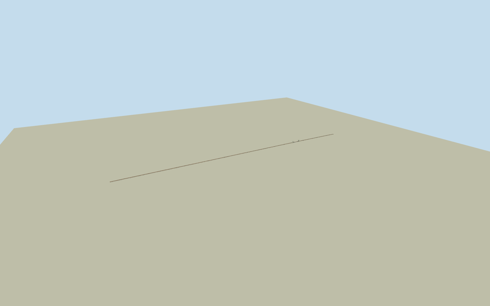

# Pamban Bridge

Whole original Pamban railway bridge, full approximately2.06km native three-way alignment from mainland to island, low paired plate girders/single broad-gauge track, repeated narrow concrete piers/caps, maintenance refuges, complete closed double-leaf Scherzer rolling-bascule section with open through trusses, curved rear rolling sectors/counterweights and small attached operating hut. Dated2015-03-08 appearance. Exclude separate parallel road bridge, replacement2025vertical-lift bridge, coast/railapproaches beyond original ends, publicground/sea slab, detachedfenders, boats, vegetation, signs, people, vehicles and interior equipment. Preserve realvoidbetweenpiers/undertrack/throughtrusses, curvedsteelsaddleandcounterweightreturns. DirectgeometryfromclearCC0photoandnativecentrelines; identicalhiddenoppositeside/sectiondimensions/piercensus/footings approximate. No overheadwire/electrification/newlift towers. Datedhistoricalcatalogplacementonly.

Authoring state: **review-in-qa.json**. Current completion evidence is in [qa.json](qa.json) and the [completion ledger](../../../../qualla-structures/batches/qualla-002.PROGRESS.md).

- [Pamban Bridge](https://qualla.com/pamban-bridge/)

ExactoldQ1854285threewaynativealignment157361873/475485286/475485287, fulloriginalnodes. Oldmovable90.6moverallmappedextent includesrearrolling/counterweightportions, distinctfromTYPSA66.5mclearopening; original12.2mclearfixedspantextisnotpiercenterpitch. Fullmainland/islandendpointsretained; no storycoordinatecenterlineguess/newbridge substitution. Nativeplanprovidesnoactualpierpositions, girder/railheights, trussprofileorgaugeofstructuralsections. Repeatcount145smallspans, split113west/32east andnominal13.5mpierpitch estimatedwithinthe nativeendpoints; photosections/counterweights/refuges/operatorhutpositionsbounded.

Wholehistoric2015-03-08oldrailwaybridgefromexactpublishedRudolph.A.furtadoownCC0original. NativeSHA1matches4608x3456bytes. Questionableassumed-creatorPDimagesandallattributionimagesunused; no newphotos/generated/copiedtextures. Ordinarygeographicasset/foldername.

Fulloldnative2.06kmalignment, repeatedlowpiersandpairedgirders/single1676mmtrack, maintenancecantileverrefuges, closedtwo-leafScherzerthroughtrusses, curvingrearrollingsectors, counterweightsandattachedsmallturquoisehut. Distinct2025vertical-liftandparallelroadbridgesexcluded. No trains/boats/signs/coastslab/fenders/vegetation.

145smallspanallocation/individualpierlocationsandheightsestimatedinsidenativefixedendpoints; primary12.2mclearspanisnotpierpitch. Mapped90.6moverallmovablesectionincludesrollingtails; primary66.5mclearopeningretainedseparately. Trussrisesections/backcurves/counterweights/oppositefaces/refugecensus/underwaterfootingsareboundedphotographicestimates, notengineeringsurvey.

Skylinepreservesfullalignment/allpierpositions/fullclosedbasculewiththinreversiblepierfaces; highlevelsclosedvolumetricpiers/caps/feet, girderflanges, rails, sleepers/refugesandbraces. Exactgirdersection/connectionhardwareandmechanicalmotionnotmodeled; staticcloseddatedappearanceonly.

Independent20mreviewgriddoesnotimply20maccuracy or2015bathymetry; rawcurrentcoastalfieldand4originaltilesretainedunchanged. Footingto-3.1m/deckrail3.15mrelativetoapproachdatumestimated. FlatQAgroundforgeometryonly, exact livehistoricalwater/groundcontactuncertified. DatedhistoricalplacementwithreplaceFootprint=false,currentWorldEligible=false.

Build: `node packages/worldgen/scripts/generate-authored-places.mjs --ids=pamban_bridge`. Add `--check` to verify exact regeneration. 57912 triangles; 5 materials; no embedded photographs.
